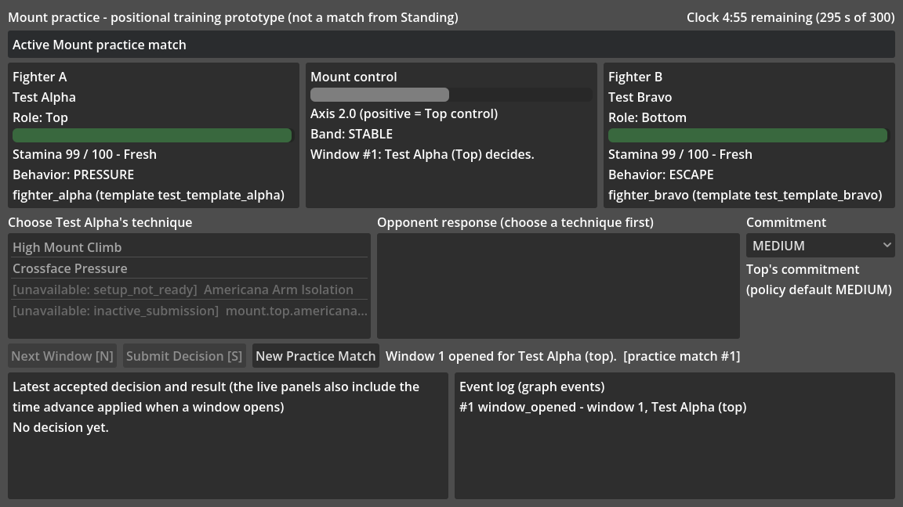
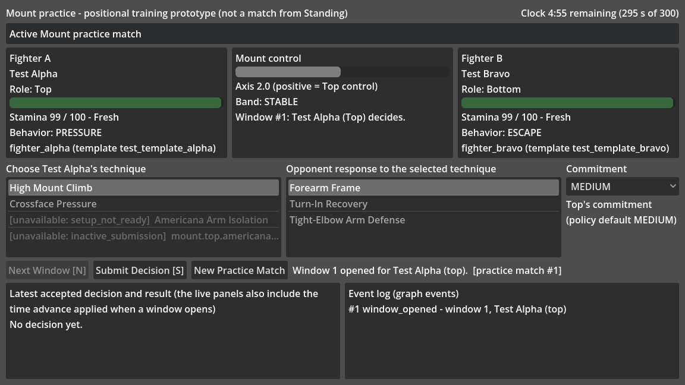
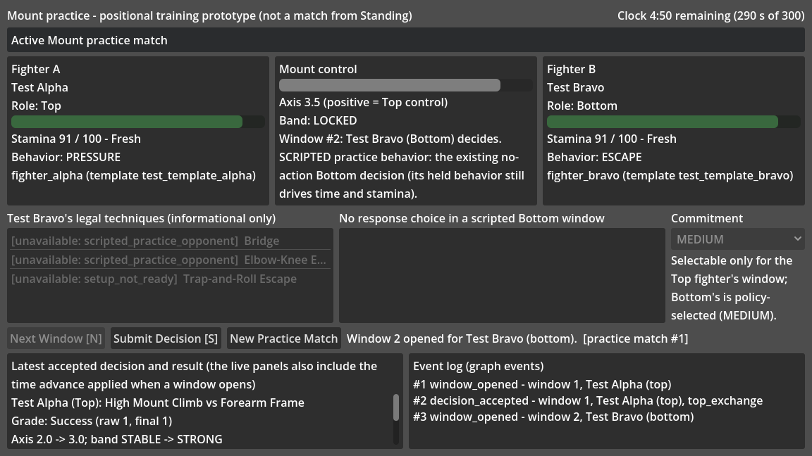

# F1 — First playable 2D Mount practice prototype

**Status:** implemented, deterministic, headless-tested. Stacked on F0 (PR #53). This is an **interactive positional-training
prototype**: one Mount position, no match from Standing, no combat AI, no scoring. It invents no rule. **F1.1 adds an explicitly selected
second practice mode (see section 1A): in the default *Scripted practice* the human controls the Top fighter only; in *Two-sided practice* the
human controls both fighters on their legitimate decision windows.**

## 1. How to open and play it

1. Install Godot 4.7.2-stable (standard build) and import `GODOT_V1/project.godot`.
2. Press **F5**. The default scene is now `res://scenes/mount_practice.tscn` (the old 3D greybox `scenes/mount_debug.tscn`
   is kept as a separate diagnostic scene: open it and press **F6**).
3. You see two fighters (names come from the F0 sample `.tres` definitions), their role (Top/Bottom), stamina bar,
   `current / maximum`, exhaustion band and held behavior, the simulated clock, the Mount control axis and band, the match
   banner, the current window owner, the legal techniques, the legal responses and the event log.
4. Play loop:
   * **Next Window** (button or **N**) opens the next decision window. Time advances only here (the engine applies its normal
     drift and stamina flow when a window opens, so the live panels can differ slightly from the "latest decision" panel).
   * When **Top** owns the window (you decide): pick a technique, then the **opponent's response** to it (any response the
     engine admits), optionally change the Top's **commitment**, then **Submit Decision** (button or **S**). The Top must choose
     a technique: the engine would also admit a Top no-action reset, which F1 deliberately does not offer.
   * When **Bottom** owns the window, the opponent is a **scripted practice behavior**: **Submit Decision** sends the
     engine's existing no-action Bottom decision (under the production policy this may be a plain reset or a recovery hold;
     the result text shows the engine's decision kind). Nothing else is chosen for the opponent, and the Bottom's held
     behavior (for example ESCAPE) still drives time and stamina flow, so its label can look odd next to a passive opponent.
   * Unavailable techniques and responses are disabled and show the engine's exact reason code first, for example
     `[unavailable: setup_not_ready]` or `[unavailable: inactive_submission]`.
   * **New Practice Match** starts an independent match (fresh stamina, clock, events and window numbering).
5. The banner distinguishes three states: **Active Mount practice match**, **TERMINAL OUTCOME: timeout | tap**, and
   **BLOCKED POSITION TRANSITION** (a Mount exit whose destination does not exist yet; not a victory or defeat; it names the
   exit label, the engine's reason and either "declared destination X is not implemented" or "destination unresolved (no
   landing)" for Reversal). After a halt or an end every command is disabled.

## 1A. Scripted practice vs two-sided practice (F1.1)

A **mode selector** in the header chooses between two modes. **Scripted practice is the default** and is exactly the F1 described above.
Choosing a different mode always starts a **fresh independent practice match** (the previous match is discarded, never re-run or converted;
the message line says so). *New Practice Match* keeps the current mode.

| | Scripted practice (default) | Two-sided practice |
| --- | --- | --- |
| Top window | the human picks a technique, then the opponent's response, optionally the commitment | identical |
| Bottom window | scripted: Submit sends the engine's existing no-action Bottom decision; the technique rows are informational and disabled with `scripted_practice_opponent` | **the human decides**: pick one of the engine's Bottom techniques and then the **Top's response** to it, or the explicit **No action** row; Submit sends that decision |
| Bottom commitment | policy-selected | policy-selected (the gateway refuses a Bottom commitment, so none can be selected) |
| Top responder commitment (F1.2) | n/a | selectable once a Bottom technique and the Top's response are chosen (section 1B) |
| What the Top's response means in a Bottom window | n/a | the response list shows the **Top** fighter's admitted responses to the Bottom technique, from the engine's own `response_options` |

Two-sided rules, all enforced by the engine and only presented here:

* Bottom techniques come from `BjjPositionGraphMatch.action_options(<Bottom fighter id>)`. Unavailable rows stay visible with the engine's exact reason
  (for example `setup_not_ready`) and cannot be selected; the responses come from `response_options(<technique>)`.
* Submit sends `BjjPositionGraphMatch.submit(<open window id>, <Bottom fighter id>, technique, response)`, the same command path as the Top. The graph
  forwards it to the production window gateway, which sends a Bottom window through `bottom_decision()`: D3-B classification, RESET/HOLD and recovery stay
  the engine's. The controller never calls the low-level contract or match, and it sends no commitment for the Bottom.
* **No action** is a practice-only row ("No action (reset or recovery hold)", id `practice.bottom_no_action`, never an engine id; its tooltip explains it). It is submitted as an empty action id, so the existing
  production policy decides whether the window is a reset or a recovery hold. It takes no response. Nothing new is invented.
* The result text follows what the engine did, not what was asked. A normal technique reports "Bottom: <technique>; Top's response: <response>", the
  Bottom's grade, the axis and band change, any exit, and the engine's decision kind when it is not the plain UNARMED one (for example ARMED_NORMAL). In the
  engine's D3-B lockout the engine can run a **recovery hold instead of the requested technique**; the text then says so ("You chose X, but the engine's
  D3-B decision ran a recovery hold instead ...") and claims no grade or axis change.
* When a Bottom escape produces an exit whose destination does not exist yet (Half Guard, Open Guard or Reversal), the match halts and the banner shows
  **BLOCKED POSITION TRANSITION (not a victory or defeat)** with the exit label and the engine's reason. It is not a tap or a timeout.
* The N and S hotkeys work as before. While the mode dropdown's popup is open it absorbs keys; close it with Escape first.

A tested, deterministic route to a blocked exit from the default start (two windows): in *Two-sided practice* press Next Window; as Top pick *High Mount
Climb* with the response *Tight-Elbow Arm Defense* and Submit; press Next Window; as Bottom pick *Elbow-Knee Escape* with the Top response *Hand Post and
Base* and Submit. The match halts with the exit *Half Guard* (`destination_not_implemented`).

## 1B. Top responder commitment (F1.2)

In a two-sided Bottom window the player can also choose **how hard the Top answers** the Bottom technique. It reuses the existing commitment control, which now has
three meanings that are always labelled:

| Window | Header | Items | Meaning |
| --- | --- | --- | --- |
| Top window | Top's commitment | LOW, MEDIUM, HIGH | the Top **initiator's** commitment (F1, unchanged) |
| Two-sided Bottom window | Top's response commitment | Engine default (MEDIUM), LOW, MEDIUM, HIGH | the Top **responder's** commitment (F1.2) |
| Scripted Bottom window, no window, ended or blocked match | Commitment | LOW, MEDIUM, HIGH, disabled | nothing to choose; the Bottom's own commitment is policy-selected |

* The control is disabled, with its reason in the note, until a real Bottom technique **and** the Top's response are chosen. For the *No action* row it stays
  disabled with "No response commitment: No action was chosen." The Bottom's own commitment stays policy-selected and is never editable.
* The choice is a separate controller field (`selected_response_commitment`). `""` is the **engine default** and is a real, distinct choice. Under the practice
  rules the Mount exchange funds an omitted responder commitment as **MEDIUM** (`mount_exchange.gd`), and the tests show that the default and an explicit MEDIUM
  give identical reports and engine states. The label says so; the controller still forwards exactly what was selected.
* It travels only as the sixth argument of `BjjPositionGraphMatch.submit()`, only from a two-sided Bottom window and only with a real technique. A Top window,
  a scripted Bottom window and a No-action decision never forward it, even if a script writes a value into the field (the engine would refuse it with
  `commitment_without_action`). An invalid name is refused (`unknown_commitment`); a forced invalid value is refused by the engine (`invalid_response_commitment`)
  and the controller reports that code and changes nothing.
* It is cleared whenever the technique or the response changes, when No action is chosen, when a window opens, after an accepted decision, on a mode switch and on a
  new match, so an earlier choice can never ride into a later decision.
* The result text states what the engine settled: "Top's response commitment: HIGH (chosen)" or "(engine default)". The Top can only fund what it can afford, so
  the text says when it "could only afford LOW" or when the response was **UNFUNDED** (not even LOW was affordable). In a D3-B recovery hold no responder commitment is
  settled; the text says "Your Top response commitment choice (X) was not used."
* Keyboard note: a disabled `OptionButton` is skipped by Tab, so the control becomes reachable only after a technique and a response are chosen; the note beside it says so.

Screenshots (rendered by the real renderer into an offscreen 1152x648 viewport): `docs/images/f1_01_window_open.png`,
`docs/images/f1_02_selected.png`, `docs/images/f1_03_scripted_bottom.png`.





A tested, deterministic route to a tap exists (prefer the Americana finish, then the arm isolation, then High Mount Climb,
always answering with the first admitted response); choosing the second response each time runs the 300-second clock out to a timeout.

## 2. Architecture (who owns what)

```
mount_practice.tscn (Control nodes, containers/anchors)
  └ mount_practice_scene.gd  -- renders a model, forwards input; no simulation, no _process
       └ BjjMountPracticeController (RefCounted) -- UI selections + the last result text only
            ├ BjjPositionGraphMatch  -- the ONLY command path: open_window(), submit()
            └ BjjFighterSnapshotAdapter (F0) -- fighter-keyed read-only views over the same graph
```

* Every simulation command is `BjjPositionGraphMatch.open_window()` (never `open_window_for()`) or `.submit()`.
* Every displayed fact is a detached read of the graph's public views (`state_fields`, `window_fields`, `roles`,
  `action_options`, `response_options`, `selected_commitment`, `status`, `events`, `blocked_transition`) or of the F0 adapter,
  plus static lookups (catalog names, commitment ids, band names).
* The controller keeps only UI state (selected technique/response/commitment, the practice-match serial, the last command's
  message), the pre-rendered text of the last accepted decision (the before/after stamina comparison cannot be recovered later)
  and a deep copy of the last accepted report, which the tests compare with a reference graph (the panel itself does not read
  it). The event log is `graph.events()` itself, not a copy. The scene holds only the controller. The selection fields are public
  UI state; the engine re-validates everything at `submit`, so writing them cannot bypass it.
* Nothing advances in `_process`, `_physics_process`, animations or timers.
* **Controller-level codes:** `no_match`, `match_ended`, `window_already_open`, `no_open_window`, `technique_required`,
  `response_required`, `not_selectable`, `unknown_action`, `unknown_response`, `unknown_commitment`,
  `unsupported_practice_setting`, and (F1.1) `unknown_practice_mode`, `no_response_for_no_action`. Every other code (the graph's `halted_unsupported_transition`, option reasons such as
  `setup_not_ready`, `inactive_submission`, `incompatible_ready_response`, and admission errors) is the engine's or graph's own,
  passed through unchanged.

### Exact practice configuration

`BjjMountPracticeController.match_configuration()` is the production stamina policy (Rule 1 ON, Rule 2 OFF, RECOVER, D3-B) plus
the three existing features the qualified graph and gateway suites also enable: setup (`enable_v02_setup`), submissions
(`enable_v03_submissions`) and commitment semantics (`enable_v04_commitment_semantics`). Stalling, Recognition and scoring are not
enabled. `start_new_match` may override only `clock`, `interval`, `axis`, `top_stamina` and `bottom_stamina` (the engine validates
the values); any other key, including `rules`, is refused with `unsupported_practice_setting`.

## 3. Feasibility record (transferable to the owner's HTML matrix)

Gate: concrete need, smallest alternative, benefit, change/maintenance cost, deterministic regression risk, can we live with the
current design, decision.

| # | Candidate | Concrete need | Smallest alternative | Benefit | Cost | Regression risk | Live with current? | Decision |
| --- | --- | --- | --- | --- | --- | --- | --- | --- |
| 1 | Drive the UI through `BjjPositionGraphMatch` (owner-approved), not the bare gateway | The graph is the real command path: it halts on unsupported exits and logs events; the UI must not bypass it | Bare gateway (no halt/event semantics) | Real position-graph behavior, blocked/terminal states for free | None (existing API) | None | No | **Implement** |
| 2 | Graph `behavior_fields()` pass-through | The F0 adapter needs held behaviors through the graph; the graph keeps its gateway private | Hold the raw gateway beside the graph (lets a caller bypass the halt) | Behavior in snapshots without exposing the gateway | 5 lines, read-only, detached | Very low (pure read; test-compared with the gateway and inertness-checked) | No | **Implement** |
| 3 | Extend `BjjFighterSnapshotAdapter` to accept a graph | One validated snapshot path for both owners | A second adapter class | One mapping, F0 validation preserved | One type check; the private handle becomes `_source: Variant`, which **weakens** the F0 private-member pin (it no longer constrains the type; `create()` carries the guarantee). One F0 expectation string was updated; its assertion count is unchanged at 750 | Low: every F0 gateway-path test passes unchanged; the graph path is compared with the gateway path step by step | No | **Implement** |
| 4 | Generalized position interface for the adapter | None until a second position exists | Mount-specific adapter | Hypothetical | Speculative abstraction | None | Yes | **Defer** |
| 5 | `RefCounted` controller separate from the scene | Testable input handling without rendering | Logic inside the scene script | Headless tests of the whole loop | ~350 lines | None | No | **Implement** |
| 6 | Scripted Bottom = the existing no-action decision | The brief: no invented AI | A response-picking AI | Deterministic, clearly labelled | None | None | Yes | **Implement** (AI rejected). Note the opponent never acts, yet its held behavior still spends and recovers stamina |
| 7 | Opponent response chosen by the player from the engine's admitted responses | The brief: explicit selectable practice response | Auto-pick | Nothing is fabricated | None | None | n/a | **Implement** |
| 8 | Responder commitment (`response_commitment`) control | F1.1 left the engine default in place; F1.2 exposes the Top responder's choice in two-sided Bottom windows | Reuse the existing commitment control, context-sensitively | The human can choose how hard the Top answers a Bottom technique | One selection field and a view model entry; no scene node | Low (the sixth `submit` argument already existed and is compared with a reference graph) | No | **Implement in F1.2** (Top responder in a Bottom window only; the Bottom's initiator commitment stays policy-selected) |
| 9 | Expose `open_window_for(duration)` | None; it is a session-owner test seam | n/a | n/a | Lets a UI manufacture windows | High | Yes | **Reject** |
| 10 | `extra` match settings on `start_new_match()` | Short practice matches and engine-driven test states | Hard-coded configuration only | Tests reach terminal states in seconds; later practice options | An allow-list of five keys; the engine validates values; `rules` and `production` cannot be replaced | Low | Mostly | **Implement** (allow-listed) |
| 11 | Project display settings (`window/stretch/mode=canvas_items`, `aspect=expand`) | A tiling window manager forced a 664x352 window on this machine and the unscaled UI was cropped | None (cropped UI) | The whole 2D UI scales into small windows | `[display]` section; only the two stretch lines change behavior (1152x648 are the defaults); no renderer change; affects canvas content only, so the 3D greybox's 3D rendering is unchanged (its HUD label scales) | None for the simulation | No | **Implement** |
| 12 | F0 sample definitions loaded from `res://tests/resources/` | Names from the F0 `.tres` files, per the brief | Copy them into a content folder | No duplicate content | The scene reads a tests path (provisional; an export that drops `tests/` would break the default scene) | None | Yes | **Adapt**: moving content to a real folder is a separate decision |
| 13 | Scene authored as a generated `.tscn` of containers | A real, editable Godot scene | Build nodes in code | Inspector/editor friendly; anchors/containers only | One text scene (a test pins its node types) | None | n/a | **Implement** |
| 14 | Blocked-transition path exercised by the UI | The brief asks the UI to distinguish it | Only render it | Correct display if the engine reaches it | n/a | n/a | n/a | **Render and test through engine-driven states**; see limitations |
| 15 | Offer a Top no-action reset | Not requested | Offer it | Hypothetical | Another path | Low | Yes | **Defer** (the controller requires a technique) |

## 4. Verification

* `tests/test_mount_practice.gd`: **1036 assertions**, negative-first, deterministic, headless, wired into `godot-v1.yml` through
  the existing fail-closed validator (`--name "Mount practice"`, exact pin 1036, a measured value).
* It proves: the graph-backed adapter equals the gateway-backed one step by step and applies the F0 refusal list to the graph path
  (non-sources, duck-typed objects, bad maps, unknown/missing/extra/odd keys, bad definitions) with detachment, inertness and
  role-by-identity preserved; controller refusals (no window, wrong role, unknown/unavailable technique, unknown/unavailable
  response, premature submit, stale and replayed decisions) change nothing and carry the engine's exact codes; the controller's
  reports and resulting graph state equal a separately driven reference graph for eight windows including every commitment
  choice; the scripted Bottom decision equals the engine's no-action path; 50 `view()` reads and 30 scene refreshes are inert; all
  three Mount exits (Half Guard, Open Guard, Reversal) render as blocked with the exact reason and destination, with every
  command refused by the controller and by the graph itself; a tap and a 300-second timeout are rendered as terminal and never as
  blocked; a new match shares nothing with the old one; a response the engine marks `incompatible_ready_response` can neither be
  selected nor submitted, in the controller and through the scene's lists; the practice configuration and the settings allow-list
  are pinned; and the scene is instantiated and played headlessly through its real buttons, lists, commitment widget and the N/S
  hotkeys (including their guards).
* Source-boundary scans keep the presentation code away from the gateway, the match, stamina pools, timers and per-frame hooks,
  and a scan of the scene file allows only 2D Control and container node types. They are tripwires, not proofs.
* During development 49 disposable mutants of the controller, scene, graph pass-through and adapter were all detected (the
  scripts are not committed).
* F1.1 adds `tests/test_mount_practice_two_sided.gd`, a **separate** suite with its own pin (**491 assertions**, workflow step "Validate F1.1 two-sided
  Mount practice ...", validated with `--name "Mount practice two-sided"`). The original `test_mount_practice.gd` is unchanged and still passes its 1036
  assertions: that unchanged suite, run against the F1.1 code, is the proof that scripted practice behaves as before. The new suite proves: mode
  selection and the fresh-match reset (unknown, same and repeated modes, discarded matches left untouched); scripted mode driven side by side with the
  default controller gives identical views and engine states over eight windows; the Bottom's rows equal the graph's options; refusals (Top technique in a
  Bottom window, unavailable technique with its engine reason, response before technique, no-action with a response, commitment in a Bottom window,
  Next Window with a window open) change nothing; six Bottom technique/response combinations equal a separately driven reference graph (report, state,
  events, clock and stamina) for window 2 and the Bottom fighter; the no-action decision equals the graph's empty-action Bottom decision and the scripted
  path's engine state; a located D3-B recovery-hold window shows the hold text and equals the reference; the engine's own refusal codes for wrong fighter,
  stale window, replay, wrong action/response side, missing response and Bottom commitment; manual Bottom escapes reaching blocked *Half Guard* and
  *Reversal* are shown as blocked, never terminal, with every command refused; a two-sided timeout is terminal and a new match keeps the mode; one Bottom
  decision adds exactly one event and one settlement; 50 reads are inert; source scans keep the Bottom away from the contract, match and D3-B and keep the
  controller at exactly three command lines; and the scene (mode dropdown, rows, headers, hotkey, new match, mode switches) is played headlessly.
* During development 15 disposable mutants of the controller (sentinel id sent as an action, every Bottom window scripted, mode switch without a reset,
  missing No-action row, a Bottom commitment forwarded, wrong fighter id, unavailable techniques selectable, hold text claiming an attempt, no response
  required, mode reset on New Practice Match, mode switch dropping the start settings, a reset text claiming an initiative rule, the Top-response label
  dropped, the engine's armed decision kind not reported, a response accepted with No action) were all detected; the scripts are not committed.
* The Bottom's commitment is structurally absent: the controller forwards a commitment only from a Top window, so even a value written into
  `selected_commitment` by a script is ignored in a Bottom window (tested against a commitment-free reference).
* F1.2 adds `tests/test_mount_practice_response_commitment.gd`, a third separate suite with its own pin (**432 assertions**, workflow step "Validate F1.2 Top
  responder commitment ...", `--name "Mount practice response commitment"`). It proves: where the control applies and its states; refusals (no match, no window, Top and
  scripted windows, before a technique or response, No action, invalid names, finished and blocked matches) leave the engine untouched; stale choices are cleared on every
  change listed above, including a value written between windows; LOW, MEDIUM, HIGH and the default equal direct graph calls with the sixth argument (report and whole
  state), with the literal Top stamina cost of each; the default equals an explicit MEDIUM directly on the graph; forced values are never forwarded from a Top window, a
  scripted window or a No-action decision; a forced invalid value is refused by the engine with its own code; the D3-B hold text; an underfunded Top (UNFUNDED, only
  LOW or MEDIUM affordable, fully funded) with literal texts; the documented blocked-exit route with a responder commitment; a timeout; inert reads; source scans
  (still three command lines); and the scene (relabelling, enabling, item mapping, hotkey submit, No action, new match, scripted mode). 23 disposable mutants were all detected.
* Pins unchanged: Mount slice 256,992; position registry 431; fighter foundation 750; Mount practice 1036; two-sided 491.
* Not covered headlessly: viewport input routing and focus (the tests call the hotkey handler directly; list type-ahead is turned
  off so it cannot swallow N/S), real-window scaling, and visual quality.

## 5. Limitations

* **In Scripted practice a human cannot reach a blocked transition** (only an escape-capable Bottom action produces an exit destination and the
  scripted Bottom never chooses one); the player can only reach a tap or a timeout there. **In Two-sided practice (F1.1) the player can reach it**
  by a successful Bottom escape (see the route in section 1A). Reaching it is an engine fact, not a victory: Mount play stops and nothing replaces it.
* Fighters are fixed (Test Alpha on top, Test Bravo on the bottom); there is no fighter selection, no scoring, no game plan. In Two-sided practice one
  human operates both sides: it is a practice tool, not an opponent, and no AI chooses anything.
* The responder commitment is offered only for the **Top responder in a two-sided Bottom window** (F1.2). A Top technique is still answered with the
  engine's default Bottom responder commitment: choosing the Bottom's response commitment in a Top window is not offered in any mode.
* No art, animation or sound; the layout targets keyboard and mouse on a PC. Long technique names are clipped in the lists (the
  full id is the tooltip) and disabled rows are low-contrast; the reason code always comes first.
* Content definitions still live under `tests/resources/` (see row 12).
* The adapter and controller are Mount-specific, and a bare `BjjPositionGraphMatch.new()` (never produced by `create()`) would
  raise a script error just like a bare gateway. Half Guard and Standing are not implemented and nothing here makes them playable.
* An interactive run needs a display; CI exercises the scene headlessly. Screenshots here were rendered locally.
