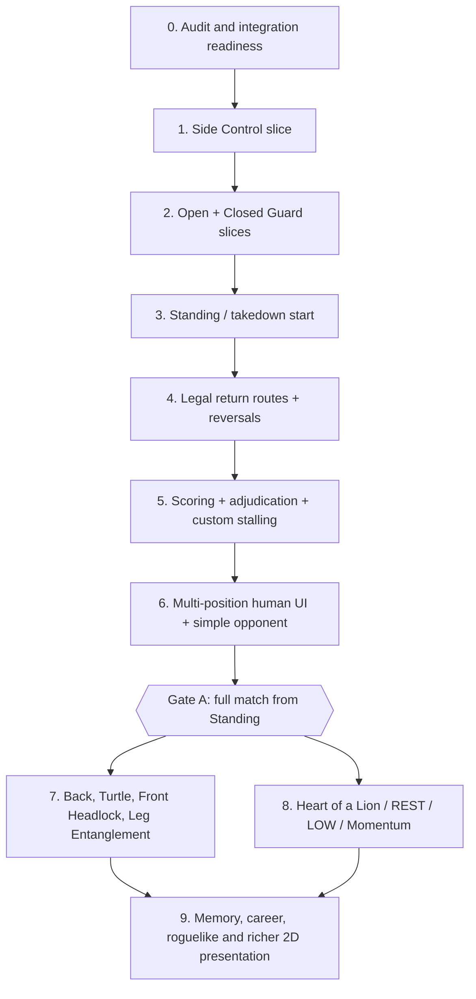
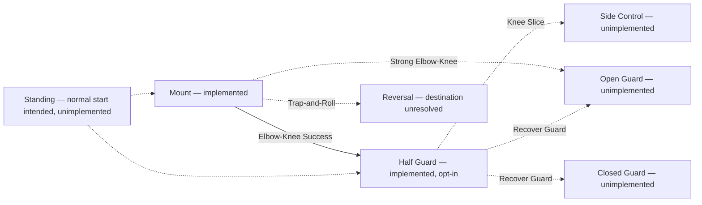

# BJJ Game — Engineering Roadmap & Overseer Ledger

**Audit date:** 2026-10-12 (living snapshot; update after each Claude handoff)  
**Roadmap revision:** 4.3 — Local-first workflow adopted (owner decision 2026-10-13); educational-comment rule and three reviewed skills added; cumulative PR #66 integrated the stack through #65 into main (21/21 CI)  
**Repository:** https://github.com/theaxlklo/BJJ-Game  
**Baseline audited:** `main` (`626321721209ffb0850bbdd1f2613992e1eaa629`, after cumulative PR #66) and historical draft PR #65 (`9942c5a53caf58d0d944bd7931ccc81bf86d0d07`), stacked on #63 (`650e7e1b9c6ba138a931c2805ce661e2268431b2`)  
**Decision authority:** The project owner approves new combat mechanics and unresolved design decisions. Ordinary development is local-first on `main` (see *Development workflow*). This document recommends; it does not change engine behavior.

## Development workflow (current — owner decision 2026-10-13)

The earlier PR-stack, exact-head-CI and merge-train process is **retired**. Passages below that describe PRs, `CI gate`, branch protection or merge authorization are historical evidence, not instructions.

- Claude Code with Ponytail Full is the primary coding assistant; it works **directly on `main`**, with no PRs for ordinary development.
- Tests run **locally** (Godot 4.7.2 headless, Python); locally validated work is committed and pushed straight to `origin/main`, reporting the SHA. The owner has ChatGPT review GitHub independently.
- GitHub Actions are **manual only** (`workflow_dispatch`); optional full qualification of an exact SHA remains available. See `docs/CI_OPTIMIZATION.md`.
- Deterministic behavior, the frozen Python reference and production opt-in rules are unchanged. New mechanics and unresolved design decisions (SC-D1–SC-D15, B2a.1, ...) still need the owner's approval.
- Historical PRs are left as they are; no closure, branch deletion or force-push is planned unless the owner asks.
- **Educational code comments are a permanent rule** (`AGENTS.md`): new and meaningfully modified code explains *why* (algorithms, stamina, initiative, transitions, determinism, invariants, tradeoffs) so the owner can learn from it; no repository-wide comment rewrite.
- **Installed Claude Code skills (2026-10-13, loaded on demand, pinned in `docs/third_party/skills/PROVENANCE.md`):** `godot-gdscript` and `godot-ui-control` (gamedev-skills, Apache-2.0) and `systematic-debugging` (obra/superpowers, MIT). BJJ rules override them; existing `bjj-*` skills come first.
- **One-command setup:** `python3 tools/setup_dev.py` (read-only check; interactive `--install` for PyYAML in a project `.venv` and the Ponytail plugin; Godot is never downloaded). See `docs/DEV_SETUP.md`.
- **Future optional improvement (not scheduled):** let Codex reuse the reviewed Godot and debugging skills through its supported project-skill mechanism, with `AGENTS.md` staying authoritative. Avoid duplicate skill copies and extra plugin infrastructure; Ponytail itself need not be installed for Codex to follow the lean principles.
- Only this roadmap and `OVERSIGHT_LEDGER.md` are living progress documents. The full rules are in `AGENTS.md`.

## Executive verdict

The deterministic Godot foundation is strong and the Mount→Half Guard graph is real, but the game cannot yet execute a complete scored match from Standing. Shift from engine polishing to **connected, human-playable matches**, without abandoning test coverage or frozen Python parity. Put integration discipline ahead of additional unbounded stacking.

**Current repository facts, independently verified after cumulative #66:** 54 PRs in the known inventory (new #66 included), **21 merged** including #23 (automatically marked merged by GitHub ancestry) and #66, four closed unmerged CI probes (#24–#27), **29 open**. Twenty-seven superseded linear stack PRs (#28–#30, #39, #41–#43, #45–#63, #65) remain open as stale review metadata; their exact source commits are contained in `main` through merged cumulative PR #66. Divergent #44 and independent oversight docs #64 remain **excluded from the integrated tip**. Current `main` is merge commit `626321721209ffb0850bbdd1f2613992e1eaa629`; full 21/21 post-merge CI passed. Do not treat open superseded PRs as 27 pieces of unmerged gameplay work.

**Functional evidence at the stacked tip:** typed Godot Mount parity and stamina/commitment systems, production-safe window gateway, PositionContract, graph, validated Mount→Half Guard transition, Half Guard independent oracle, preparation/feints/sealed-intent, F0 fighter read views, F1 interactive **Mount-only** 2D practice, B1e structural and exploratory match-flow harness. F1 has a scripted non-acting Bottom path and player-selected opposition responses; it is not a true computer opponent or cross-position match UI. B1e measured 2,534 games/74,490 windows, including 1,438 unsupported exits, 907 clock endings with no adjudication and 189 taps; the outcomes are scripted-policy evidence, **not** balanced player tests.

**Current integration interpretation:** Cumulative PR #66 was qualified as one entire candidate and then merged into `main`, with full Python 3.11/3.13 and Godot 21/21 successful post-merge CI. This proves the complete integrated slice passed the current automated gates, **not** that a fully human-playable, scored match from Standing exists or that each intermediate historical commit is independently proven in its merged state. PR #65's earlier docs-only CI was not used as executable qualification; independent oversight docs PR #64 remains outside the merge. The original sequential PRs are stale review records even though their commits are integrated.

## Visual roadmap



This is **a dependency-oriented sequence, not a requirement to finish every position before scoring**. Adjacent tasks may overlap if the feature gates are separate and no shared engine state is mutated concurrently. In particular, the minimal zero-stamina safety path may need to move **before Gate A** if a playtest demonstrates a deadlock. The full BJJ ten-family graph remains a long-term scope target, not a condition for the first playable match.

## Position connectivity snapshot



Dotted connections are **not runnable** in the current graph; Standing arrows show future integration intent, **not approved transition mechanics**. Some additional possible edges exist in topology proposals and must not be mistaken for executable transitions.

## Ordered backlog with gates

| Priority | Work package | First artifacts / PR boundary | Exit gate and overseer evidence | Current status |
|---|---|---|---|---|
| P0 | **Integration-readiness checkpoint** | **COMPLETED through #65** by approved cumulative integration PR #66. Old B1 proposal is superseded. | Keep main protected with required CI gate; harden truncated-fixture/terminal-exception checks and main-push concurrency; reconcile 27 superseded open PRs in one controlled, owner-approved metadata sweep; separately assess divergent #44 and oversight #64. | **Cumulative integration verified on `main`; no more backlog merges needed.** |
| P1 | **B2a Side Control spec** | [Draft #65](https://github.com/theaxlklo/BJJ-Game/pull/65): `GODOT_V1/docs/SIDE_CONTROL_V0_PROPOSAL.md` (346 lines); 3 actions and 3 responses per side, proposed grade tables, four proposed exits, Knee Slice receiver, R1–R12 risks and SC-D1–SC-D15. | Owner accepts or amends exact mechanics and architecture before any oracle is frozen. | **DOC-QUALIFIED; awaiting owner approval**. |
| P1.1 | **B2a.1 Position-aware initiative contract** | New documentation-only checkpoint stacked on qualified B2a #65. Compare current Mount/Half Guard windows against Side Control, Closed Guard, Open Guard and Standing needs; define first-window, ongoing-initiative and neutral simultaneous-choice semantics, with impact on personal turn accounting. | Report design alternatives and owner decisions, no code/fixture/default changes; preserve SC-D2 as open. | **NEXT · approved to investigate only**. |
| P2 | **Side Control executable** | **B2b** accepted canonical rules sheet and independent test-only Python oracle (checkpoint PR), **B2c** typed Godot engine, **B2d** source→destination keyed receiver/opt-in graph seam, **B2e** measurement (separate slices). | After owner approval: independent oracle prior to GDScript, negative-first and replay parity, real Knee Slice→Side entry, no leaked Half Guard protocol or Mount replay, honest unsupported exit halts. | **Blocked on SC-D1–SC-D15; not started**. |
| P3 | **Open Guard** | Spec/oracle/engine plus legal receiving routes from Mount and Half Guard. | Unblocked real exits; no illegal role/axis conversion or fabricated window. | Not started. |
| P4 | **Closed Guard** | Spec/oracle/engine receiving Half Guard recovery; deliberate guard initiative/defense and realistic return paths. | Legal entry/exit, rejection atomicity, replay. | Not started. |
| P5 | **Standing and takedown opening** | Fresh-start factory; takedowns, guard pulls, defenses, start roster, legitimate receiver paths. | A normal match can actually start Standing; Mount-only practice constructors still unchanged. | Architectural direction approved; mechanics absent. |
| P6 | **Return routes, reversals and graph traversal** | Side→Half/Mount, guard escapes/sweeps, role swaps, Mount re-entry D3-B rebase decision, unresolved Mount `Reversal`. | Multi-hop, cyclic deterministic trace; no duplicate score/stamina/clock settlement or repeated exhaustion token. | Open design/implementation. |
| P7 | **Scoring, 3s holds, time expiry and stalling** | Separate ruleset ledger and event interpreter; minimum positional scoring (takedown/sweep/pass/mount); custom 3-consecutive-inactive-personal-turn penalty; IBJJF-inspired penalty effects; winner/decision handling. | 5-minute (prototype) clock-end produces a lawful result rather than `timeout` with no adjudication; non-stalling defense and failed genuine efforts protected. | Game rules partly specified; code absent. |
| P8 | **Human multi-position play + baseline opponent** | Extend F1 to real graph traversal; choices for both physical roles, valid counters, sealed intents; separate deterministic rule-based opponent (no advanced AI); legible HUD. | One human can start Standing, choose legal actions, face an independently responding opponent, traverse ≥3 positions, and win/lose by legitimate tap/points/decision. | F1 Mount-only practice exists. |
| **Gate A** | **First complete playable match** | End-to-end human-in-loop acceptance transcript and regression suite. | No reachable unsupported exit in the supported match scenario menu; gameplay doesn't deadlock at zero stamina; playable on lightweight laptop; state/log determinism. | **Not reached**. |
| P9 | **Further graph breadth** | Back Control, Turtle, Front Headlock, Leg Entanglement, appropriate submissions and the remaining ten-family coverage. | All intended family nodes reachable through correct grappling transitions, no surprise fallthrough halts. | Not started. |
| P10 | **Distinctive tactical mechanics** | Heart of a Lion (once, mutual zero, 50%; five *personal* turns each; 100%), zero-stamina LOW memories, REST with 2-turn stalling allowance, Momentum with capped owner-approved modifier. | Exact normal-turn accounting, no infinite refills/extra windows, no double penalties, deterministic tests and per-ruleset opt-in. | **Design direction recorded in #63; not coded.** Bring essential anti-deadlock minimum forward to P8 if required. |
| P11 | **Game identity and campaign** | F0 expanded with belts/styles/loadouts; Memory Constellation and **three-slot blurry-memory learning queue**, clutch/never-forget, persistent belt career, three-win runs, rewards, injuries, 2D anime/arcade UI. | First complete short roguelike run changes player choices meaningfully; no unearned belt loss. | Mostly approved/open design, not engine. |

### Why this order

- **Side Control** is the highest-value near connection: B1e Population B recorded 910 Side Control blocked exits vs 353 Closed Guard and 155 Open Guard, under scripted test policies. This is *coverage evidence*, not real player play rates.
- **Standing** is mandatory before the project's North-Star complete-match gate. It can move ahead of Guard details if full-match implementation is otherwise blocked; preserving realistic legal receivers is the constraint.
- **Scoring and active play** should start as soon as enough connected positions are executable; not all ten positions must be built first.
- **The F1 UI** is not multi-position nor a real opponent; extend it only after the engine supports legal traversal. The controller must never force engine decisions.
- **The zero-stamina escape hatch** is a gameplay liveness concern; whether it can wait until after Gate A must be validated. Do not assume that every match can end without it.

## Latest engineering checkpoint — B2a qualified (2026-10-12)

- **Verified:** [PR #65](https://github.com/theaxlklo/BJJ-Game/pull/65), base `docs/match-incentives-heart-of-lion-spec` at `650e7e1b9c6ba138a931c2805ce661e2268431b2`, head `9942c5a53caf58d0d944bd7931ccc81bf86d0d07`. Exactly one new `GODOT_V1/docs/SIDE_CONTROL_V0_PROPOSAL.md`, 346 lines, one commit, no production behavior. Docs-only CI: 4 PASS / 4 SKIP. All unchanged engine functionality remains **unmerged**.
- **B2a deliverable:** identity-role proposal, Side Control local axis and initiative, 3 Top + 3 Bottom proposed actions, three responses per defending side, a grade matrix, setup/readiness/economy, four exits all **unsupported in v0**, a Half Guard Knee Slice→Side Control receiver contract, oracle plan, negative-first tests, 12 architectural risks, 15 owner decisions.
- **Primary architecture risks:** existing graph keys receivers only by destination, hard-codes Mount→Half Guard building and source reporting, uses 17+ nullable routing sites, exposes stale sealed-protocol/export fallthrough hazards, and has Mount-only retained-segment fingerprint tests. B2d must address these without changing default graph behavior or fabricating a return route. The B1e measurement file and digest remain frozen.
- **Recommendation (not authorization):** accept the compact v0 *scope* and tested approach first; review SC-D1–D15, especially first Side Control initiative (Top-first after Top's Knee Slice means consecutive **personal** decisions across positions) and the tentative raw grades/axis/entry thresholds. Treat all proposed combat numbers as provisional test baselines until measured. After owner sign-off, proceed **B2b docs+test-only Python oracle**, then **B2c standalone typed engine**, then **B2d graph/edge**, then **B2e measured population**.
- **Overseer action:** update `OVERSIGHT_LEDGER.md` with this evidence. Do not advance B2b, merge or retarget any PR without the relevant owner decision.

## New design checkpoint — B2a.1 position-aware initiative (owner direction, 2026-10-12)

The owner deliberately **declined to freeze** a universal initiative rule or the Top-first Side Control choice (SC-D2). Design must accommodate position-specific tactical rights:
- Side Control: Top may have priority because of pinning control; Bottom still has meaningful, initiated escape opportunities.
- Closed Guard: the Bottom can sometimes own initiative despite physical Bottom role.
- Open Guard and Standing: neutral exchanges may use genuinely simultaneous committed choices.
- Mount and Half Guard: preserve all existing implemented decision-window and role behavior; do not retrofit universal simultaneous choices.

Separate three dimensions: **positional control / authority**, **initiative ownership / eligibility**, and **decision-timing protocol** (sequential with response, or simultaneous sealed choices). Assess entrance initiative separately from ongoing initiative and from cross-position exchange fairness. Top-first after a Knee Slice would give that fighter consecutive **personal opportunities** across positions, even without a free clock/window; treat this as an **open game-balance decision** rather than a technical inevitability.

**B2a.1 deliverable:** one docs-only `GODOT_V1/docs/POSITION_AWARE_INITIATIVE_PROPOSAL.md` (name itself provisional), proposed state-machine/contract, position matrix and explicit compatibility/test plan covering actor eligibility, real simultaneous commitment secrecy, responder rights, `window_id` and simulated clock once per bounded exchange, and **per-fighter** completed-turn tracking for future 3-turn stalling and 5-turn-per-fighter Heart of a Lion. No executable engine/refactor, no proposed numeric buffs, no changes to #65, and no B2b authorization. Prefer conditional design variants to premature universal abstractions.

### Technical proficiency as a possible initiative modifier (owner idea; PROPOSAL ONLY, 2026-10-12)

The owner proposed adding a fighter **Technique proficiency stat** with **overlapping typical distributions by belt** (White, Blue, Purple, Brown, Black) and meaningful within-belt fighter variance. The idea is to let exceptional technical proficiency sometimes overcome a position's default opening initiative. This is not approval of values, dynamic turn theft or new fighter schema. Distinguish:

- **Belt** = progression/rank and a possible *distribution for initial proficiency*, never an automatic initiative win or a hard cap on later learning.
- **General technique proficiency** = fighter characteristic; **position-specific proficiency** = expertise in the relevant position; **individual memory mastery** = proficiency with a named move/variant. Avoid double counting one learned technique both as a priority modifier and a resolution/grade boost without explicit balance approval.
- **Position policy** = ordinary opening initiative and sequential-vs-simultaneous timing. **Technical differential** = possible *bounded exception* to that policy if one fighter's relevant proficiency greatly exceeds the other's. Control axis, authority, and legality of defenses remain separate; even a priority loss must not eliminate legal responses.
- **Determinism** = any within-belt variation is assigned reproducibly at fighter creation/career progression and stored in fighter state, never randomly rerolled during a decision window. Re-evaluate only at explicit match-owner boundaries. Avoid extra windows, time advances, repeated initiative theft, sealed-intent leaks or opportunity inflation.

**Illustrative candidate ranges only (NOT ACCEPTED, 0–100):** White 10–35, Blue 25–50, Purple 40–65, Brown 55–80, Black 70–95. These represent overlapping starting distributions, not the real BJJ belt system or proven game balance; exceptional positional specialists may differ substantially. An equally provisional Side Control +12 bias for Top is useful solely as a paper test of whether an opposing proficiency gap could reverse opening priority. Do not freeze any bonus, formula, threshold, range, tie rule, or simultaneous protocol from this example.

**B2a.1 proposal must evaluate:** how to represent general vs positional vs move-level skill without feature bloat; whether fighter definitions currently expose enough skill data; when skill may override *opening priority* vs ongoing turn eligibility; per-position policy table including neutral simultaneous entry; how belts and persistent career affect stable stats; no deadlock or passive runaway advantage; and a deterministic test matrix for equal ratings, adjacent belts, underdogs, high-skill Bottom in Side Control/Closed Guard, and low-technique Top in Open Guard. This is docs-only and does **not** expand the approved B2a.1 into implementation.

### Selectable positional training focus — role-specific fighter strategy (OWNER PROPOSAL, 2026-10-12)

The owner wants a player to **choose the positions they actively train**, instead of having every fighter improve equally everywhere. Example at White Belt: choose **two focus slots**, such as `mount/top` and `side_control/top`; as the persistent fighter wins, improves and advances belts, the number of available focuses may expand. **Two starting slots is the owner's example/provisional direction; no higher-belt slot ladder, XP rates, unlock schedule or numeric modifier has yet been decided.**

**Role-aware focus keys are essential:** `mount/top`, `mount/bottom`, `side_control/top`, `side_control/bottom`, `closed_guard/bottom`, `closed_guard/top` are distinct specializations. Neutral positions such as Standing require position-specific roles rather than fictitious top/bottom assignments. Track the stable family ID and that family's physical role vocabulary, not the fighter's identity, axis sign or control authority. Whether each pair consumes exactly one slot needs owner review.

**Proposed three-factor composition** (not three independent permanent bonuses to one outcome):
1. **General Technique**: baseline competence, potentially initialized from overlapping belt ranges with reproducible fighter variance; never use belt as a universal priority trump.
2. **Positional proficiency**: accumulated role-specific experience. Player-chosen **training focuses** accelerate growth or direct investment for their matching position/role; previously earned proficiency remains persistent when a focus changes.
3. **Individual memory mastery**: progress with a particular named technique/variant (blurry discovery → clarified/learned → mastered); focus may improve discovery/clarification and training, but it should not auto-grant mastery or block observation-based learning elsewhere. The Never Forget/clutch selection is a separate, limited overlay.

**Safeguards and progression questions:**
- **No legal move or defense locked solely for lack of focus.** Focus changes the fighter's preparation, growth and possibly familiarity, not the basic legality of positional survival. Non-focus techniques may still be learned or performed under the game's existing knowledge/belt gating.
- **No XP farming through pass/no-op/REST.** Growth events require legitimate accepted attempts, defenses, focused training or reviewed match/career rewards; failed legitimate effort can count while repeated meaningless spam should not.
- **No automatic promotion or automatic focus deletion.** The persistent fighter retains earned belt and historical positional proficiency across runs under existing career rules. The focus slot unlock path can be linked to promotion or specific milestone wins, but no exact threshold is chosen here.
- **Avoid triple dipping.** General Technique, relevant positional expertise and memory mastery must have clearly separated responsibilities (opening priority versus execution/grading versus learning speed), with bounded contributions and explicit balance tests; no hidden stat double-count or passive initiative monopoly.
- **Training selection is between matches or explicit career opportunities**, not a free priority rebalance mid-exchange. Determine how reassignment works, whether choices persist across matches, and whether unused training focuses are allowed.
- **Stable deterministic representation** when implemented: fighter ID, belt, general Technique, role-specific proficiency per stable position ID, active focus-slot list, unlocked slot count, and named move mastery; assign any variance once and persist it. Current F0/fighter snapshots are not claimed to support this model.
- **Sealed neutral decisions remain sealed.** Even an exceptional specialist doesn't get to see the opponent's committed technique before choosing, and all legal emergency defenses remain available.

**Design gate / tests for B2a.1:** Compare two White Belts with different 2-focus selections; Bottom Closed Guard specialist against high-general-Technique opponent; Top Side Control specialist against high-general-Technique Bottom escape specialist; identical belt/general Technique with different focus histories; a respec retaining earned proficiency; off-focus legitimate moves; fighter promotion unlocking an additional active focus; replay determinism across career load/save and matches. These are **test cases to specify**, not authorization to implement the underlying career or serialization system.

**Scheduling:** B2a.1 may define the *interfaces and meaning* of role-specific proficiency and show how future priorities use them, but **must not implement focus selection, memory XP, fighter data migrations, belt advancement or combat modification**. Implement selectable focuses when fighter identity/career/memory infrastructure is ready; do not make its full implementation a blocker for the next Side Control oracle. Until the subsystem exists, use explicit stable test inputs or a provisional fixed initiative rule approved by the owner.


**Status 2026-10-13:** the B2a.1 proposal is delivered as [`GODOT_V1/docs/POSITION_AWARE_INITIATIVE_PROPOSAL.md`](../../GODOT_V1/docs/POSITION_AWARE_INITIATIVE_PROPOSAL.md) (documentation only). It formalizes the owner's agreed model (General Technique + position-role proficiency + the position's tactical advantage, with a skill override of the opening priority; neutral positions stay simultaneous sealed; Mount and Half Guard preserved; Memory Mastery excluded) as a policy contract, with a position matrix, edge cases, a per-fighter turn ledger design, a test plan and proposed numbers backed by exact enumeration. SC-D2 is no longer a binary choice. Owner decisions OD-1–OD-11 are open.

**Gate:** project owner reviews B2a.1 and the Side Control SC-D2 choice together. Only then can B2b freeze a self-contained Side Control rules sheet and independent Python oracle. Any new 2-fighter simultaneous action protocol is a later independently qualified slice, not assumed to exist because Half Guard has a sealed feint/response protocol.

### Blurry memory learning queue — three unfinished techniques maximum (OWNER DIRECTION, 2026-10-12)

The user proposes an **exactly three-slot capacity for active blurry / unfinished technique memories** at a time. This is a constraint on **concurrent learning projects**, **not** the lifetime total of learned techniques, currently equipped match techniques, positional training focuses, or the limited `Never Forget` / clutch recall pool.

**Proposed state machine for later memory-system implementation:**

```text
Opponent uses a technique not yet learned
      │
      ├─ available blurry slot ──> add fuzzy observation to open slot
      │                              │
      │                         repetition / practice
      │                              │
      │                         learned / clarified ──> learned repertoire
      │                                                      │
      │                                                   free slot
      │
      └─ all 3 occupied ───────> prompt non-authoritative player choice:
                                  keep 3 current blur memories
                                  OR deliberately replace ONE with the new encounter
```

**Owner-defined principles:** at most three unresolved blurry memories concurrently; the player may **grind/practice until one becomes learned** (then its slot is freed) or **discard one and acquire a newly encountered technique**. A new encounter must **never automatically evict** an existing blurry memory. Reject or defer admission of a fourth active blurry record if no player replacement choice has been committed. **Discarding preserves a percentage of that blurry memory's current learning progress as a dormant residual trace, rather than deleting all partial progress.** The slot is freed; if the technique is encountered again, the stored trace is available for relearning instead of a forced fresh start. Do not lose learned/mastered techniques when clearing a blurry slot. These mechanics do not narrow the future total memory/technique collection.

**Residual clarity / partial learning retention (OWNER-APPROVED CONCEPT; numeric rate OPEN):**
- A discarded unfinished memory keeps **a fraction of its earned clarity** keyed by that technique's stable identity; the player does not retain an active fourth blurry memory. The residual trace is dormant, not a new usable/equipped technique, and confers no priority, legal-action entitlement or mastered-memory status.
- At a later genuine encounter, selecting the rediscovered technique for an available slot restores its residual progress rather than resetting it to zero. **Example only:** if clarity was 60% and the retention rate were 50%, the dormant trace would be 30% clarity. Neither the 50% rate nor rounding is approved.
- Decide a consistent rounding rule, whether the retained fraction depends on belt/general Technique/positional focus or is universal, how repeated discard/reacquisition affects the stored trace (avoid exploitative double-counting or unreasonably punitive decay), and whether it survives loss/restart/career progression. The rule must be deterministic, recorded per stable move/variant, and auditable in replays.
- Preserve the three-slot cap and explicit replacement choice. Never automatically convert dormant traces into active blurry memories, permanently learned repertoire, or Never Forget selections.

**Proposed interactions (not frozen implementation):**
- A White Belt's illustrative **two positional-focus slots** (`mount/top` etc.) are unrelated to the **three blurry-memory slots**; active positional focus may speed learning matching move memories but does not change the concurrency cap absent a later explicit rule.
- General `Technique`, role-specific positional proficiency and memory mastery have distinct effects. A blurred memory is **not fully learned**. Whether it can be attempted weakly or as a LOW-memory variant before clarity, and how near-learned techniques graduate into deeper mastery, require a separate rule gate.
- If the three slots are occupied and an opponent reveals a new move during a real exchange, record a deterministic `technique_observed` fact and offer a choice in safe UI flow; **do not add an unauthorized combat decision window, extra clock, automatic reveal of sealed intent or another action**. The player may continue with current memories without swapping.
- Store active slots in stable order with stable technique/variant IDs, deterministic clarity progress, optional pending encounter reference and explicit `keep` / `replace(slot_id)` selection. Replay/load must reproduce the same choices and queue. Treat distinct technique variants consistently, and do not count the same technique twice.
- No pass/REST spam or scripted opponent repetition should award unlimited mastery. Progress triggers and anti-farming policy require independent measurement; previously mastered / Never Forget techniques are not forcibly displaced by slot replacement.

**Open implementation decisions:** the exact **nonzero residual retention percentage** and rounding, what exact events add clarity (observation, using an incomplete memory, practice, defeat/training), repeated-discard handling, what counts as `learned` versus `mastered`, whether pending observations expire, timing/UX for replacement prompts in five-minute matches, duplicate-variant semantics, career/run persistence boundaries, and whether the 3-slot cap ever upgrades. **The existence of percentage-based partial progress retention is owner direction; the numeric rate is not approved.** Do not fill missing numerical XP thresholds or game-balance rules without owner approval.

**Milestone placement:** include this in the **memory/career design** phase and in a later bounded memory learning specification, not the current B2a.1 initiative contract or B2b Side Control oracle. B2a.1 may reference how positional focus would accelerate memory progress, but it must not implement this queue or change initiative.

## P0 integration checkpoint — Batch A chosen for review (2026-10-12)

**Status: FIRST-BATCH CANDIDATE APPROVED FOR PREFLIGHT, NOT FOR MERGE.** Claude's read-only P0 audit closing message identified Batch A as PRs #17, #18, #22. The full audit report was not included in that owner-pasted excerpt; the oversight reviewer independently verified the selected slice against GitHub. Do not infer approval of the remainder of the audit or a blanket 31-PR merge train.

| Step | Exact currently observed head | Current base | Read-only findings |
| --- | --- | --- | --- |
| [#17](https://github.com/theaxlklo/BJJ-Game/pull/17) | `1de58ef97c4a0a4342f6a80a36c352926620be6e` | `main` at `7aaf576e5fc01af4a5592dc544d632e9a3bf4fb1` | 1 commit ahead / 0 behind, 5 changed paths, mergeable, historical exact-head CI success |
| [#18](https://github.com/theaxlklo/BJJ-Game/pull/18) | `9c4166cef43d367786bbb24b76bccef6624779ba` | #17 head branch, matching exact parent head | 6 commits ahead / 0 behind, 18 changed paths, mergeable, historical exact-head CI success |
| [#22](https://github.com/theaxlklo/BJJ-Game/pull/22) | `83d2eb9d4d5f29249f1954ebf7b6b82661bac982` | #18 head branch, matching exact parent head | 4 commits ahead / 0 behind, 19 changed paths, mergeable, historical exact-head CI success |

**Integration procedure to prepare, not execute yet:** verify GitHub branch protections, exact SHA and PR review gate; recommend **merge-commit ancestry preservation** for this dependent stack where permitted; simulate/inspect result against current `main`; prepare a *one-PR-at-a-time* gate and rollback procedure, with explicit owner authorization required before every actual mainline mutation. Once #17 is integrated and independently verified, reassess #18's base/diff/CI against the actual updated `main`; only then proceed to #18, and repeat for #22. Do not rewrite ancestor commit SHA, squash early dependencies without an explicit ancestry-safe recovery design, auto-retarget dependent PRs or merge if checks are incomplete. Existing exact-head CI success **does not** prove the subsequent integration commit's CI.

**Watchouts:** the existing early PRs have no submitted GitHub reviews in the queried API result, and the presence/absence of branch-protection gates is not established by that fact. Track both explicitly. Keep proposed B2a.1/Side Control design paused until P0 integration is stable. Independent oversight [#64](https://github.com/theaxlklo/BJJ-Game/pull/64) may be evaluated separately; divergent #44 is not a chain predecessor.

## P0 PR #17 pre-merge GO — awaiting owner authorization (2026-10-12)

**Claude's read-only premerge report:** clean scratch merge of `main` at `7aaf576e5fc01af4a5592dc544d632e9a3bf4fb1` and PR #17 head `1de58ef97c4a0a4342f6a80a36c352926620be6e`; expected resulting tree `3c91f43da03fd08af86a950351c26a023284af58`. Reported local Godot 4.7.2 import, Mount slice 40 assertions, independent Python fixture 4,140 actions + 300 drifts, 92,939 parity checks, frozen digest, three `PYTHONHASHSEED` values, Godot smoke, semantic checker and 516 Python 3.14.7 tests all passed. **Local commands/logs are Claude-reported, not independently re-executed by oversight.**

**Independent GitHub recheck:** #17 is open, non-draft, mergeable, base `main` at the expected SHA, head unchanged; one commit ahead, zero behind, exactly five expected docs/workflow/fixture/test paths and **no production scripts**. Its exact-head PR/push workflow records concluded `success`; merge-commit method enabled. User/Claude report no branch protections or mandatory reviews; consider this reported policy evidence rather than an ownership approval.

**Engineer's decision:** **GO recommended for a SINGLE merge commit of #17**, conditional on the owner explicitly authorizing a real mainline write. **No merge authorization has been supplied in the pasted report, and no GitHub merge or PR retargeting has occurred.** The preflight does not authorize #18 or #22.

**Integration gate once the owner authorizes #17:** re-verify `main` and #17 head; merge with a head guard using merge-commit strategy; verify the resulting `main` tree is exactly `3c91f43da03fd08af86a950351c26a023284af58`, and #17 head is an ancestor; inspect both workflow results **on the actual new `main` push SHA**, including Godot's 40/4140/300/92939 counts. Fail closed on changed SHAs, missing/cancelled/failing post-merge jobs, tree mismatch or unexpected files. Do not automatically retarget #18, and do not merge more PRs. Recovery is an explicitly approved forward-fix or `git revert -m 1 <merge_sha>`, never a forced main reset.

**Known debt to track:** at this old PR's stage a parity checker may report success on an empty or incomplete expected fixture; the CI path regenerates fixture and observed counts were pinned manually in Claude's preflight, but enforce explicit counts when the later pinning slice merges. The historic old `test.yml` aggregate gate does not itself include Godot; verify the independent Godot job on the new `main` commit.

## P0 PR #17 merged and validated — first integration complete (2026-10-12)

**Confirmed GitHub state:** [PR #17](https://github.com/theaxlklo/BJJ-Game/pull/17) is merged, with merge commit [`27599f28fa0e815693aa9d36aedb7aa14d573ac8`](https://github.com/theaxlklo/BJJ-Game/commit/27599f28fa0e815693aa9d36aedb7aa14d573ac8), now the exact `main` SHA; the original head `1de58ef97c4a0a4342f6a80a36c352926620be6e` is retained in ancestry. The reported `main` tree `3c91f43da03fd08af86a950351c26a023284af58` was validated by Claude's local Git tree check, not by an independently exposed tree-SHA field in the GitHub connector.

**Post-merge actual-main CI independently reviewed:**
- [Python workflow `38313261406`](https://github.com/theaxlklo/BJJ-Game/actions/runs/38313261406): 18 successful jobs, one expected docs-only skip (12 Python 3.11/3.13 unit shards, verification and history jobs, aggregate CI gate).
- [Godot workflow `38313261503`](https://github.com/theaxlklo/BJJ-Game/actions/runs/38313261503): `godot-v1` successful. **Godot job log inspected directly**: `Mount slice PASS: 40 assertions`; `Python reference generated: 4140 actions, 300 drifts`; `Python–Godot Mount parity PASS: 4140 actions, 300 drifts, 92939 field checks`.
- Claude reported both events were `push`, no cancellations, zero deviations, and no changes to PR #18/#22. This event identification and scratch-clone state are Claude-reported, while exact job outcomes/counts and GitHub PR/commit states were directly checked.

**#18 next-step assessment:** [PR #18](https://github.com/theaxlklo/BJJ-Game/pull/18) remains open, non-draft and mergeable, at original head `9c4166cef43d367786bbb24b76bccef6624779ba`, currently based on predecessor head branch `feat/godot-v1-reference-parity`. Comparing `main` to #18 head shows expected **6 commits ahead / 1 behind** (the one behind is the #17 merge commit) with **18 intended file paths**; comparing predecessor head to #18 shows six commits ahead / zero behind. This is expected after a merge-commit integration, **not a reason to rebase**.

**Recommendation for next bounded Claude assignment:** explicitly authorize **base retargeting of #18 to `main` only** as a PR metadata change, with no head change. Before/after, prove that the intended 18-file, six-new-commit diff remains, check for anomalies in GitHub's new PR diff and CI, and run a separate simulated merge against actual `main`; return a GO/NO-GO #18 premerge report. **Do not merge #18**, touch #22, rewrite commits, push or change `main` without separate authorization. Existing #17 CI cannot automatically qualify #18.

**Known debt:** at this integration point the old aggregate Python CI gate does not enforce the path-filtered Godot job, and early parity assertions can accept empty fixtures unless scenario counts are verified. Keep these mitigations explicit until later changes land.

## P0 PR #18 retargeted and pre-merge-qualified — awaiting owner authorization (2026-10-12)

**GitHub-verified facts:**
- [PR #18](https://github.com/theaxlklo/BJJ-Game/pull/18) remains open, non-draft, mergeable, now based on `main` `27599f28fa0e815693aa9d36aedb7aa14d573ac8`; unchanged head `9c4166cef43d367786bbb24b76bccef6624779ba`; 6 commits, 18 intended paths, +948/−1. `main` still has the same SHA, no integration yet.
- The GitHub comparison of actual `main` vs #18 head reports **6 ahead / 1 behind** (the #17 merge commit), common merge base `1de58ef97c4a0a4342f6a80a36c352926620be6e`; expected with preserved ancestry and **not** a rebase request. Scope is typed stamina/commitment scripts, matching tests/docs and Godot workflow only; no frozen Python source, no Mount position script edits.
- [PR #22](https://github.com/theaxlklo/BJJ-Game/pull/22) is unchanged, base `feat/godot-v1-stamina-commitment`, head `83d2eb9d4d5f29249f1954ebf7b6b82661bac982`. Its retarget and merge are still outside authorization.
- Historic exact-head [Python workflow 37988354328](https://github.com/theaxlklo/BJJ-Game/actions/runs/37988354328): 18 successful jobs and one expected docs-only skip. [Godot workflow 37988354550](https://github.com/theaxlklo/BJJ-Game/actions/runs/37988354550): successful. **No new CI on base retarget.**
- The Godot job log was independently inspected: Mount slice **40 assertions**, Mount parity **4,140 actions + 300 drifts + 92,939 checks**, stamina generated **1,752 traces + 13,433 operations**, stamina parity **410,192 checks / 0 failures**, native stamina boundaries **154 checks / 0 failures** with two expected `read_only_property` diagnostics checked by CI.

**Claude-reported simulated-merge proof, not independently run here:** actual post-#17 `main` merged with #18 head in an isolated scratch clone with no conflict, resulting tree `06f1407f0bbd11e7015d5ce732a9cab4c1b2622e` (matching #18 head tree). Godot 4.7.2 / Python 3.14.7 local checks and deterministic hash-seed replay all passed; adversarial corruptions were detected. The full local Python unit suite was not rerun, but both historical 3.11/3.13 CI shards succeeded.

**Engineering verdict:** **GO recommended for the merge-commit integration of PR #18 only, pending explicit owner authorization**. Before any mainline change, require exact `main` SHA `27599f28fa0e815693aa9d36aedb7aa14d573ac8`, exact #18 head SHA, open clean mergeability and historical jobs still green. Use `gh pr merge 18 --merge --match-head-commit 9c4166cef43d367786bbb24b76bccef6624779ba` only after owner approval. After merge, require the actual `main` tree `06f1407f0bbd11e7015d5ce732a9cab4c1b2622e`, #18 head as ancestor, uncancelled successful *push* Python and Godot workflows on the new SHA, and all counts above. **Do not retarget #22**, rewrite history, delete branches or merge further PRs automatically. Any mismatch is a STOP; recovery needs separately authorized forward fix/revert, not force-push.

**Known defects to carry forward, without unapproved scope creep:** both early parity comparers accept an empty fixture or truncated scenarios, so their counts must be checked manually; Godot still runs as a separate path-filtered workflow and is not included in the aggregate Python CI gate until later integration slices such as #23. Do not silently weaken or change existing frozen reference evidence.

## P0 PR #18 merged and validated — Batch A 2/3 complete (2026-10-12)

**Confirmed GitHub state:** [PR #18](https://github.com/theaxlklo/BJJ-Game/pull/18) is merged with merge commit [`7f0496ad9b2381e24e0dba1d22501d4c93c7eb85`](https://github.com/theaxlklo/BJJ-Game/commit/7f0496ad9b2381e24e0dba1d22501d4c93c7eb85), which is the current `main` SHA. Original PR #18 head `9c4166cef43d367786bbb24b76bccef6624779ba` was preserved by merge-commit ancestry. GitHub comparison shows seven new commits from previous `main` (merge plus six #18 commits) and the **18 intended Godot paths**, with no frozen Python source or Mount position-script change. Claude reports its expected merge-tree hash `06f1407f0bbd11e7015d5ce732a9cab4c1b2622e` was verified locally; the connector does not expose a tree field independently in this inspection.

**Post-merge actual-main CI independently verified:**
- [Python workflow 38317610905](https://github.com/theaxlklo/BJJ-Game/actions/runs/38317610905) — **18 successes / one expected docs-only skip**, including 12 Python 3.11/3.13 unit shards, historical verification and `CI gate` success. This is the #18 push run, **not** previous #17 run `38313261406`.
- [Godot workflow 38317611022](https://github.com/theaxlklo/BJJ-Game/actions/runs/38317611022) — `godot-v1` success. **Godot job log directly inspected:** Mount 40 assertions, Mount 4,140 action cases / 300 drifts / 92,939 parity checks; stamina 1,752 traces / 13,433 operations / 410,192 checks, zero failures; native stamina 154 checks, zero failures and exactly two expected `read_only_property` errors (`current`, `maximum`). Claude reports workflows ran on new `main` as `push`, not cancelled.
- No divergence or unrelated changes in the GitHub PR metadata and mainline comparison. The exact simulated-tree verification and local worktree cleanliness remain **Claude-reported**, not independently executed by oversight.

**#22 next-step assessment:** [PR #22](https://github.com/theaxlklo/BJJ-Game/pull/22) remains open, non-draft and mergeable, unchanged head `83d2eb9d4d5f29249f1954ebf7b6b82661bac982`, based on `feat/godot-v1-stamina-commitment` (the old #18 head `9c4166...`). Compare `main` to #22 head: **4 ahead / 2 behind** (the two previous #17/#18 merge commits) and **19 proposed paths**. Relative to #18 head it is **4 ahead / 0 behind**. No rebase or head rewrite is justified by these expected counts.

**Next bounded action, pending owner's explicit authorization:** retarget the **base of #22 to `main` only**, with original head and 4 commits unchanged; verify complete original 19-path inventory and intended diff after retarget, and independently simulate the merge against exact current `main`. This slice adds exchange settlement and **explicit production Rule 1 ON / Rule 2 OFF opt-in**, so inspect raw defaults, integer-cost input admission, history mutation atomicity, native negative cases, six policy presets and independently generated exchange oracle. Existing #22 PR body claims 14,631 scenarios, 14,780 operations, 8,851,698 comparisons, 233 native assertions and deliberate terminal differences; **these are pending renewed premerge qualification against the integrated `main`**, not assumed to have been re-executed now. Stop after GO/NO-GO for #22, before merge. #22 merge requires a separate owner authorization and fresh post-merge push CI on the resulting `main` SHA.

**Carry-forward weaknesses:** early Mount/stamina reference comparers can pass an empty or truncated fixture; continue checking exact nonzero corpus counts manually until count pins are integrated. Godot is still not in the aggregate Python `CI gate` until later CI improvements such as #23. Do not merge unrelated PRs into Batch A.

## P0 PR #22 retargeted and qualified — conditional GO, awaiting owner merge authorization (2026-10-12)

**GitHub state independently verified:**
- [PR #22](https://github.com/theaxlklo/BJJ-Game/pull/22) open, non-draft, mergeable, now based on `main` at `7f0496ad9b2381e24e0dba1d22501d4c93c7eb85`. Original head **unchanged** at `83d2eb9d4d5f29249f1954ebf7b6b82661bac982`; **4 commits, 19 intended paths (+1,673/−3)**. Compared to #18 head, four ahead/zero behind; compared to `main`, four ahead/two behind because previous PRs were merged with merge commits. The common merge base is #18 head. No Python `src/`, frozen `tests/`, root `docs/` or `pyproject.toml` changes in this PR.
- [PR #23](https://github.com/theaxlklo/BJJ-Game/pull/23) remains open with original base `feat/godot-v1-exchange-settlement`, based on #22 head, and unchanged head `f5d49673276d655e0f9080944c23bf8c9e612152`. Do not retarget or merge #23 in this gate.
- Historical exact-head [Python CI 37997418131](https://github.com/theaxlklo/BJJ-Game/actions/runs/37997418131): 18 successful jobs, one expected docs-only skip. Historical [Godot CI 37997418190](https://github.com/theaxlklo/BJJ-Game/actions/runs/37997418190): successful `godot-v1`. The retarget did not start fresh CI.
- **Godot log independently checked:** 40 Mount assertions, 4,140 action cases/300 drifts/92,939 checks, 1,752 stamina traces/13,433 operations/410,192 checks (0 failures), 154 native stamina checks (0 failures, exactly two expected read-only diagnostic errors), **14,631 exchange scenarios/14,780 operations**, exchange oracle replayed twice with **8,851,698 comparisons/0 mismatches/4 approved terminal operations**, and **233 native exchange assertions/0 failures**. These counts are historical CI evidence at #22's exact head, not new post-retarget CI.

**Claude-reported read-only local proof (not rerun independently here):** a simulated merge of #22 into exact `main` was conflict-free, with resulting tree **`8e7123a4e20cb70c491ca178f1081ba1ec82d5a1`** matching #22 head's tree. Local Godot 4.7.2 and Python 3.14.7 checks reproduced all counts, fixture hashes across PYTHONHASHSEED 0/1/12345, frozen digest and replay evidence. An additional disposable 46-check probe confirmed six policy modes, rejection atomicity, no default wiring and production policy **Rule 1 ON / Rule 2 OFF only when explicitly selected with v0.4a**. Complete Python local unit suite was not rerun; prior historical 3.11/3.13 CI shards cover unchanged Python tree. Policy hold-operation counts (raw 416, other five 325 each) were taken from docs, **not independently recounted**.

**Newly demonstrated test-harness debt — explicit immediate follow-up candidate:**
- Exchange comparer accepts a header-only/empty corpus as a success, and a truncated corpus also returns success; independently outputting numerical counts is not equivalent to enforcing minimum expected counts.
- The terminal exception allowance can silently grow: a fifth `terminal_override` can be accepted where the approved bound is **exactly four**. Dropping configuration scenarios may also silently pass. A missing fixture and real corrupted values still fail.
- Until count pins are implemented, require **exact observed values** in the merge's `main` Godot log: **14,631 scenarios / 14,780 operations / 8,851,698 comparisons / 4 terminal / 233 native assertions**, plus previous Mount/stamina counts. **This is temporary manual risk mitigation, not a claim the checker is safe from omissions**. Rank a small, independently qualified **minimum-count/approved-exception hardening slice** promptly after CI integration (#23); avoid adding new work to the already qualified #22 branch.
- Godot remains an independent path-filtered workflow rather than aggregate Python CI gate until #23's CI changes land.

**Engineering verdict:** GO recommended for **one guarded #22 merge commit only**, **conditional on explicit owner authorization**. Before mutation, `main` must be `7f0496ad9b2381e24e0dba1d22501d4c93c7eb85`, head as above, base `main`, PR mergeable/clean and historic CI not regressed. Then use merge commit, no rebase/squash; verify resulting `main` tree `8e7123a4e20cb70c491ca178f1081ba1ec82d5a1`, #22 head ancestor, scope restricted to exactly 19 intended paths, and *actual new-main push* Python and Godot workflows fully successful and uncancelled with the above pinned counts. On discrepancy, STOP before #23 or any further PR and seek owner-approved recovery (never force-push). No #22 merge was performed by oversight or authorized by this documentation entry.

## P0 Batch A complete — PR #22 mainline post-merge gates verified (2026-10-12)

**Merged ancestry and mainline SHAs:** [#17](https://github.com/theaxlklo/BJJ-Game/pull/17) → `27599f28fa0e815693aa9d36aedb7aa14d573ac8`; [#18](https://github.com/theaxlklo/BJJ-Game/pull/18) → `7f0496ad9b2381e24e0dba1d22501d4c93c7eb85`; [#22](https://github.com/theaxlklo/BJJ-Game/pull/22) → `7259b2e6ee9b2e5d7e4b84754c9848b4e84a2e8f`. PR #22 is `merged=true` at its unchanged head `83d2eb9d4d5f29249f1954ebf7b6b82661bac982`; `main` equals the reported merge SHA. Comparing #18 merge with actual `main` gives exactly **19 expected #22 paths**, no `src/`, root `tests/`, root `docs/` or `pyproject.toml` change. Claude reports the merged tree equals `8e7123a4e20cb70c491ca178f1081ba1ec82d5a1` and head ancestry is correct; tree hash verified by Claude, not independently via GitHub connector's exposed fields.

**Post-merge actual-main workflows independently checked:** [Python push CI 38321296165](https://github.com/theaxlklo/BJJ-Game/actions/runs/38321296165) has 18 SUCCESS/1 expected docs-only SKIPPED, includes 12 Python 3.11/3.13 shards, historical and reference verification and CI gate. [Godot push CI 38321296047](https://github.com/theaxlklo/BJJ-Game/actions/runs/38321296047) has successful `godot-v1`. **Downloaded actual Godot job log**: Mount 40 assertions, 4,140 actions/300 drifts/92,939 checks; stamina 1,752 traces/13,433 operations/410,192 checks/154 native boundary checks, 0 failures and exactly two expected `read_only_property` diagnostics; exchange **14,631 scenarios/14,780 operations/8,851,698 comparisons, 0 mismatches, exactly 4 approved terminal operations and 233 native assertions**, replay twice. This is exact-corpus evidence despite the current comparers' acceptance of empty/truncated data. Claude reports both workflow events as uncancelled `push` and policy blobs as identical to the 46-check premerge probe; those runtime/environment checks were not separately reexecuted by oversight.

**Remaining risk:** the Mount, stamina and exchange comparers can accept empty/truncated fixtures; exchange terminal override count is printed but not enforced and configuration coverage can be omitted silently. This is a bounded, known qualification weakness. A **small automatic count/exception guard** is a high-priority follow-up following #23, not an unbounded rewrite of #22's tested changes.

**#23 is a CI-infrastructure checkpoint:** [PR #23](https://github.com/theaxlklo/BJJ-Game/pull/23), unchanged head `f5d49673276d655e0f9080944c23bf8c9e612152`, still based on original #22 branch `feat/godot-v1-exchange-settlement`; PR open, non-draft, mergeable, **12 commits/8 paths**. Diff contains **two GitHub Actions workflows**, `tools/ci/{route,watch_qualification}.py` + tests and CI documentation, **no gameplay code**. The new workflow changes how qualification is routed, how stale SHA evidence is rejected, and how Godot participates in the aggregate CI gate; it must be verified independently **before** using it to approve later PRs. The branch retarget to `main` remains unapproved and unexecuted. Owner to authorize base-only retarget and premerge qualification; merge requires distinct approval and actual-main full postmerge qualification, including routing fail-closed probes and exact corpus counts. Note upstream #23 reports metadata/routing/full-dispatch tests, but *reported* runs are not equivalent to a new qualification on the current main.

**After #23:** leave the one-at-a-time conversational approval loop. Have Claude inventory and submit **one scoped merge-batch plan for approximately 3–5 related downstream PRs**, with immutable heads and order. Owner approves the batch once; Claude performs each head-guarded merge commit and checks its resulting mainline CI **before continuing**, stopping on first failure or drift. No blanket authorization to #65; draft PRs must be expressly included/approved or remain untouched. First proposed normal development batch: **#28, #29, #30**, subject to actual ancestry, scope and CI audit. Keep separate divergent #44 and independent oversight #64 outside gameplay merge batches.

## P0 PR #23 CI integration premerge GO and supervised batch B1 proposal (2026-10-12/13 UTC)

**Current independently verified GitHub state:** `main` remains `7259b2e6ee9b2e5d7e4b84754c9848b4e84a2e8f`. [PR #23](https://github.com/theaxlklo/BJJ-Game/pull/23) remains open, non-draft, mergeable, now retargeted to **base `main`** at that exact SHA. Unchanged head `f5d49673276d655e0f9080944c23bf8c9e612152`, **12 commits, 8 intended paths**: `.github/workflows/{godot-v1,test}.yml`, `tools/ci/{route,watch_qualification}.py` and their tests, `docs/CI_OPTIMIZATION.md`, `docs/ci/PR22_REVIEW.md`. There are no gameplay implementation changes. Relative to `main`, branch head is 12 commits ahead and 3 merge commits behind, merge-base equals original #22 head; this is expected.

**Post-retarget exact-head GitHub CI:** [run 38325332666](https://github.com/theaxlklo/BJJ-Game/actions/runs/38325332666) **21/21 success**, including Godot inside the aggregate gate and both Python versions. Earlier full PR run [38004395247](https://github.com/theaxlklo/BJJ-Game/actions/runs/38004395247) and pinned manual dispatch [38004499268](https://github.com/theaxlklo/BJJ-Game/actions/runs/38004499268) each **21/21 success**. **Downloaded the post-retarget Godot log:** Mount 40 assertions / 4,140 actions / 300 drifts / 92,939 field checks; stamina 1,752 traces / 13,433 operations / 410,192 checks, 154 native boundary checks and exactly 2 expected read-only diagnostics; exchange 14,631 scenarios / 14,780 operations / 8,851,698 comparisons, 0 mismatches, **exactly 4 approved terminal operations** and 233 native assertions. Frozen Python reference unchanged.

**Claude-reported separate local validation (not independently executed by oversight):** conflict-free isolated merge into exact main with expected tree **`981cc116bc2025b72730e23b0639f710124beb83`** (equal to #23 head's tree); local Godot parity, Python 3.14.7 sharded 516/516, frozen verification, 10 CI-tooling tests and actionlint passed. Router exercised with 17 synthetic Git heads and fail-closed variants; watcher tested against 18 mock Actions API cases; CI-gate logic 17/17 result combinations. Python 3.11/3.13 were verified by the GitHub workflows, not local. Local scratch-only tooling/manifest is **not in version control and its mutating executor has never been used**; never treat it as a trusted deploy system without review.

**Engineering verdict:** **GO recommended for ONE head-guarded, owner-authorized merge commit of #23**, no auto-merge. Reverify `main`, PR base/head, 8-file diff and clean mergeability before mutation. If specifically authorized, use `gh pr merge 23 --merge --match-head-commit f5d49673276d655e0f9080944c23bf8c9e612152`. After merge require resulting exact `main` tree `981cc116bc2025b72730e23b0639f710124beb83`, expected parent order and 8 paths, **new-main push full qualification 21/21 success**, uncancelled, all detailed parity counts above, no widened terminal exceptions. On discrepancy STOP, do not revert or retarget without approval.

**CI operational blockers for batching to address immediately after #23:** `main` currently has no required-check protection/ruleset according to Claude's inspection; independent repo metadata also does not enforce the `CI gate`. Maintainer should configure an appropriate required `CI gate` rule once #23 lands and the check exists, without prematurely imposing a strict up-to-date branch policy that would invalidate stacked PRs. On `main`, `cancel-in-progress: true` can cancel an earlier push CI if subsequent merges happen before it completes. Therefore **serialize every merge and wait until the preceding exact-main push run is fully complete**. Schedule a small workflow fix to limit cancellation to suitable PR events; no change to #23's qualified branch without a new qualification. Current router treats ordinary docs as skippable based on naming, so audit or guard new Python-pinned docs; existing CI tools fail closed on unknown paths.

**Proposed first combined development batch B1, pending #23 integration and separate specific owner authorization:** [#28](https://github.com/theaxlklo/BJJ-Game/pull/28) original head `e252698e4b1c96358e4218a9fa2cbc8a0dacc251`, 2 commits/5 paths, exchange validity and finite-check hardening; [#29](https://github.com/theaxlklo/BJJ-Game/pull/29) original head `4dee3d08eaed875424232e6be2043e032359eb6e`, 2 commits/10 paths, Mount advancement and RECOVER; [#30](https://github.com/theaxlklo/BJJ-Game/pull/30) original head `a5ed9b97bff10a3f78b61f002de93386852a1b5e`, 2 commits/10 paths, opt-in D3-B. Each is open/non-draft/mergeable, correct linear stack (#28→#23, #29→#28, #30→#29), and has its own historical exact-head successful workflow. Claude reports simulated successive merged trees `fea3ca22...`, `2ea140fd...`, `8e431c4e...` (abbreviated values are **not** sufficient as binding manifest pins). #29 introduces 756 Mount lifecycle scenarios / 5,418 operations / 41 native checks / **1,658,052** comparisons. #30 adds `free_pending` and `free_beneficiary` state, so the same lifecycle corpus rises to **1,683,252** comparisons, plus D3-B 72 scenarios / 1,550 operations / 61 native checks / 596,644 comparisons; #30's body still cites stale 1,658,052. #28 raises exchange native assertions from 233 to 242. Revalidate exact numbers per merge.

**Proposed future batch workflow:** present a *fully qualified immutable manifest* of exact main-before SHA, full PR heads, expected tree SHAs, paths and per-step count pins. Owner authorizes only named PRs as one batch. Claude retargets and merges each separately (merge-commit, exact head guard), waits for new-main 21/21 CI, verifies ancestry/tree/diff/counts, and **stops at first failure, cancelled/missing run or drift** without proceeding, force-pushing or silently recovering. The prototype executor is scratch-only and untested for mutations; require human-supervised first batch execution or independently reviewed persistent script. Do not grant blanket authorization through #65. Keep independent #44/#64 outside game branch train.

## P0 cumulative integration — PR #66 MERGED, all downstream stack content adopted (2026-10-13 UTC)

**Owner authorized a faster all-at-once integration instead of another per-PR merge train.** Claude reports creating the backup tag `backup/main-pre-cumulative-7259b2e` at prior main `7259b2e6ee9b2e5d7e4b84754c9848b4e84a2e8f`, then branch `integration/cumulative-p65` containing the exact original #65 head `9942c5a53caf58d0d944bd7931ccc81bf86d0d07` through merge commit `fa2ae7d56cee94b4fba39382d4d8927f60548d1c`. [PR #66](https://github.com/theaxlklo/BJJ-Game/pull/66) then merged that branch into `main` as **`626321721209ffb0850bbdd1f2613992e1eaa629`**. GitHub directly reports #66 `merged=true`, confirms the exact merge commit/current main and the approved **168 changed paths**, with zero `src/` paths; backup tag creation and exact tree SHA `9c3eee3c095a24af938f4a3970ee82d21bb9d321` are Claude-reported, not independently rehashed through the connector.

**Scope and ancestry:** GitHub confirms that #65 head is a full ancestor of `main` (comparison 5 ahead/0 behind and no file difference), and #44's head **diverges** rather than being an ancestor. Oversight #64 also diverges from `main` and was not included. The integrated tree includes #23, #28–#30, #39, #41–#43, #45–#63 and #65; the original draft status of these PRs does not change the fact that their commits were incorporated. GitHub **automatically marked #23 merged** on #66 integration (original #23 head now ancestor of `main`); its merge SHA is reported as its original head, not a distinct #23 mainline merge commit. Twenty-seven other historical stack PRs remain open although their changes are already integrated. **Do not remerge them**; mark superseded only on explicit owner instruction.

**CI independent verification:**
- [PR #66 exact-head full run 38329885284](https://github.com/theaxlklo/BJJ-Game/actions/runs/38329885284) **21/21 jobs successful**; [actual new-main push run 38332178012](https://github.com/theaxlklo/BJJ-Game/actions/runs/38332178012) **21/21 successful**. Python 3.11/3.13 discovered **646 tests per version according to Claude's inspected logs** (516 previous + 130 newly added Half Guard oracle tests); one history-sensitive test can skip in shallow checkout but passes dedicated history jobs; frozen digest/semantic checks succeeded.
- **Actual post-merge Godot job log independently inspected:** Mount slice **256,992 assertions**; exchange **14,631 scenarios / 14,780 operations / 8,851,698 comparisons**, zero mismatches, exactly **4 approved terminal operations**, exchange native **242 assertions**; Mount advancement **756 scenarios / 5,418 operations / 1,683,252 comparisons**, zero mismatches; D3-B **72 scenarios / 1,550 operations / 596,644 comparisons**, zero mismatches; Position Contract **209,284 native assertions**, oracle **8,851,706 comparisons** and **4 terminal exceptions**; Half Guard reference **49,609 assertions** and 1,677,596 comparisons/0 mismatches; Match-flow invariants **73,606 assertions**. These are actual-main push results, not inferred from the doc-only CI previously reported for #65.
- **Review limits:** full cumulative qualification provides no guarantee each intermediate development-stack state was tested in main. Existing oracle comparers can accept truncated fixture/terminal exceptions, though this actual CI run's nonzero counts and exactly four exceptions match the required corpus. The original Python engine under `src/` was unchanged in the approved cumulative diff.

> **Superseded 2026-10-13 by the local-first workflow:** stale-PR closure, required `CI gate` branch protection and the #64 refresh are not planned. Hardening exact scenario/exception pins in the parity comparers and a docs-reference routing guard remain valid technical tasks, done as ordinary local-first commits.

**Next priority is no longer merging #23→#65.** Recommended actions: (1) owner-approved *metadata-only* bulk closure of the **27 stale integrated PRs** as superseded by #66, without deleting their branches (leave #44 and #64 untouched); (2) protect `main` with required `CI gate` after checking exact settings/provider permissions; (3) add a small CI follow-up to avoid `main` push cancellation and to enforce exact scenario/exception pins and docs-reference routing; (4) refresh oversight #64 on the new main later as a separately approved branch operation, since it currently reports an older base and is no longer mergeable; (5) return to building a human-playable multi-position match, with optional position-aware initiative specification before a separately scoped Side Control implementation. Do not silently start gameplay PRs or merge #44/#64.

## Open PR inventory — status snapshot

**Merged foundation:** #1–#16 are merged on main (Python stamina, stalling groundwork, submission track, commitment, production policy, CI experiments).  
**Closed disposable probes:** #24–#27 are closed and not merged.  
**Active, continuous Godot integration stack (31 PRs, oldest to newest):**

| Layer | PRs | Delivered on stack (not necessarily on main) |
|---|---|---|
| Base parity / stamina / CI | [#17](https://github.com/theaxlklo/BJJ-Game/pull/17), [#18](https://github.com/theaxlklo/BJJ-Game/pull/18), [#22](https://github.com/theaxlklo/BJJ-Game/pull/22), [#23](https://github.com/theaxlklo/BJJ-Game/pull/23) | Mount Python comparison, typed stamina, settlement, targeted CI. |
| Mount lifecycle | [#28](https://github.com/theaxlklo/BJJ-Game/pull/28), [#29](https://github.com/theaxlklo/BJJ-Game/pull/29), [#30](https://github.com/theaxlklo/BJJ-Game/pull/30) | Hardening, advancement/RECOVER, D3-B and production lifecycle. |
| Contracts and first graph | [#39](https://github.com/theaxlklo/BJJ-Game/pull/39), [#41](https://github.com/theaxlklo/BJJ-Game/pull/41), [#42](https://github.com/theaxlklo/BJJ-Game/pull/42), [#43](https://github.com/theaxlklo/BJJ-Game/pull/43), [#45](https://github.com/theaxlklo/BJJ-Game/pull/45) | PositionContract, window gateway, graph rules, unsupported exits, classified outcomes. |
| Quality/architecture | [#46](https://github.com/theaxlklo/BJJ-Game/pull/46), [#47](https://github.com/theaxlklo/BJJ-Game/pull/47), [#48](https://github.com/theaxlklo/BJJ-Game/pull/48), [#49](https://github.com/theaxlklo/BJJ-Game/pull/49), [#50](https://github.com/theaxlklo/BJJ-Game/pull/50), [#51](https://github.com/theaxlklo/BJJ-Game/pull/51), [#52](https://github.com/theaxlklo/BJJ-Game/pull/52) | Agent workflow, settlement extraction, carryover, topology, frozen exit inventory, fail-closed CI, identity-only registry. |
| Fighter/player vertical prototype | [#53](https://github.com/theaxlklo/BJJ-Game/pull/53), [#54](https://github.com/theaxlklo/BJJ-Game/pull/54) | Fighter definitions and snapshots, Mount-only F1 interactive 2D scene. |
| Half Guard executable pipeline | [#55](https://github.com/theaxlklo/BJJ-Game/pull/55), [#56](https://github.com/theaxlklo/BJJ-Game/pull/56), [#57](https://github.com/theaxlklo/BJJ-Game/pull/57), [#58](https://github.com/theaxlklo/BJJ-Game/pull/58), [#59](https://github.com/theaxlklo/BJJ-Game/pull/59), [#60](https://github.com/theaxlklo/BJJ-Game/pull/60), [#61](https://github.com/theaxlklo/BJJ-Game/pull/61) | Rules, oracle, Mount→Half edge, graph receiver, sealed protocol, feints/fallback, connected sealed flow. |
| Evidence / owner rulebook | [#62](https://github.com/theaxlklo/BJJ-Game/pull/62), [#63](https://github.com/theaxlklo/BJJ-Game/pull/63) | Match diagnostics and separately documented future stalling/Momentum/Heart/LOW/REST. |

**Parallel divergence:** [#44](https://github.com/theaxlklo/BJJ-Game/pull/44) is a separate, open draft Half Guard proposal based on #43, NOT an ancestor of #63. Compared with #63, it is a three-commit divergent branch and needs explicit reconcile/close/retain review; never blindly merge it into the mainline. The current proposal #55 and rules #56 are the active successor lineage.

## Overseer's living dashboard specification

Maintain one canonical file on the integrated repo branch, e.g. `docs/project/OVERSIGHT_LEDGER.md`, updated **on every qualified slice**. This snapshot can initialize it but **do not** mark an unmerged PR as integrated.

| Field | Meaning | Current snapshot |
|---|---|---|
| `main_sha` | Integrated baseline | `7aaf576e5fc01af4a5592dc544d632e9a3bf4fb1` |
| `stack_tip` | Latest tested/observed development head | PR #63, `650e7e1` (21/21 exact-head CI; unmerged draft) |
| `connected_executable_families` | Real interconnected nodes on development tip | 2: Mount, Half Guard (latter opt-in) |
| `normal_start_standing` | Normal match can start Standing | NO |
| `run_to_result` | Full match with legal scoring/adjudication | NO |
| `human_control` | Human can control multi-position fight | Mount practice only |
| `opponent` | Autonomous opponent policy | No production opponent, only scripted practice/harness |
| `special_mechanics` | Momentum/Lion/REST/zero-LOW implemented | No, documented only |
| `open_merge_work` | Main-stack, divergent and oversight branches | 31-stack + independent #44 + independent docs #64 |
| `next_gate` | Near-term objective | B2a.1 initiative design checkpoint before SC-D1–SC-D15 approval and B2b |

For each new slice, record these fields **even if unchanged**:

```
Slice ID / short title:
Owner-approved scope and exclusions:
Base PR / base SHA:
Head PR / exact head SHA:
Implementation evidence (new executable behavior vs docs only):
Oracle and pinned tests / result:
CI at exact SHA (PASS / FAIL / PENDING / NOT RUN):
Blocked exits / new playable transitions:
Open owner design decisions (with explicit choices, not guesses):
Integrated to main? (NO / YES at SHA):
Player-visible result or screenshot/test session:
Next dependency and responsible agent:
```

**Board columns:** Ideas → Needs owner decision → Spec accepted → Implementing → Tests green at exact SHA → Integration review → Merged to `main` → Human-play verified. A proposal is not a mechanic, a green draft is not merged, and a merged mechanic is not automatically human-play validated. Establish GitHub milestones `Playable Multi-Position`, `Full Match From Standing`, `Ten-Position Graph`, `Roguelike Run` (titles are suggestions, not existing repo milestones).

**Progress measures, not vanity metrics:** number of usable graph families, count of real receivable exits, complete played matches without unsupported halts, reference replay mismatches, open unknown-owner decisions, number of pending unmerged PRs, number of user-input paths actually tested, unresolved UI/AI blockers. Maintain separate scores for structural correctness, game completeness and experience quality.

**Default checkpoint cadence:** update a one-screen project summary after each PR and compare against this baseline. At each milestone gate, run deterministic headless suite plus a **manual 2D interactive check** on the target laptop. No fabricated test times or green badges before evidence.

## Completed Claude assignment (B2a; archived task boundary)

B2a was executed by Claude as [draft PR #65](https://github.com/theaxlklo/BJJ-Game/pull/65), exact head `9942c5a53caf58d0d944bd7931ccc81bf86d0d07`, documentation only, GitHub exact-head workflow 4 PASS / 4 SKIP. The original scope below is retained as historical acceptance criteria, not as an instruction to rerun the task.

1. Verify `AGENTS.md`, all 30 mainline ancestor heads, independent #44, current CI on #63 and Godot code at exact SHA; do not change existing PR bases or merge anything.
2. Review `BjjPositionGraphMatch`, `PositionContract`, `HALF_GUARD_V0_RULES`, `POSITION_TOPOLOGY`, the B1e measurement and Side Control rules in Master Guide.
3. Draft `GODOT_V1/docs/SIDE_CONTROL_V0_PROPOSAL.md` with legal roles, separate axis, initiative, 3–5 meaningful actions per side, responses, setup/defense, fatigue policy, legal escape routes, a **real Half Guard Knee Slice→Side Control carryover**, validation of previous state's freeze, schema and independent Python test-only oracle plan. Label each as approved/demonstrated/proposed/open.
4. Include a boundary matrix for Half Guard entry, Side Control proposed exits, continuity of clock/stamina/latches/remainder, D3-B frozen controller, orientation and re-entry concerns. Do not create an automatic return into Mount.
5. Define negative tests for invalid label/id, stale window, wrong initiator, responder admission, terminal/halt, two independent replays, unsupported exits and receiver failure. Make the design testable in isolation, without extra action windows.
6. **Docs only, draft PR stacked on verified current #63**, with owner-review questions. No combat tuning, universal graph framework, new position code, scoring, stalling, Lion/REST/Momentum or UI in B2a. Stop for rule approval.

## Key owner decisions, deferred to the right gate

- **B2a.1:** investigate position-specific initiative and sequential versus simultaneous decisions; do **not** implement or preapprove Top-first Side Control, Bottom-first Closed Guard, or neutral simultaneous Open Guard. Show minimal safe extension without disturbing implemented windows.
- **B2a owner review (SC-D1–SC-D15):** Top/Bottom identities, first Side Control initiative, declared exits, action and defense set, local axis/grades/readiness, no-recovery economy, Half Guard snapshot edge, new opt-in graph constructor and oracle-vs-engine slicing. Draft #65 proposes values, none is frozen.
- **Return routes:** exact Mount Reversal landing and role swap; re-entry semantics for frozen Mount D3-B episode.
- **Ruleset:** how the game-specific third inactive *personal* turn earns repeat penalties and what meaningful activity means in each position. Keep official IBJJF 20-second rule separate.
- **Zero stamina:** REST recharge amount/timing and zero-stamina LOW technique grade/funding exception; the present LOW cost is 3, so both mechanics need code changes.
- **Lion:** integer rounding at 50%, deterministic personal-turn settlement including pass/D3-B/feints, precise ordering with end-of-match.
- **Momentum:** exact gain/consume/stack/grade impact. Feint secrecy and defender response must survive unchanged.
- **Match end:** pinned IBJJF edition, bout division/time and the game's deterministic adjudicator for tied scenarios.

## Non-negotiable engineering controls

1. Frozen Python oracle and historical evidence remain immutable unless an **explicitly authorized new ruleset** requires a separate oracle.
2. Typed Godot deterministic computation; no wall time, frame rate or hidden random rolls in game authority.
3. Match owner/position owner separation; positions determine rules and emit outcomes; graph validates/commits one destination; never let a UI invent transitions or windows.
4. Existing production config is opt-in; do not turn on experimental mechanics by accident.
5. One commit (or a small series) = one reviewable deliverable on `main`; keep changes small and reversible. The PR-stack cadence is retired.
6. Locally run tests with exact pinned counts plus meaningful scenario evidence; report what was **not** tested. Manual GitHub qualification of an exact SHA is optional.
7. Respect F1's low-spec 2D-first requirement and the `AGENTS.md` project rule: human-play breadth over endless Mount tuning.

*This document is tracked on `main`; updates are committed directly under the local-first workflow.*

## Living document workflow (established 2026-10-12)

The companion file [`OVERSIGHT_LEDGER.md`](OVERSIGHT_LEDGER.md) is the fast one-page overseer view. This longer roadmap is the architectural sequence, unchanged unless evidence changes dependencies or the owner approves a new rule. The first Claude assignment is archived as `CLAUDE_B2A_HANDOFF.md` (archived on branch `docs/project-oversight-canonical`); Claude completed it in draft [#65](https://github.com/theaxlklo/BJJ-Game/pull/65). The next gate is **B2a.1 position-aware initiative review**, followed by owner review of SC-D1 through SC-D15, not permission to build Side Control. The #64 oversight documentation branch is kept independent of the gameplay stack.

**When the owner pastes Claude's next handoff:** cross-check its commit SHA on `main`, changed files and local-test (or optional manual CI) claims against GitHub; add a timestamped immutable result entry to the ledger; update status/dependencies here, preserving old baseline evidence; identify proposal versus qualified code versus merged state; and produce one bounded next Claude prompt. Do not treat a claimed PASS as verified until independently checked. No background monitoring or automatic merge is implied.
