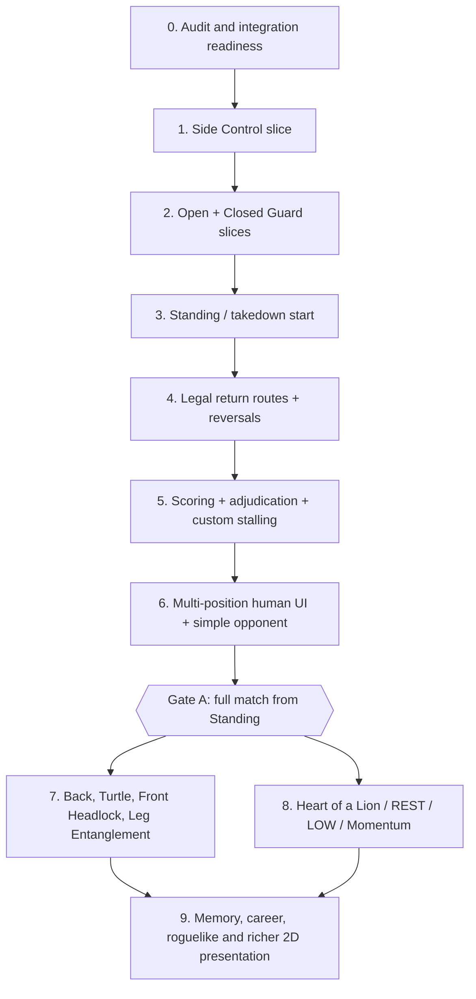
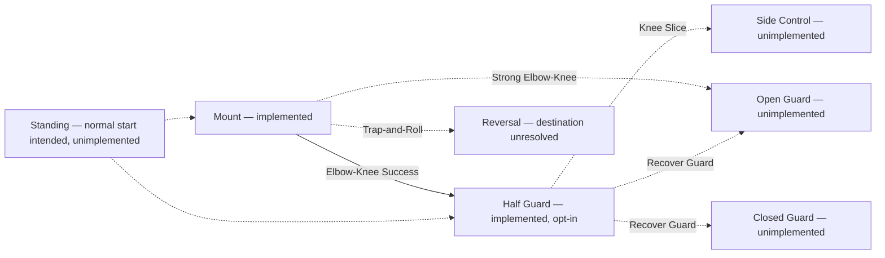

# BJJ Game — Engineering Roadmap & Overseer Ledger

**Audit date:** 2026-10-12 (living snapshot; update after each Claude handoff)  
**Roadmap revision:** 1.1 — handoff prepared; latest PR #63 CI evidence refreshed  
**Repository:** https://github.com/theaxlklo/BJJ-Game  
**Baseline audited:** `main` (`7aaf576e5fc01af4a5592dc544d632e9a3bf4fb1`) and draft PR #63 (`650e7e1b9c6ba138a931c2805ce661e2268431b2`)  
**Decision authority:** The project owner approves new combat mechanics and any merge/integration. This document recommends; it does not change engine behavior or authorize a merge.

## Executive verdict

The deterministic Godot foundation is strong and the Mount→Half Guard graph is real, but the game cannot yet execute a complete scored match from Standing. Shift from engine polishing to **connected, human-playable matches**, without abandoning test coverage or frozen Python parity. Put integration discipline ahead of additional unbounded stacking.

**Observed repository facts:** 51 total PRs in the repository search; 16 merged (#1–#16), four closed CI probes without merge (#24–#27), 31 open PRs. Thirty open PRs form one continuous, SHA-checked branch stack from #17 through #63 (gaps in PR numbering are expected); #44 is an additional, divergent Half Guard proposal, not in the active lineage. Compared with `main`, the latest mainline tip is 74 commits ahead, 0 behind, with 198 changed files. All 31 open PRs are **not** merged to `main`. Some early Godot PRs are not drafts, but their open state is not approval to merge.

**Functional evidence at the stacked tip:** typed Godot Mount parity and stamina/commitment systems, production-safe window gateway, PositionContract, graph, validated Mount→Half Guard transition, Half Guard independent oracle, preparation/feints/sealed-intent, F0 fighter read views, F1 interactive **Mount-only** 2D practice, B1e structural and exploratory match-flow harness. F1 has a scripted non-acting Bottom path and player-selected opposition responses; it is not a true computer opponent or cross-position match UI. B1e measured 2,534 games/74,490 windows, including 1,438 unsupported exits, 907 clock endings with no adjudication and 189 taps; the outcomes are scripted-policy evidence, **not** balanced player tests.

**Critical management risk:** CI tests and PR qualification measure the exact tested branches. They are not proof of playable game completion and not proof that `main` contains the work. PR #62 and PR #63 have each been verified with **21/21 successful exact-head jobs** (at `cd87bf21` and `650e7e1` respectively); both remain unmerged drafts.

## Visual roadmap



This is **a dependency-oriented sequence, not a requirement to finish every position before scoring**. Adjacent tasks may overlap if the feature gates are separate and no shared engine state is mutated concurrently. In particular, the minimal zero-stamina safety path may need to move **before Gate A** if a playtest demonstrates a deadlock. The full BJJ ten-family graph remains a long-term scope target, not a condition for the first playable match.

## Position connectivity snapshot



Dotted connections are **not runnable** in the current graph; Standing arrows show future integration intent, **not approved transition mechanics**. Some additional possible edges exist in topology proposals and must not be mistaken for executable transitions.

## Ordered backlog with gates

| Priority | Work package | First artifacts / PR boundary | Exit gate and overseer evidence | Current status |
|---|---|---|---|---|
| P0 | **Integration-readiness checkpoint** | Inventory the 30-PR stack, independent #44, all exact heads, CI and dependent commits; explicitly plan safe bottom-up integration. | Owner-approved merge train, no silently changed bases or SHA, full composite CI; branch/PR reconciled with `main`. | **Needed**. No merges authorized. |
| P1 | **B2a Side Control spec** | Rules document: side/top/bottom roles, own axis, legal actions/defenses, entry from Half Guard, scoring signals, exits, return-path risks, independent oracle/test gate. | Owner reviews unresolved mechanical values and state/role rules. No combat code yet. | **Next Claude task**. |
| P2 | **Side Control executable** | Independent test-only oracle, typed position engine, position contract, receiver integration through the graph, sealed-option compatibility as needed. | Existing oracles/pins unchanged except justified additive pins; real Half Guard→Side entry, continuity, negative tests and deterministic replay. | Not started. |
| P3 | **Open Guard** | Spec/oracle/engine plus legal receiving routes from Mount and Half Guard. | Unblocked real exits; no illegal role/axis conversion or fabricated window. | Not started. |
| P4 | **Closed Guard** | Spec/oracle/engine receiving Half Guard recovery; deliberate guard initiative/defense and realistic return paths. | Legal entry/exit, rejection atomicity, replay. | Not started. |
| P5 | **Standing and takedown opening** | Fresh-start factory; takedowns, guard pulls, defenses, start roster, legitimate receiver paths. | A normal match can actually start Standing; Mount-only practice constructors still unchanged. | Architectural direction approved; mechanics absent. |
| P6 | **Return routes, reversals and graph traversal** | Side→Half/Mount, guard escapes/sweeps, role swaps, Mount re-entry D3-B rebase decision, unresolved Mount `Reversal`. | Multi-hop, cyclic deterministic trace; no duplicate score/stamina/clock settlement or repeated exhaustion token. | Open design/implementation. |
| P7 | **Scoring, 3s holds, time expiry and stalling** | Separate ruleset ledger and event interpreter; minimum positional scoring (takedown/sweep/pass/mount); custom 3-consecutive-inactive-personal-turn penalty; IBJJF-inspired penalty effects; winner/decision handling. | 5-minute (prototype) clock-end produces a lawful result rather than `timeout` with no adjudication; non-stalling defense and failed genuine efforts protected. | Game rules partly specified; code absent. |
| P8 | **Human multi-position play + baseline opponent** | Extend F1 to real graph traversal; choices for both physical roles, valid counters, sealed intents; separate deterministic rule-based opponent (no advanced AI); legible HUD. | One human can start Standing, choose legal actions, face an independently responding opponent, traverse ≥3 positions, and win/lose by legitimate tap/points/decision. | F1 Mount-only practice exists. |
| **Gate A** | **First complete playable match** | End-to-end human-in-loop acceptance transcript and regression suite. | No reachable unsupported exit in the supported match scenario menu; gameplay doesn't deadlock at zero stamina; playable on lightweight laptop; state/log determinism. | **Not reached**. |
| P9 | **Further graph breadth** | Back Control, Turtle, Front Headlock, Leg Entanglement, appropriate submissions and the remaining ten-family coverage. | All intended family nodes reachable through correct grappling transitions, no surprise fallthrough halts. | Not started. |
| P10 | **Distinctive tactical mechanics** | Heart of a Lion (once, mutual zero, 50%; five *personal* turns each; 100%), zero-stamina LOW memories, REST with 2-turn stalling allowance, Momentum with capped owner-approved modifier. | Exact normal-turn accounting, no infinite refills/extra windows, no double penalties, deterministic tests and per-ruleset opt-in. | **Design direction recorded in #63; not coded.** Bring essential anti-deadlock minimum forward to P8 if required. |
| P11 | **Game identity and campaign** | F0 expanded with belts/styles/loadouts; Memory Constellation, clutch/never-forget, persistent belt career, three-win runs, rewards, injuries, 2D anime/arcade UI. | First complete short roguelike run changes player choices meaningfully; no unearned belt loss. | Mostly approved/open design, not engine. |

### Why this order

- **Side Control** is the highest-value near connection: B1e Population B recorded 910 Side Control blocked exits vs 353 Closed Guard and 155 Open Guard, under scripted test policies. This is *coverage evidence*, not real player play rates.
- **Standing** is mandatory before the project's North-Star complete-match gate. It can move ahead of Guard details if full-match implementation is otherwise blocked; preserving realistic legal receivers is the constraint.
- **Scoring and active play** should start as soon as enough connected positions are executable; not all ten positions must be built first.
- **The F1 UI** is not multi-position nor a real opponent; extend it only after the engine supports legal traversal. The controller must never force engine decisions.
- **The zero-stamina escape hatch** is a gameplay liveness concern; whether it can wait until after Gate A must be validated. Do not assume that every match can end without it.

## Open PR inventory — status snapshot

**Merged foundation:** #1–#16 are merged on main (Python stamina, stalling groundwork, submission track, commitment, production policy, CI experiments).  
**Closed disposable probes:** #24–#27 are closed and not merged.  
**Active, continuous Godot integration stack (30 PRs, oldest to newest):**

| Layer | PRs | Delivered on stack (not necessarily on main) |
|---|---|---|
| Base parity / stamina / CI | [#17](https://github.com/theaxlklo/BJJ-Game/pull/17), [#18](https://github.com/theaxlklo/BJJ-Game/pull/18), [#22](https://github.com/theaxlklo/BJJ-Game/pull/22), [#23](https://github.com/theaxlklo/BJJ-Game/pull/23) | Mount Python comparison, typed stamina, settlement, targeted CI. |
| Mount lifecycle | [#28](https://github.com/theaxlklo/BJJ-Game/pull/28), [#29](https://github.com/theaxlklo/BJJ-Game/pull/29), [#30](https://github.com/theaxlklo/BJJ-Game/pull/30) | Hardening, advancement/RECOVER, D3-B and production lifecycle. |
| Contracts and first graph | [#39](https://github.com/theaxlklo/BJJ-Game/pull/39), [#41](https://github.com/theaxlklo/BJJ-Game/pull/41), [#42](https://github.com/theaxlklo/BJJ-Game/pull/42), [#43](https://github.com/theaxlklo/BJJ-Game/pull/43), [#45](https://github.com/theaxlklo/BJJ-Game/pull/45) | PositionContract, window gateway, graph rules, unsupported exits, classified outcomes. |
| Quality/architecture | [#46](https://github.com/theaxlklo/BJJ-Game/pull/46), [#47](https://github.com/theaxlklo/BJJ-Game/pull/47), [#48](https://github.com/theaxlklo/BJJ-Game/pull/48), [#49](https://github.com/theaxlklo/BJJ-Game/pull/49), [#50](https://github.com/theaxlklo/BJJ-Game/pull/50), [#51](https://github.com/theaxlklo/BJJ-Game/pull/51), [#52](https://github.com/theaxlklo/BJJ-Game/pull/52) | Agent workflow, settlement extraction, carryover, topology, frozen exit inventory, fail-closed CI, identity-only registry. |
| Fighter/player vertical prototype | [#53](https://github.com/theaxlklo/BJJ-Game/pull/53), [#54](https://github.com/theaxlklo/BJJ-Game/pull/54) | Fighter definitions and snapshots, Mount-only F1 interactive 2D scene. |
| Half Guard executable pipeline | [#55](https://github.com/theaxlklo/BJJ-Game/pull/55), [#56](https://github.com/theaxlklo/BJJ-Game/pull/56), [#57](https://github.com/theaxlklo/BJJ-Game/pull/57), [#58](https://github.com/theaxlklo/BJJ-Game/pull/58), [#59](https://github.com/theaxlklo/BJJ-Game/pull/59), [#60](https://github.com/theaxlklo/BJJ-Game/pull/60), [#61](https://github.com/theaxlklo/BJJ-Game/pull/61) | Rules, oracle, Mount→Half edge, graph receiver, sealed protocol, feints/fallback, connected sealed flow. |
| Evidence / owner rulebook | [#62](https://github.com/theaxlklo/BJJ-Game/pull/62), [#63](https://github.com/theaxlklo/BJJ-Game/pull/63) | Match diagnostics and separately documented future stalling/Momentum/Heart/LOW/REST. |

**Parallel divergence:** [#44](https://github.com/theaxlklo/BJJ-Game/pull/44) is a separate, open draft Half Guard proposal based on #43, NOT an ancestor of #63. Compared with #63, it is a three-commit divergent branch and needs explicit reconcile/close/retain review; never blindly merge it into the mainline. The current proposal #55 and rules #56 are the active successor lineage.

## Overseer's living dashboard specification

Maintain one canonical file on the integrated repo branch, e.g. `docs/project/OVERSIGHT_LEDGER.md`, updated **on every qualified slice**. This snapshot can initialize it but **do not** mark an unmerged PR as integrated.

| Field | Meaning | Current snapshot |
|---|---|---|
| `main_sha` | Integrated baseline | `7aaf576e5fc01af4a5592dc544d632e9a3bf4fb1` |
| `stack_tip` | Latest tested/observed development head | PR #63, `650e7e1` (21/21 exact-head CI; unmerged draft) |
| `connected_executable_families` | Real interconnected nodes on development tip | 2: Mount, Half Guard (latter opt-in) |
| `normal_start_standing` | Normal match can start Standing | NO |
| `run_to_result` | Full match with legal scoring/adjudication | NO |
| `human_control` | Human can control multi-position fight | Mount practice only |
| `opponent` | Autonomous opponent policy | No production opponent, only scripted practice/harness |
| `special_mechanics` | Momentum/Lion/REST/zero-LOW implemented | No, documented only |
| `open_merge_work` | Main-stack and divergent review | 30-stack + 1 parallel |
| `next_gate` | Near-term objective | P0 integration-readiness + B2a Side Control spec |

For each new slice, record these fields **even if unchanged**:

```
Slice ID / short title:
Owner-approved scope and exclusions:
Base PR / base SHA:
Head PR / exact head SHA:
Implementation evidence (new executable behavior vs docs only):
Oracle and pinned tests / result:
CI at exact SHA (PASS / FAIL / PENDING / NOT RUN):
Blocked exits / new playable transitions:
Open owner design decisions (with explicit choices, not guesses):
Integrated to main? (NO / YES at SHA):
Player-visible result or screenshot/test session:
Next dependency and responsible agent:
```

**Board columns:** Ideas → Needs owner decision → Spec accepted → Implementing → Tests green at exact SHA → Integration review → Merged to `main` → Human-play verified. A proposal is not a mechanic, a green draft is not merged, and a merged mechanic is not automatically human-play validated. Establish GitHub milestones `Playable Multi-Position`, `Full Match From Standing`, `Ten-Position Graph`, `Roguelike Run` (titles are suggestions, not existing repo milestones).

**Progress measures, not vanity metrics:** number of usable graph families, count of real receivable exits, complete played matches without unsupported halts, reference replay mismatches, open unknown-owner decisions, number of pending unmerged PRs, number of user-input paths actually tested, unresolved UI/AI blockers. Maintain separate scores for structural correctness, game completeness and experience quality.

**Default checkpoint cadence:** update a one-screen project summary after each PR and compare against this baseline. At each milestone gate, run deterministic headless suite plus a **manual 2D interactive check** on the target laptop. No fabricated test times or green badges before evidence.

## Next bounded Claude assignment (B2a only)

1. Verify `AGENTS.md`, all 30 mainline ancestor heads, independent #44, current CI on #63 and Godot code at exact SHA; do not change existing PR bases or merge anything.
2. Review `BjjPositionGraphMatch`, `PositionContract`, `HALF_GUARD_V0_RULES`, `POSITION_TOPOLOGY`, the B1e measurement and Side Control rules in Master Guide.
3. Draft `GODOT_V1/docs/SIDE_CONTROL_V0_PROPOSAL.md` with legal roles, separate axis, initiative, 3–5 meaningful actions per side, responses, setup/defense, fatigue policy, legal escape routes, a **real Half Guard Knee Slice→Side Control carryover**, validation of previous state's freeze, schema and independent Python test-only oracle plan. Label each as approved/demonstrated/proposed/open.
4. Include a boundary matrix for Half Guard entry, Side Control proposed exits, continuity of clock/stamina/latches/remainder, D3-B frozen controller, orientation and re-entry concerns. Do not create an automatic return into Mount.
5. Define negative tests for invalid label/id, stale window, wrong initiator, responder admission, terminal/halt, two independent replays, unsupported exits and receiver failure. Make the design testable in isolation, without extra action windows.
6. **Docs only, draft PR stacked on verified current #63**, with owner-review questions. No combat tuning, universal graph framework, new position code, scoring, stalling, Lion/REST/Momentum or UI in B2a. Stop for rule approval.

## Key owner decisions, deferred to the right gate

- **B2a:** Side Control entry, attack/defense catalog, return edges, own axis and setup rules.
- **Return routes:** exact Mount Reversal landing and role swap; re-entry semantics for frozen Mount D3-B episode.
- **Ruleset:** how the game-specific third inactive *personal* turn earns repeat penalties and what meaningful activity means in each position. Keep official IBJJF 20-second rule separate.
- **Zero stamina:** REST recharge amount/timing and zero-stamina LOW technique grade/funding exception; the present LOW cost is 3, so both mechanics need code changes.
- **Lion:** integer rounding at 50%, deterministic personal-turn settlement including pass/D3-B/feints, precise ordering with end-of-match.
- **Momentum:** exact gain/consume/stack/grade impact. Feint secrecy and defender response must survive unchanged.
- **Match end:** pinned IBJJF edition, bout division/time and the game's deterministic adjudicator for tied scenarios.

## Non-negotiable engineering controls

1. Frozen Python oracle and historical evidence remain immutable unless an **explicitly authorized new ruleset** requires a separate oracle.
2. Typed Godot deterministic computation; no wall time, frame rate or hidden random rolls in game authority.
3. Match owner/position owner separation; positions determine rules and emit outcomes; graph validates/commits one destination; never let a UI invent transitions or windows.
4. Existing production config is opt-in; do not turn on experimental mechanics by accident.
5. One PR = one reviewable deliverable. Stop expanding the long stack without agreed integration cadence. Prefer reviewing/moving the ancestor chain bottom-up after owner authorization.
6. Exact-head CI plus meaningful scenario evidence; report what was **not** tested.
7. Respect F1's low-spec 2D-first requirement and the `AGENTS.md` project rule: human-play breadth over endless Mount tuning.

*This document is a planning baseline tracked in the repository documentation branch; publication does not merge, close or retarget any gameplay PR.*

## Living document workflow (established 2026-10-12)

The companion file [`OVERSIGHT_LEDGER.md`](OVERSIGHT_LEDGER.md) is the fast one-page overseer view. This longer roadmap is the architectural sequence, unchanged unless evidence changes dependencies or the owner approves a new rule. The first Claude assignment is saved separately as [`CLAUDE_B2A_HANDOFF.md`](CLAUDE_B2A_HANDOFF.md) and is intended to create a documentation-only B2a Side Control proposal stacked on #63.

**When the owner pastes Claude's next handoff:** cross-check its PR URL, exact SHA, changed files and CI claims against GitHub; add a timestamped immutable result entry to the ledger; update status/dependencies here, preserving old baseline evidence; identify proposal versus qualified code versus merged state; and produce one bounded next Claude prompt. Do not treat a claimed PASS as verified until independently checked. No background monitoring or automatic merge is implied.