# BJJ Game — Project Oversight Ledger

**Revision:** 4.6 · **Snapshot date:** 2026-10-13 · **State:** Living manual ledger, updated from actual Claude handoffs and verified GitHub evidence.

**Workflow (owner decision 2026-10-13, see E-016 to E-021):** local-first. Direct commits to `main`, local Godot/Python tests, no PRs, no automatic GitHub Actions; ChatGPT reviews GitHub afterwards.  
**Repository:** https://github.com/theaxlklo/BJJ-Game  
**Engineering roadmap:** [`ENGINEERING_ROADMAP.md`](ENGINEERING_ROADMAP.md) (canonical repository document)  
**Completed Claude handoff:** `CLAUDE_B2A_HANDOFF.md` (archived on branch `docs/project-oversight-canonical`) (archived B2a scope; completed in [PR #65](https://github.com/theaxlklo/BJJ-Game/pull/65)). **Next gate:** B2b-1 rules sheet (E-023) and B2b-2 independent test-only Python oracle (E-024) are done; B2c typed Godot engine needs separate owner authorization.

## One-screen overseer pulse

| Indicator | Observed value | Meaning |
|---|---|---|
| Stable integrated baseline | `main` @ `626321721209ffb0850bbdd1f2613992e1eaa629` | **Cumulative PR #66 integrated through #65**; 21/21 actual-main CI PASS |
| Historic stacked tip | PR [#65](https://github.com/theaxlklo/BJJ-Game/pull/65) @ `9942c5a53caf58d0d944bd7931ccc81bf86d0d07` | Its exact commit is now **an ancestor of `main`** through merged PR #66; Side Control remains proposal-only |
| Qualified cumulative CI | PR #66 [38329885284](https://github.com/theaxlklo/BJJ-Game/actions/runs/38329885284) **21/21**; new-main [38332178012](https://github.com/theaxlklo/BJJ-Game/actions/runs/38332178012) **21/21** | Full Python/Godot checks, exact oracle counts and 4 approved terminal exceptions |
| Development workflow | **Local-first on `main`** | No PRs; local tests are the gate; automatic Actions disabled, manual qualification optional |
| Open work | 27 stale **already-integrated** stack PRs, divergent #44, separate oversight #64 | **29 open** total; #23 automatically marked merged; no backlog gameplay merge remains |
| Tip relative to `main` | #65 head is an **ancestor** of `main` (0 paths different) | The historical 75-commit snapshot is superseded; cumulative integration changed 168 paths relative to old `main` |
| Executable connected positions on tip | **Mount -> Half Guard**, opt-in | No Side Control receiver |
| Player interface | **F1 Mount practice** | Not a full multi-position player-vs-opponent match |
| Complete match from Standing | **NO** | Standing, scoring, decisions and wider routes missing |
| Future custom mechanics | **Specification only** | Stalling, Momentum, Heart of a Lion, REST, zero-stamina LOW memories |

## Visual project traffic flow

```mermaid
flowchart LR
  P0["P0 · Integration review"] --> P1["B2a · Side Control spec QUALIFIED"]
  P1 --> D["SC-D1–D15 · owner decision"]
  D --> P2["B2b/c · Oracle + engine"]
  P2 --> G["Open / Closed Guard"]
  G --> ST["Standing + loops"]
  ST --> R["Scoring + stalling"]
  R --> UI["Human UI + simple opponent"]
  UI --> MVP{{"First complete match"}}
  MVP --> MORE["Other positions + distinct mechanics + career"]
```



Status legend: **Observed** means source or GitHub evidence reviewed. **Proposed** means awaiting owner approval. **Qualified** means CI passed at the exact SHA. **Merged** means the changes actually entered `main`. **Playable** requires manual acceptance evidence.

## Current work queue

| Track | Slice | State | Next owner-visible result |
|---|---|---|---|
| Stack safety | P0 — cumulative integration **COMPLETE** | PR #66 merged successfully | Local-first workflow adopted (E-016); stale PRs left untouched; harden comparer count/exception pins locally |
| Gameplay breadth | B2a — Side Control rules/entry spec | **Doc-qualified #65, not approved** | SC-D2 reframed by B2a.1 (not a binary); owner-decision review in `SIDE_CONTROL_V0_PROPOSAL.md` §11A; no numbers frozen | 
| Initiative design | B2a.1 — Position-aware and skill-sensitive contract | **Proposal revised (E-020): OD-2 approved; awaiting OD-2a, OD-3 to OD-12** | Include role-specific selectable training focuses, belt Technique variance and move mastery without implementing career, focus selection, or initiative changes |
| Implementation | B2b+ — rules sheet, independent oracle, Godot, receiver | **B2b-1 rules sheet (E-023) and B2b-2 oracle (E-024) done; B2c+ not authorized** | B2c typed engine from the sheet and oracle fixture; B2d real Knee Slice → Side Control; B2e measurement |
| Wider positions | Open/Closed Guard, Standing, reversals | **Planned** | Full legal graph traversal and start |
| Match completion | Scoring, adjudication, activity enforcement, basic opponent | **Planned** | Human plays a complete fight from Standing |
| Distinctive mechanics | Heart of a Lion, REST, LOW-at-zero, Momentum | **Approved concept, not implemented** | Separate rule gates and tests after core match, or earlier if liveness blocks play |

## Owner decision register

| ID | Question | Current decision / state |
|---|---|---|
| D-SC-01 | Side Control SC-D1–SC-D15: roles, first initiative, axis, catalog, grades, economy, exits, entry, opt-in and slicing | **Proposal delivered #65; all owner decisions remain OPEN** |
| D-INIT-01 | Position-aware initiative, especially SC-D2 first Side Control window | **B2a.1 docs investigation approved; OD-2 Option B (separate `G` and `R`, new fighter `R = 0`) OWNER-APPROVED 2026-10-13 (E-020); no numerical threshold, scale, weight or XP rate approved** |
| D-INIT-02 | Neutral simultaneous commitments in Open Guard/Standing and potential Bottom initiative in Closed Guard | **Proposed future capability; not implemented; requires secrecy, clock, ordering, personal-turn rules** |
| D-INIT-03 | Belt-banded Technique stat with within-belt variance and position-specific proficiency affecting opening priority | **New owner design idea, NOT APPROVED**. Investigate in B2a.1, keep control/authority/response and clock independent; initial ranges/override thresholds OPEN. |
| D-FOCUS-01 | Player-selected positional training focuses keyed by position family **and physical role**; White Belt begins with proposed 2 focuses (e.g. Mount Top and Side Control Top); more slots as fighter improves | **Owner design direction/provisional 2-slot example; NOT CODE-AUTHORIZED.** Decide exact slot ladder, focus switching, XP/learning rules and persistent storage later. Preserve off-focus move legality, earned belts and earned proficiency. |
| D-MEM-01 | Three concurrent **blurry/unfinished memory slots**; learn one to free a slot, or choose to discard one when discovering a new move | **Owner mechanic direction; NOT IMPLEMENTED.** No automatic eviction; three is a concurrent learning limit, not total techniques, training focuses or Never Forget count. Explicit opt-in replacement required. |
| D-MEM-02 | Percentage retained on discarding blurry memory; later rediscovery restores residual clarity | **Owner-approved concept:** discard frees slot but preserves **some percentage of current earned progress** in a dormant trace; it is not an active fourth memory. **OPEN:** numeric rate, rounding, repeated replacements, persistence and learned/mastered thresholds. |
| D-STACK-01 | Batch A and authorized cumulative PR #66 through #65; separate #44/#64 excluded | **ALL LINEAR STACK CODE IN `main`, postmerge CI 21/21**. Twenty-seven superseded old PRs may be bulk closed only with owner's explicit metadata-sweep approval; preserve branches. No B1 batch required. |
| D-STALL-01 | Game-specific stalling trigger | **Approved direction: third consecutive inactive personal turn**, independent by fighter |
| D-STALL-02 | Penalty repeat/reset cadence and full activity classifier | **Open**; IBJJF-inspired scoring consequences are proposed |
| D-LION-01 | Heart of a Lion | **Approved concept**: both exactly 0; once per match; 50%; five completed personal turns each; then 100% if active |
| D-REST-01 | REST recovery amount and timing | **Open** |
| D-LOW-01 | Funding/grade rule for eligible LOW memories at stamina 0 | **Open**; existing LOW normally costs 3 |
| D-MOM-01 | Momentum strength, trigger, cap, consumption | **Open** |
| D-RETURN-01 | Mount Reversal destination and Mount re-entry D3-B reconciliation | **Open**; do not assume landing |

## Verified handoff history

### E-000 — Baseline audit, 2026-10-12

- Audited [PR #62](https://github.com/theaxlklo/BJJ-Game/pull/62) and [PR #63](https://github.com/theaxlklo/BJJ-Game/pull/63), active Godot stack and parallel [#44](https://github.com/theaxlklo/BJJ-Game/pull/44).
- PR #62 match-flow diagnostics: **2,534 games**, **74,490 windows**, **73,606 CI-gated structural assertions**. Unsupported exits are *incomplete-engine boundaries*, not losses; qualitative population measurements do not prove balance.
- Corrected report typo: Half Guard exchanging-cell maximum no-progress streak **53**, not 788 (which counted feint attempts in a different table).
- #63 exact head `650e7e1b9c6ba138a931c2805ce661e2268431b2`: **21/21 CI jobs passed**. Remains **open draft**; no merge.
- Next handoff expected: **B2a specification**. No Side Control mechanics authorized until owner approves the proposal.

### E-001 — Claude B2a Side Control proposal, 2026-10-12

- **User-supplied Claude handoff independently verified:** [draft PR #65](https://github.com/theaxlklo/BJJ-Game/pull/65), base draft #63 branch `docs/match-incentives-heart-of-lion-spec` at `650e7e1b9c6ba138a931c2805ce661e2268431b2`; exact head `9942c5a53caf58d0d944bd7931ccc81bf86d0d07`. GitHub comparison: **1 commit ahead, 0 behind**, **one new Markdown file** (`GODOT_V1/docs/SIDE_CONTROL_V0_PROPOSAL.md`, 346 lines). No code or engine behavior changed.
- **Exact-head GitHub workflow `38297697211`:** 8 total jobs, **4 success** (CI gate, classify changes, lightweight validation, qualification results), **4 skipped** (Godot and Python paths). This qualifies a **documentation proposal only**. Claude reports local whitespace/link checks; those local commands were not independently re-executed here.
- **Proposal contents:** Side Control identity and Top/Bottom role map; own signed axis, authority, first-window initiative question; six proposed action IDs (3 Top/3 Bottom), three responses per side and two raw-grade matrices; new readiness and economy rules; four exit labels (Mount, Back Control, Half Guard, Turtle) **all halt in v0**; Half Guard Knee Slice→Side Control adapter, snapshot validator and segment-continuity plan; B2b oracle, B2c Godot engine, B2d opt-in graph, B2e measurement.
- **Design decisions:** SC-D1–SC-D15 in §11 of the proposal are **unapproved**. Architectural recommendation to owner: D1 preserve roles; D2 Top-first is consistent with positional authority but causes consecutive personal decisions after Top's pass (no free window); D10 pure Half Guard snapshot adapter; D12 explicit new opt-in with unchanged defaults; D15 independent Python oracle checkpoint before GDScript. All numeric grades, entry axis/threshold, tier and stamina rules are provisional; owner must approve test baseline before oracle, not treat oracle as a substitute for owner decisions.
- **Critical risks to test at B2d:** destination-only receiver could wrongly rebuild Half Guard from retained Mount; at least 17 nullable routing sites and hard-coded Mount transition origin; stale Half Guard sealed protocol; missing Half Guard frozen fingerprint; stale carry-over-export and terminal handling; source scans/CI pins need explicit, justified updates; earlier B1e populations must remain unchanged. No return route or Mount Reversal landing may be invented.
- **Agent provenance:** Claude reports the named repo-specific reviewer agents were not registered in its session; it used general-purpose read-only agents with repository definitions inlined. Their findings are reported, not independently reproduced by the reviewers in this oversight turn.
- **Independent oversight docs:** [draft PR #64](https://github.com/theaxlklo/BJJ-Game/pull/64) holds this ledger and roadmap on a separate main-based branch; exact-head workflow at `e15b7ee4d623ee5a36edfe41b5947a12d3adb93b` succeeded. Docs #64 and gameplay #65 remain **unmerged**.
- **Next action:** present compact owner decision matrix; **do not authorize B2b or change #65's text** absent owner approval. Then draft B2b rules-sheet + test-only Python oracle prompt; keep P0 bottom-up integration as a parallel read-only track.

### E-002 — Owner initiates B2a.1 position-aware initiative review, 2026-10-12

- **Source:** owner's game-design concern accepted as a **new documentation-only design checkpoint**. Side Control may favor the pinning Top; Closed Guard may give offensive initiative to Bottom; neutral Open Guard and Standing may offer simultaneous committed choices. This is a design investigation, **not approval of Top-first SC-D2**, any per-position authority rule, or a new engine protocol.
- **Reason:** a universal alternating-turn rule or a universally Top-first rule would misrepresent some positions. Cross-position Knee Slice already creates a known consecutive-initiative ambiguity; existing Mount/Half Guard behavior is frozen and must not be changed by this exploratory slice.
- **New gate:** B2a.1 docs-only contract and position matrix, separate positional authority, initiative eligibility, and decision-timing mechanism. Require analysis of one clock advance per global bounded exchange, sealed information, preserved response options, and **per-fighter** personal completed-turn accounting for future custom stalling and Heart of a Lion. Simultaneous protocols are **not currently supported by simply adopting Half Guard's sealed feint flow**.
- **Development sequence:** B2a doc-qualified #65 → **B2a.1 (next)** → owner approval of SC-D1–SC-D15 → B2b standalone oracle/rules sheet → B2c typed engine → B2d graph seam → B2e measurement. P0 integration audit continues independently.
- **Git authority:** no merges, refactors or modifications to the #65 gameplay-stack branch authorized. Oversight updates committed to the independent main-based draft [PR #64](https://github.com/theaxlklo/BJJ-Game/pull/64); its new exact-head CI needs verification and must not be presumed green.

### E-003 — Owner proposes technique-sensitive initiative and belt variation, 2026-10-12

- **Owner's question, not a frozen rule:** can default initiative favor the naturally advantaged fighter in a position, but be overridden by a sufficiently large fighter Technique proficiency difference? White/Blue/Purple/Brown/Black would have different, overlapping typical skill distributions with variability within each belt.
- **Provisional paper model only:** 0–100 initial skill ranges White 10–35, Blue 25–50, Purple 40–65, Brown 55–80, Black 70–95. Distinguish *general Technique*, position-specific knowledge and named memory mastery. A Side Control Top bias such as +12 is **just an example**; neither ranges nor positional bonus nor threshold nor calculation is approved.
- **Key architecture constraints:** belt never decides automatically; skilled Bottom may earn opening priority without becoming the physical Top or nullifying the Top's response. No additional turn, premature window, clock advancement, feint information leak or RNG on every exchange. If skill varies at fighter generation, the variation must be seeded/stored and reproducible. Do not equate priority with already present action-result exhaustion modifiers.
- **Scope decision:** add the proficiency-vs-positional-bias alternatives and deterministic test cases to the **existing B2a.1 docs-only initiative investigation**, not to B2b oracle or current gameplay. The owner still needs to approve the eventual formula, belt distributions and SC-D2 interaction. No PR #65 or engine file was changed by this entry.

### E-004 — Owner proposes player-selected positional training focuses, 2026-10-12

- **Owner game-design direction:** positional expertise develops according to the positions a fighter **chooses to train**, with growing focus capacity through wins and belt/career development. Illustrative White Belt start: **2 chosen position-and-role focuses** (`mount/top` and `side_control/top`); later belts/achievements may unlock more. Exact level gating, number of later slots and XP rates remain open. This direction complements—not replaces—the proposed belt-banded general Technique and named memory mastery.
- **Role-specificity matters:** `mount/top` and `mount/bottom` are separate expertise areas, as are `side_control/top` and `side_control/bottom`. Standing/neutral families require their real role semantics, never fabricated top/bottom.
- **Proposed integration:** active focus enhances rate/direction of positional skill growth and may improve practice/clarity of matching move memories; earned role-specific proficiency persists when training assignments change. General Technique supplies broad competence, focus influences specialist skill, and named move memory controls learned-technique mastery. Avoid stacking all three independently into repeated priority and grade bonuses.
- **Constraints:** off-focus positions and legal defense remain playable; true observation-based technique learning remains possible outside focuses; no pass/REST spam for XP; no in-match free reallocations, new decision windows or clock changes. Career persistence respects retained earned belts and mastered knowledge. The current Godot fighter foundation is not assumed to implement these mechanics.
- **Action:** include a small, deterministic design matrix and data/role-contract proposal within B2a.1. **No PR #65, engine, oracle, roster, persistence format or default behavior was edited.** Defer numeric slot ladder, per-action XP, assignment/respec economy and initiative override formula to owner approval and later implementation. Full focus/memory development must not hold up the Side Control oracle once a safe provisional initiative baseline is approved.

### E-005 — Owner caps blurry memory queue at three slots, 2026-10-12

- **Owner mechanic direction:** a fighter may hold **three active blurry/unfinished technique memories simultaneously**. A new technique encountered while full offers a deliberate decision: **keep** the three existing learning projects, or **discard one** to admit the new blurry memory. Continued practice/observation can bring a chosen blurry memory to **learned** status and free its slot. This does **not** limit the fighter's accumulated learned/mastered repertoire.
- **Distinct player-controlled resources:** the White Belt example of two selected *positional training focuses* (D-FOCUS-01) is independent of **three active blurry memories** (D-MEM-01); both differ from the future limited **Never Forget** / clutch selections. Specializing in a position might speed clarification of related memories but cannot silently add blurry slots.
- **Safeguards:** explicit confirmation before replacement; no automatic loss of learned memories, no fourth hidden blurry slot, no duplicate technique IDs, deterministic encounter and selection history; observation and selection must not create a new combat decision window, advance the match clock, expose a sealed feint or remove mandatory defenses. Protect progression from trivial repeat-action XP farming.
- **Open design:** whether dropping a blurry memory destroys its incomplete progress, when it reaches learned (vs mastered), how to practice, whether repeated observations while queue is full can be tracked, the exact player-choice UI timing, technique-variant granularity, persistence across runs, and whether slot capacity can ever increase. None of these was implicitly approved by the capacity rule.
- **Scope:** added to [Roadmap v1.6](ENGINEERING_ROADMAP.md) for a later memory/career implementation slice; B2a.1 remains a **documentation-only initiative investigation**, and B2b remains blocked pending Side Control rules approval. No gameplay branch, PR #65 or existing oracle was modified.

### E-006 — Owner preserves partial clarity when discarding a blurry memory, 2026-10-12

- **Owner decision:** when a fighter deliberately discards one of the three unfinished/blurry memory projects, they retain **a percentage of the progress earned so far**. This prevents an abandoned learning project from feeling entirely wasted. The slot becomes free for the newly observed technique; the abandoned progress becomes a **dormant residual trace**, not a fourth active blurry memory.
- **Rediscovery:** upon a later genuine encounter and voluntary re-admission into one of the three slots, the technique should restore its residual clarity instead of starting completely from zero. The original three-slot cap, consent before replacing a memory, and permanent separation from learned/mastered and Never Forget memories remain unchanged.
- **Illustration, not an accepted rate:** 60% learned × a hypothetical 50% retention = 30% dormant clarity. **The actual retention percentage has NOT been selected**; also open are integer rounding, whether specializations influence retention, prevention of repeated-discard exploits, re-discovery recognition, and career/run persistence.
- **Implementation gate:** later Memory Constellation/learning slice only, with deterministic stable technique IDs and replay/save tests. No combat engine, SC-D2 initiative, B2a.1 or Side Control oracle work was authorized or changed by this decision.

### E-007 — P0 audit closing message and Batch A preflight decision, 2026-10-12

- **Supplied Claude excerpt:** the read-only P0 audit has finished and proposed first integration Batch A = PRs #17, #18 and #22. Claude reports **no merges, pushes, retargets or other mutations**. Its full audit report was not reproduced in the latest pasted excerpt, so conclusions outside Batch A cannot be independently accepted on that basis.
- **Independently checked on GitHub:** [#17](https://github.com/theaxlklo/BJJ-Game/pull/17) `1de58ef97c4a0a4342f6a80a36c352926620be6e` → [#18](https://github.com/theaxlklo/BJJ-Game/pull/18) `9c4166cef43d367786bbb24b76bccef6624779ba` → [#22](https://github.com/theaxlklo/BJJ-Game/pull/22) `83d2eb9d4d5f29249f1954ebf7b6b82661bac982`; each open, non-draft, mergeable, correctly stacked and historical exact-head workflows successful. GitHub submitted review list for each returned no reviews. PR #17 is directly based on main `7aaf576e5fc01af4a5592dc544d632e9a3bf4fb1`; subsequent bases match direct predecessor heads.
- **Merge-method recommendation:** repository reports merge commits, squash merges and rebase merges enabled. Prefer the **merge-commit** method to retain stacked ancestry, but confirm branch policies, bot rules and expected diff changes at each step. A green source PR does not demonstrate CI success on a new integration commit.
- **Decision:** approve Batch A as the **first integration candidate and read-only preflight scope**, not a blanket three-PR merge approval. Preflight should report exact current heads, branch protection, simulator/merge-tree or read-only diff, required CI and rollback; stop for the project owner's separate explicit merge authorization before changing `main`, PR bases or history. After a single authorized merge, check cumulative CI on the actual main SHA before permitting the next.
- **Scope frozen:** B2a.1, Side Control B2b+, #44 and oversight #64 must not be swept into this batch. Existing Python oracle, frozen fixtures, Godot parity and production opt-in must remain unchanged.
- **Next task:** Claude returns an actionable first-step premerge gate report, then owner selects go/no-go for #17. Keep `main` stable until approved.

### E-008 — PR #17 pre-merge qualified, engineering GO recommended, 2026-10-12

- **Claude report (local proof, not rerun by oversight):** clean isolated scratch merge of #17 `1de58ef97c4a0a4342f6a80a36c352926620be6e` into `main` `7aaf576e5fc01af4a5592dc544d632e9a3bf4fb1`; expected tree `3c91f43da03fd08af86a950351c26a023284af58`. Godot 4.7.2 headless import and Mount slice 40 assertions PASS; independent Python fixture 4,140 actions + 300 drifts; Godot-v-Python 92,939 comparisons; digest match; PYTHONHASHSEED 0/1/12345 reproducibility; 3D smoke, semantic checker, legacy entry point, PG8 history, and 516 Python 3.14.7 unit tests PASS. Claude reports no Git ref or remote mutations. These checks were **not independently executed** here.
- **Independently verified GitHub:** [PR #17](https://github.com/theaxlklo/BJJ-Game/pull/17) remains open non-draft, mergeable, with 1 commit/5 changed paths (only `.github/workflows/godot-v1.yml`, `GODOT_V1/.gitignore`, `GODOT_V1/docs/PORT_STATUS.md`, reference generator/test); base `main` at `7aaf576e5fc01af4a5592dc544d632e9a3bf4fb1`, exact head unchanged `1de58ef97c4a0a4342f6a80a36c352926620be6e`; both PR/push exact-head workflows completed successfully. GitHub reports merge-commit strategy enabled. Branch protection/review policy assessment is from Claude, not separately verified in this oversight action.
- **Known weaknesses:** the old Mount parity checker may incorrectly accept an empty fixture or an omitted expected field; local preflight deliberately inspected nonzero 4,140/300/92,939 counts and CI regenerates the fixture. The old aggregate CI gate does **not** include the independent Godot job. Track explicit count pins after the appropriate later PR, never retroactively alter frozen evidence.
- **Engineering verdict:** **GO for #17 using a merge commit once the project owner expressly authorizes the actual mainline operation**. The user supplied a GO report but has **not supplied an explicit merge instruction**. No merge, retarget, push or main mutation was executed by oversight. This is not approval for #18, #22, #44 or #64.
- **Post-merge strict gates:** verify current head/base again; resulting `main` tree exactly `3c91f43da03fd08af86a950351c26a023284af58`, #17 head ancestor, new `main` push workflow and separate Godot workflow on the *actual new main SHA* successful and not cancelled, Godot counts unchanged (40 assertions, 4,140 actions, 300 drifts, 92,939 checks). On changed SHAs/red/missing/cancelled/mismatched checks: stop, no retarget, no next merge, report discrepancy and recovery path. After complete PASS ask separately before changing #18's base.

### E-009 — PR #17 successfully integrated; post-merge CI verified, 2026-10-12

- **Claude's OVERSIGHT HANDOFF:** owner-authorized merge commit for [PR #17](https://github.com/theaxlklo/BJJ-Game/pull/17) using exact-head guard `1de58ef97c4a0a4342f6a80a36c352926620be6e`. New `main` `27599f28fa0e815693aa9d36aedb7aa14d573ac8`, with original predecessor `7aaf576e5fc01af4a5592dc544d632e9a3bf4fb1`. Claude reports correct expected tree `3c91f43da03fd08af86a950351c26a023284af58` and #17 head as ancestor; no other merge, retarget, push or deletion.
- **Independently verified GitHub:** #17 `merged=true`, `state=closed`, `merge_commit_sha=27599f28...`, with exact #17 head unchanged. `main` is exactly the reported merge SHA, based on commit comparison. Python workflow [38313261406](https://github.com/theaxlklo/BJJ-Game/actions/runs/38313261406) has 18 SUCCESS and one expected docs-only SKIPPED, including both Python versions' unit shards and `CI gate`. Godot workflow [38313261503](https://github.com/theaxlklo/BJJ-Game/actions/runs/38313261503) has a successful `godot-v1` job; its downloaded job log **independently confirms** 40 Mount assertions, 4,140 reference actions, 300 drifts and 92,939 cross-language parity checks. Claude reports both were non-cancelled `main` push runs with no deviations.
- **Verification limit:** the connector exposed the merged commit but not its complete tree object for an independent hash comparison; the exact tree equality and scratch clone cleanliness remain **Claude-reported**, not re-executed here. Godot's independent CI is still not part of old Python aggregate gate, and the old parity checker requires explicit count scrutiny.
- **Remaining stack:** 30 open sequential Godot PRs #18→#65; divergent #44 and independent docs/ledger #64 remain outside that stack. #18 unchanged head `9c4166cef43d367786bbb24b76bccef6624779ba`, based on `feat/godot-v1-reference-parity` (the original #17 head). Comparing #18 to actual `main` shows six commits ahead, one behind (the merge commit), 18 intended paths. #22 unchanged at `83d2eb9d4d5f29249f1954ebf7b6b82661bac982`. No reason to rebase or change head.
- **Next recommended owner authorization:** allow **retargeting PR #18 base to `main` only**, keeping its head unchanged, then have Claude qualify a simulated merge into actual `main` (CI/determinism/fixture counts, policy, no unexpected diff) and stop for a separate GO/NO-GO decision. **#18 merge, #22 retarget/merge and all further mainline writes are NOT approved by this entry.**

### E-010 — PR #18 retargeted to main, premerge GO verified with qualifications, 2026-10-12

- **Claude OVERSIGHT HANDOFF:** user-authorized base-only retarget of [PR #18](https://github.com/theaxlklo/BJJ-Game/pull/18) from `feat/godot-v1-reference-parity` to `main`. No mainline merge, branch push, rebase, amendment, forced update or PR #22 mutation. In an isolated simulated merge, Claude reports **zero conflicts**, expected tree `06f1407f0bbd11e7015d5ce732a9cab4c1b2622e`, no unrelated files, Godot 4.7.2 and Python 3.14.7 local parity, boundaries, digest and hash-seed replay PASS. **Local simulation/tree SHA not independently reproduced by oversight.** Full Python local unit tests were intentionally not rerun.
- **GitHub-confirmed state:** `main` remains `27599f28fa0e815693aa9d36aedb7aa14d573ac8`; #18 base `main`, same SHA as `main`; head `9c4166cef43d367786bbb24b76bccef6624779ba`, open non-draft mergeable, 6 commits, 18 changed file paths (+948/−1), all within expected Godot stamina/commitment scripts, tests/docs and `.github/workflows/godot-v1.yml`. Compare reports **6 ahead / 1 behind**, merge-base #17 head `1de58ef97c4a0a4342f6a80a36c352926620be6e`; the one-behind merge commit is expected from the completed #17 integration. #22 remains base `feat/godot-v1-stamina-commitment`, exact head `83d2eb9d4d5f29249f1954ebf7b6b82661bac982`.
- **Independently verified exact-head CI from 2026-10-09:** [Python workflow 37988354328](https://github.com/theaxlklo/BJJ-Game/actions/runs/37988354328) has 18 success/1 expected skipped; [Godot workflow 37988354550](https://github.com/theaxlklo/BJJ-Game/actions/runs/37988354550) successful. Downloaded Godot job log verified Mount **40 assertions, 4140 actions, 300 drifts, 92939 field checks**; stamina fixture **1752 traces, 13433 operations**; stamina parity **410192 checks/0 failures**; native boundary **154 checks/0 failures** with exactly two deliberately expected read-only-property errors. **No fresh CI triggered by retarget.**
- **Known weaknesses:** both early parity comparers accept empty fixtures/truncated samples; log counts provide essential but manual regression checks until explicit minimum pins merge. Godot remains a distinct path-filtered workflow outside the old aggregate Python CI gate. If the actual postmerge push runs fail or are missing, integration stops before #22.
- **Engineering verdict and authorization boundary:** **GO RECOMMENDED for a single guarded #18 merge commit**, conditional on the project owner's explicit authorization after checking no head/main drift. Expected post-merge `main` tree `06f1407f0bbd11e7015d5ce732a9cab4c1b2622e`, #18 head ancestor, actual-main Python+Godot push workflows successful, uncancelled, and all log counts matching. **No merge authorization received in this message; no merge executed by oversight.** #22 retarget, #22 merge, branch deletion, force-push, new gameplay PRs and recovery writes remain unauthorized.
- **Next Claude instruction recommended:** once the owner authorizes, merge #18 only with `gh pr merge 18 --merge --match-head-commit 9c4166cef43d367786bbb24b76bccef6624779ba`; check resulting tree/ancestry and both new-main CI workflows; then STOP before #22 and return OVERSIGHT HANDOFF.

### E-011 — PR #18 integrated, post-merge Godot and Python gates independently verified, 2026-10-12

- **Claude's report:** owner-authorized, head-guarded merge commit [PR #18](https://github.com/theaxlklo/BJJ-Game/pull/18) at `9c4166cef43d367786bbb24b76bccef6624779ba` into prior `main` `27599f28fa0e815693aa9d36aedb7aa14d573ac8`. New `main` `7f0496ad9b2381e24e0dba1d22501d4c93c7eb85`. Claude reports resulting tree `06f1407f0bbd11e7015d5ce732a9cab4c1b2622e`, intact head ancestry, no unrelated files, no forced updates or branch deletions, and both actual-main `push` workflows successful/uncancelled. **Tree SHA, local Git and workflow trigger attributes are Claude-reported, not independently reconstructed here.**
- **Independently verified GitHub:** #18 `merged=true`, closed, exact expected head retained, merge SHA `7f0496ad...`; current `main` exactly `7f0496ad...`. Compare previous `main` to new `main`: 7 additional commits (including merge) and precisely the 18 approved Godot stamina/commitment paths, without frozen `src/` or Mount positions edited. Corrected Python CI link is [38317610905](https://github.com/theaxlklo/BJJ-Game/actions/runs/38317610905), **18 successful jobs / one docs-only skipped**, including all Python 3.11/3.13 shards, history/verification and successful CI gate. Separate Godot run [38317611022](https://github.com/theaxlklo/BJJ-Game/actions/runs/38317611022) reports a successful Godot job.
- **Godot job log inspected directly:** Mount slice 40 assertions; Mount reference generator 4140 actions and 300 drifts; Mount parity 92939 checks; stamina reference 1752 traces and 13433 operations; stamina parity 410192 checks with 0 failures; native stamina boundaries 154 checks with 0 failures and exactly two expected `read_only_property` errors. This independently confirms the important nonzero counts and existing opt-in primitives.
- **Remaining Batch A:** [PR #22](https://github.com/theaxlklo/BJJ-Game/pull/22) unchanged open/non-draft/mergeable, original head `83d2eb9d4d5f29249f1954ebf7b6b82661bac982`, base `feat/godot-v1-stamina-commitment` at #18 head `9c4166cef...`. Compared to current `main`, head is 4 commits ahead/2 behind, with 19 proposed paths; compared to previous head it is 4 ahead/0 behind. Retargeting to `main` should not require rebase or history rewrite. **No #22 retarget or merge has happened yet.**
- **Critical #22 readiness concern:** its exchange settlement introduces a production preset (Rule 1 ON, Rule 2 OFF) but must keep legacy/raw defaults untouched, validate explicit opt-in, history and rejection atomicity, hold costs, six policy modes and independently generated Python exchange cases, including documented terminal exceptions. The existing #22 PR body reports 14631 scenarios, 14780 operations, 8851698 comparisons and 233 native assertions; these are **historical reported counts**, not yet reverified against new `main`.
- **Decision boundary:** recommend that the owner authorize **#22 base retargeting to `main` plus isolated read-only premerge qualification only**. Verify exact `main` SHA, untouched #22 head, original base/diff before retarget, resulting four commits and 19 files, actual local/CI parity, and merge tree. Stop for distinct owner consent before merging #22, touching another PR, or changing `main`. Manual check of nonzero corpus counts remains essential because the early comparers accept empty/truncated fixtures; path-filtered Godot still sits outside the old aggregate Python CI gate.

### E-012 — PR #22 base retarget, premerge GO and newly proven oracle gate gaps, 2026-10-12

- **Claude report:** owner-authorized metadata-only retarget of [PR #22](https://github.com/theaxlklo/BJJ-Game/pull/22) from #18's original branch `feat/godot-v1-stamina-commitment` to `main`, without touching PR #23, branch history, other files or `main`. Local isolated zero-conflict merge yielded **expected tree `8e7123a4e20cb70c491ca178f1081ba1ec82d5a1`**. Godot 4.7.2/Python 3.14.7 checks and fixture determinism reported PASS. A temporary **46-check** probe (six policy modes, raw default, v0.4a opt-in, Rule 1 ON/Rule 2 OFF production, rejected-command nonmutation) reported 0 failures. Local tree, hashes and probe claims are **Claude-reported, not independently reproduced here**.
- **GitHub verification:** `main` remains `7f0496ad9b2381e24e0dba1d22501d4c93c7eb85`; #22 open/non-draft/mergeable, base `main` at that exact SHA, unchanged head `83d2eb9d4d5f29249f1954ebf7b6b82661bac982`; **4 commits, 19 intended paths (+1673/−3)**. Compared to `main`: 4 commits ahead, 2 behind (prior #17/#18 merge commits), merge-base `9c4166cef43d367786bbb24b76bccef6624779ba`; compared to #18 original head: 4 ahead/0 behind. No frozen Python `src/` or other non-Godot file changes except `.github/workflows/godot-v1.yml`. PR #23 remains open with its original base `feat/godot-v1-exchange-settlement` at #22 original head, head `f5d49673276d655e0f9080944c23bf8c9e612152`.
- **Historical CI independently reviewed:** [Python workflow 37997418131](https://github.com/theaxlklo/BJJ-Game/actions/runs/37997418131) 18 successful jobs/1 expected skip; [Godot workflow 37997418190](https://github.com/theaxlklo/BJJ-Game/actions/runs/37997418190) successful. Its Godot job log confirms **40 Mount assertions; 4140 actions/300 drifts/92939 parity checks; 1752 stamina traces/13433 operations/410192 checks (0 failures); 154 native stamina checks (0 failures, 2 expected read-only diagnostic errors); 14631 independent exchange scenarios/14780 operations/8851698 comparisons (0 mismatches; replay twice); exactly 4 printed approved terminal boundary operations; 233 native exchange assertions (0 failures)**. **No fresh CI ran on retarget.**
- **Newly evidenced test weaknesses:** the exchange comparer returns success for a header-only/zero-scenario fixture or a truncated corpus and does not enforce the exact **four** owner-approved terminal overrides; a fifth marked terminal override is accepted. Dropping config coverage also passes. The prior Mount/stamina comparers have similar minimum-count weaknesses. This does **not** establish a current mismatch, but green without a verified corpus/exception count could hide coverage loss. Require exact counts and explicit manual verification in **both** pre/post merge logs; prioritize automated minimum and exception gates in a bounded later hardening slice after CI integration (#23). Historic hold-mode counts (raw 416, other five 325 each) are **documentation claims**, not independently enumerated in the local premerge probe.
- **Verdict/authorization:** **GO RECOMMENDED** for a single #22 **merge commit**, conditional on owner's *separate explicit authorization*. Before merge recheck `main`, head, base, clean mergeability and CI; after merge assert expected tree `8e7123a4e20cb70c491ca178f1081ba1ec82d5a1`, #22 head ancestor, no changes outside its 19 intended paths, both actual-new-main Python and Godot push workflows successful/uncancelled, **all exact Mount/stamina/exchange counts and exactly four terminal operations**. On any deviation STOP and request explicit recovery authorization. #23 remains untouched until #22 postmerge gates pass; no #22 merge has been executed by oversight.
- **Next owner decision:** authorize #22 merge only, or defer for targeted fixture/exception hardening before production integration. The engineering recommendation is to merge with strict manual count gates, then implement the automated guard promptly.

### E-013 — PR #22 integrated, Batch A complete, exact-corpus postmerge evidence independently verified, 2026-10-12

- **Claude merge handoff:** #22 merged using `gh pr merge 22 --merge --match-head-commit 83d2eb9d4d5f29249f1954ebf7b6b82661bac982`; resulting `main` `7259b2e6ee9b2e5d7e4b84754c9848b4e84a2e8f` with previous main `7f0496ad...` as first parent and #22 head as second parent. Claude reports exact resulting tree `8e7123a4e20cb70c491ca178f1081ba1ec82d5a1`, no unrelated paths, correct ancestry, no policy changes beyond qualified opt-in, two uncancelled actual-main push workflows, clean local checkout and no other PR mutations. Local tree/probe and workflow-event metadata were **not independently re-executed/exposed** by the connector.
- **Direct GitHub evidence:** [PR #22](https://github.com/theaxlklo/BJJ-Game/pull/22) `merged=true`, closed, merge SHA `7259b2e6ee9b2e5d7e4b84754c9848b4e84a2e8f`, original head unchanged. `main` matches that SHA. Comparing previous main to new main reports exactly the **19 approved paths**, only under `GODOT_V1/` and `.github/workflows/godot-v1.yml`; no frozen `src/`, `tests/`, `docs/`, `pyproject.toml`.
- **Independently reviewed actual-main CI:** [Python 38321296165](https://github.com/theaxlklo/BJJ-Game/actions/runs/38321296165): 18 success/1 expected docs-only skip, includes 12 Python shards 3.11/3.13, both verification and history jobs and CI gate. [Godot 38321296047](https://github.com/theaxlklo/BJJ-Game/actions/runs/38321296047): Godot success, and directly downloaded log prints Mount **40 assertions, 4140 actions / 300 drifts / 92939 field checks**; stamina **1752 traces / 13433 operations / 410192 checks / 154 boundary checks**, zero failures, exactly two expected read-only diagnostics; exchange **14631 scenarios / 14780 operations / 8851698 comparisons, zero mismatches, precisely 4 terminal overrides, 233 native assertions**, replay twice. Counts match the frozen history and prior #22 local qualification.
- **Batch A result:** #17 integration `27599f28fa0e815693aa9d36aedb7aa14d573ac8`, #18 `7f0496ad9b2381e24e0dba1d22501d4c93c7eb85`, #22 `7259b2e6ee9b2e5d7e4b84754c9848b4e84a2e8f` — all qualified on new main, not just their source PRs. **30 PRs remain open:** 28 sequential development PRs beginning #23, separate divergent #44 and independently maintained draft oversight #64.
- **Carrried risks:** old parity comparers can pass empty/truncated fixtures, and the exchange terminal-override count is printed but not enforced. These were not observed to fail current nonempty corpus; however manual pin verification is insufficient long-term. User requested efficient batching: after CI integration the next automation-hardening slice should fail on empty/truncated corpus, unexpected terminal count and missing config cases. Godot outside old Python CI gate remains until #23.
- **#23 next-stage proposal (not authorized yet):** isolate one CI-infrastructure PR checkpoint [#23](https://github.com/theaxlklo/BJJ-Game/pull/23): original head `f5d49673276d655e0f9080944c23bf8c9e612152`, base `feat/godot-v1-exchange-settlement` (the original #22 head). Changes two workflows, `tools/ci` classifier/watcher + tests and CI docs; no gameplay. Authorize **base retarget to `main` plus full premerge audit** only; scrutinize SHA-event routing, target-base edits, path classification, Godot-in-aggregate enforcement, queued gate, manual exact-SHA full dispatch, job cancellation and fail-closed behavior. After explicit owner approval and qualifying main push, proceed with one **3–5 PR batch authorization** per audited related segment (first candidate #28–#30), checking each merged mainline commit before continuing. Drafts require explicit review/approval, no blanket merges.
- **No mutation by oversight on gameplay/main branches:** ledger/roadmap updates are committed on separate `docs/project-oversight-canonical` branch (PR #64), still unmerged.

### E-014 — PR #23 retargeted and qualified; first three-PR merge batch proposed, 2026-10-12/13 UTC

- **Claude bounded handoff:** authorized base-only retarget of [PR #23](https://github.com/theaxlklo/BJJ-Game/pull/23) to `main`; no merges, downstream retargets, remote pushes, gameplay file edits or rewritten history. Claimed isolated conflict-free merge at expected tree **`981cc116bc2025b72730e23b0639f710124beb83`** with eight intended files, no gameplay. Supplementary local Godot 4.7.2/Python 3.14.7 full sharded 516 tests, 10 CI-tooling tests, actionlint and synthetic router/watcher/admission probes PASS. **Local scratch tree and tests not independently rerun by overseer.**
- **Direct GitHub verification:** `main` remains exact `7259b2e6ee9b2e5d7e4b84754c9848b4e84a2e8f`. #23 remains open non-draft mergeable, base `main` at that exact SHA, unchanged head `f5d49673276d655e0f9080944c23bf8c9e612152`; 12 commits and eight paths: workflows `godot-v1.yml`, `test.yml`, `tools/ci` route/watcher modules and tests, and two CI docs. None touches production game scripts. [Post-retarget run 38325332666](https://github.com/theaxlklo/BJJ-Game/actions/runs/38325332666) **21/21 success** incl. Python 3.11/3.13, Godot and `CI gate`. Earlier [automatic 38004395247](https://github.com/theaxlklo/BJJ-Game/actions/runs/38004395247) and [manual dispatch 38004499268](https://github.com/theaxlklo/BJJ-Game/actions/runs/38004499268) each independently had **21/21 success**.
- **Godot proof from downloaded retarget job log:** Mount 40 native assertions / 4140 actions / 300 drifts / 92939 parity checks; stamina 1752 traces / 13433 operations / 410192 checks and 154 native boundaries, exactly 2 expected read-only diagnostics; exchange 14631 scenarios / 14780 operations / 8851698 comparisons / 0 mismatches / **4** approved terminal overrides / 233 native assertions. #22 main push run [38321296047](https://github.com/theaxlklo/BJJ-Game/actions/runs/38321296047) had matching counts. CI behavior changes are independently verified by exact-head CI, but **the new main-push routing has not yet been executed on main**.
- **CI-review findings and operational gate:** Claude found `main` unprotected (no branch rulesets), so green is voluntary, not technically merge-enforced. Owner/maintainer should configure a required `CI gate` when #23 lands and choose a stacked-branch-friendly up-to-date policy. Current workflow uses `cancel-in-progress: true` for pushes to main; another push can cancel ongoing qualification, therefore **never enqueue next merge until prior main-push verification ends successfully**. Address concurrency in a later small reviewed CI fix, not by silently broadening #23. Docs-only routing is path/name-sensitive and may miss a future newly pinned document without explicit contract update. Existing Mount/stamina/exchange comparers accept incomplete corpora; exact nonzero corpus/terminal counts required until hardening.
- **Engineering verdict:** **GO RECOMMENDED for single #23 merge commit**, but **owner has not authorized it in this handoff**. Before merge revalidate unchanged `main` `7259b2e6ee9b2e5d7e4b84754c9848b4e84a2e8f`, #23 head `f5d49673276d655e0f9080944c23bf8c9e612152`, base `main`, clean mergeability, eight paths and available CI. After merge require main tree `981cc116bc2025b72730e23b0639f710124beb83`, exact parent order, ancestry, exactly eight changed paths, **one completed successful uncancelled qualifying 21-job main-push run** and all counts above. Any changed SHA, red/cancelled/missing job or metric mismatch halts integration. No forced main update, automatic revert or #28–#30 retarget.
- **Proposed next batch B1 — separately authorized only after #23 full mainline gates:** [#28](https://github.com/theaxlklo/BJJ-Game/pull/28) `e252698e4b1c96358e4218a9fa2cbc8a0dacc251`, 2 commits/5 paths, exchange contract hardening; [#29](https://github.com/theaxlklo/BJJ-Game/pull/29) `4dee3d08eaed875424232e6be2043e032359eb6e`, 2 commits/10 paths, Mount advance/RECOVER; [#30](https://github.com/theaxlklo/BJJ-Game/pull/30) `a5ed9b97bff10a3f78b61f002de93386852a1b5e`, 2 commits/10 paths, opt-in D3-B. All remain open/non-draft/mergeable on sequential bases (#28→#23, #29→#28, #30→#29) with original final-head successful workflows. Claude reported sequential simulation trees `fea3ca22…`, `2ea140fd…`, `8e431c4e…` but **full immutable trees and exact per-merge manifests must be captured and approved before execution**.
- **New B1 per-step count changes:** #28 exchange native 242 vs 233; #29 Mount lifecycle 756 scenarios/5418 operations/41 native/1658052 comparisons; #30 Mount lifecycle 1683252 comparisons after two added state keys, plus D3-B 72 scenarios/1550 operations/61 native/596644 comparisons. #30 PR body repeats outdated 1658052. Every #28/29/30 step requires proper Godot counts and complete 21-job actual-main full qualification, even though #28 source PR may have a shorter Godot-only route. **One batch authorization covers only three explicitly named heads and trees; after each merge do not proceed until mainline CI and count checks have passed.**
- **Tooling caution:** Claude constructed a read-only-tested batch preflight/verifier plus an `execute` prototype in scratchpad, with tampered-input rejection probes. The mutating executor has **not been run live** and isn't committed; authorize a supervised first B1 batch only after reviewing/persisting manifest and verifier, never depend on a disappearing ephemeral script. Separate #44 and #64 are not part of B1.
- **Next owner decisions:** (1) authorize #23 only and assess its first actual-main push CI, (2) configure required CI-gate protection and decide whether to address main push cancellation immediately, (3) review an exact B1 immutable manifest and authorize all three together, (4) schedule fail-closed fixture/terminal exception gate hardening promptly. No implementation or main mutations were performed in this oversight update; documentation changes remain confined to independent draft PR #64.

### E-015 — Owner-authorized cumulative integration PR #66 merged and verified, 2026-10-13

- **Owner decision:** abandon per-PR merge train and accept faster cumulative mainline integration through draft PR #65, preserving commit ancestry, backup and one complete premerge/postmerge CI gate. This was an explicit authorization for the cumulative work, not an authorization to close old PRs or change #44/#64.
- **Claude handoff:** original `main` `7259b2e6ee9b2e5d7e4b84754c9848b4e84a2e8f`. Reported backup tag `backup/main-pre-cumulative-7259b2e`; temporary branch `integration/cumulative-p65` with exact original #65 tip `9942c5a53caf58d0d944bd7931ccc81bf86d0d07` merged as `fa2ae7d56cee94b4fba39382d4d8927f60548d1c`, tree `9c3eee3c095a24af938f4a3970ee82d21bb9d321`. [Integration PR #66](https://github.com/theaxlklo/BJJ-Game/pull/66) merged via merge commit `626321721209ffb0850bbdd1f2613992e1eaa629`. Claude reports correct first parent original `main`, second parent integration head, tree identity, backup tag, no forced updates/rewrites or unwanted PR retargets. **Backup tag and exact tree-object SHA remain Claude-reported, not independently queried through a tag/tree API.**
- **Independently checked GitHub:** #66 is closed/merged at `626321721209ffb0850bbdd1f2613992e1eaa629`, identical to actual `main`. Diff from original main is **168 paths** (reported 156 additions / 12 modifications), none under `src/`. #65 original head is a strict ancestor (GitHub comparison shows no file difference); divergent #44 does not have ancestry, and separate docs #64 also diverges. #23 is now `merged=true` without separate owner action: GitHub marks its original head as merged because it became a `main` ancestor. **Twenty-seven other historical stack PRs are open and obsolete as integration vehicles**, not missing code. #44 and #64 remain open and excluded; #64 currently reports unmergeable on old base and needs separate reconciliation if/when published.
- **CI independently inspected:** [PR #66 full 38329885284](https://github.com/theaxlklo/BJJ-Game/actions/runs/38329885284) **21/21 SUCCESS**, [postmerge actual-main push 38332178012](https://github.com/theaxlklo/BJJ-Game/actions/runs/38332178012) **21/21 SUCCESS**. Both include Python 3.11 and 3.13 unit shards, frozen verification/history and Godot. Claude reports 646 tests discovered **per Python version** and the appropriate dedicated history verification; the overseer directly verified the full successful job inventory but did not recount Python test-discovery lines from every shard.
- **Actual Godot log downloaded:** Mount native **256992 assertions**; exchange oracle **14631 scenarios/14780 operations/8851698 checks**, 0 mismatches, **4 approved terminal exceptions**, native **242 assertions**; Mount advancement **756 scenarios/5418 operations/1683252 comparisons**; D3-B **72 scenarios/1550 operations/596644 comparisons**; Position Contract **209284 native checks**, **8851706** oracle comparisons and 4 terminal exceptions; Half Guard reference **49609 assertions**, 1677596 comparisons/0 mismatches; match-flow invariants **73606 assertions**. The full reference corpus is nonempty and its exact expected counts/exception pins were visibly present in the postmerge main push.
- **Risk register:** actual CI verified cumulative state but not all intermediate mainline states; no enforced branch-protection or required-check rules; concurrent `main` pushes can cancel each other's checks; some early parity comparers accept truncated/missing scenarios and terminal-exception expansion without failing; docs-only routing uses path/name classification; PR #30 body cites stale lifecycle count; workflow runtime continues to grow. None of these were observed as a mismatch in the cumulative pre/postmerge gates. Integration success does **not** mean Standing/scoring/human-opponent complete gameplay exists.
- **Next bounded owner decisions:** (1) authorize **bulk close as superseded by #66** the 27 historic still-open linear-stack PRs, leaving source branches and comments intact and **excluding #44/#64**; (2) configure a required `CI gate` rule for main with safe mergeability/up-to-date settings; (3) a small reviewed CI/fixture-hardening PR ensuring main push isn't cancelled, routing catches pinned docs and count/exception checks fail closed; (4) separately refresh the independent #64 documentation PR against current main, avoiding rewriting existing gameplay/main branches; (5) start a focused next-gameplay decision (e.g. B2a.1 position-aware initiative and B2b Side Control oracle) only after new owner approval.
- **Scope of this oversight update:** edits to roadmap and ledger on separate `docs/project-oversight-canonical` branch only; no game/source changes, bulk PR closure, mainline operations, retargets, or CI setting changes.

### E-016 — Owner replaces the PR/CI process with a local-first workflow; migration pushed to `main`, 2026-10-13

- **Owner decision (verbatim intent):** Claude Code with Ponytail Full is the primary assistant; work directly on `main`; no PRs for ordinary development; run Godot and Python tests locally; commit and push completed, locally validated work without per-push permission; disable automatic GitHub Actions while keeping optional manual workflows; preserve deterministic behavior, frozen Python references and production rules; refactor when needed; add concise educational comments; use existing BJJ skills first and install no unreviewed skills (skills.sh only selectively). New gameplay mechanics and unresolved design decisions still need the owner. The old PR/CI requirements in `AGENTS.md`, `CLAUDE.md` and the roadmap are superseded. Historical PRs are not closed, branches are not deleted, nothing is force-pushed, B2a.1 is not started.
- **Changes (one commit on `main`, based on `626321721209ffb0850bbdd1f2613992e1eaa629`; its SHA is in Claude's handoff):** added this ledger and `ENGINEERING_ROADMAP.md` from branch `docs/project-oversight-canonical` and updated both; rewrote the obsolete PR/CI/per-push-approval rules in `AGENTS.md`, `CLAUDE.md` and `docs/AGENT_WORKFLOW.md`; `test.yml` now has only `workflow_dispatch` (`godot-v1.yml` is workflow-call only); `TriggerTests` now asserts manual-only triggers; `docs/CI_OPTIMIZATION.md` states the policy; new `tools/ci/run_godot_steps.py` runs every `godot-v1.yml` step locally. No gameplay code, `src/`, fixtures or pinned counts changed.
- **Local verification (Godot 4.7.2 headless, system Python 3.14.7):** 37 Godot qualification steps passed with every pin unchanged (Mount slice 256,992; Mount parity 92,939 field checks; stamina parity 410,192; exchange native 242 and exchange oracle 8,851,698 comparisons with exactly **4** approved terminal boundary operations; Mount advancement 1,683,252; D3-B 596,644; Half Guard reference 49,609; match-flow invariants 73,606). `tools/ci` tests 96/96, frozen digest match, semantic checker and legacy entry PASS, actionlint 1.7.7 clean, whitespace check clean.
- **Not run:** the full Python unit suite (no Python or test file changed; identical tree last qualified 646/646 on Python 3.11 and 3.13 in run 38332178012) and any GitHub Actions run (automatic runs are now disabled).
- **Next gate unchanged:** B2a.1 position-aware initiative design, then owner review of SC-D1–SC-D15. Remaining technical hardening (comparer count/exception pins, docs-reference routing guard) proceeds as ordinary local-first tasks.

### E-017 — Permanent educational-comment rule and three reviewed skills, 2026-10-13

- **Owner direction:** make educational comments a permanent rule in `AGENTS.md` (explain why; constraints, edge cases, tradeoffs; brief public-function contracts; clear names over comments; accurate comments; new and meaningfully modified code only, no repository-wide rewrite) and evaluate three skills.sh skills. `CLAUDE.md` only points to the rule.
- **Skills evaluated and installed (Claude Code, `.claude/skills/`, loaded on demand):** `godot-gdscript` and `godot-ui-control` (gamedev-skills/awesome-gamedev-agent-skills, Apache-2.0, commit `0a70cfc6…`) and `systematic-debugging` (obra/superpowers, MIT, commit `bb92a777…`). All three are inert markdown plus license text. Vendored byte-for-byte after review; no installer ran. Not vendored: `find-polluter.sh` (npm test bisector), a TypeScript example and authoring fixtures. No hooks, dependencies or network access in any of them.
- **Compatibility:** every runnable GDScript sample in both Godot skills (and their fragments, in function context) parsed on Godot 4.7.2 with `--check-only`. No functional overlap with the seven `bjj-*` skills. Conflicts are handled by precedence text in `AGENTS.md`, not by editing vendored files: no `_process`/`delta` timing, `@export` gameplay constants or `assert` invariants in authoritative simulation (`godot-gdscript`); F1 presentation only, `bjj-visual-memory` governs scope (`godot-ui-control`); real bugs and mismatches only (`systematic-debugging`). The skills mention uninstalled skills (`superpowers:*`, `godot-nodes-scenes`, ...); these were deliberately not installed.
- **Validation:** byte-compare to reviewed upstream, frontmatter and name-collision check across all 10 skills, `tools/ci` tests, whitespace check. No gameplay code, Python or pinned count changed, so no Godot parity or Python suite run.
- **Not verified:** a live Claude Code session loading the new skills (they are picked up when a session starts in the repository).

### E-018 — One-command development setup checker, 2026-10-13

- **Owner direction:** after a clone or pull on another Linux machine, `python3 tools/setup_dev.py` must report what is ready or missing and offer only safe installs. No sudo, no system-Python changes, no overwriting configuration, no silent installs, no Godot download, idempotent. Codex is reported only.
- **Delivered:** `tools/setup_dev.py` (standard library only; ~230 lines), tests in `tools/ci/test_setup_dev.py` (28), and `docs/DEV_SETUP.md`. It checks Python 3.11+, PyYAML in the interpreter the Godot runner would use (project `.venv` first), Godot 4.7.2 (`GODOT_BIN`, then `~/.local/bin/godot-bjj`; PATH hits are reported with an `export GODOT_BIN=` hint because the runner ignores PATH), Claude Code, `ponytail@ponytail` enabled (via `claude plugin list --json`), the three repo skills, and Codex (optional). Exit code 1 only when a required component is missing.
- **Install behavior:** default is read-only. `--install` needs a terminal, shows the exact argv per component, and runs it only after `y`. Offered: `.venv` plus `pip install PyYAML>=6` (never into system Python; a half-made `.venv` is left alone) and the Ponytail marketplace and plugin commands (a disabled plugin is only reported). Godot, Claude Code and Codex are never installed.
- **Validation:** 28 tests against fake executables and an injected runner (detection, wrong or stale Godot, PATH-only Godot, plugin states, unreadable CLI output, missing tools, declined and failing installs, noninteractive `--install`, rerun idempotence, and the real script run as a subprocess with an empty PATH). Four mutations of the safety guards (non-interactive guard, decline check, stale `GODOT_BIN`, auto-enabling a disabled plugin) were each caught. Real read-only run on this machine: all items OK. Full `tools/ci` suite and whitespace check pass; no workflow changed, so actionlint was not needed. No real installation was performed; no gameplay or Python reference code changed.
- **Future optional improvement (recorded, not scheduled):** let Codex reuse the reviewed Godot and debugging skills through its supported project-skill mechanism, keeping `AGENTS.md` authoritative, with no duplicate copies and no plugin infrastructure; Ponytail need not be installed for Codex.
- **Manual requirements on a new machine:** Python 3.11+, Godot 4.7.2 Standard, Claude Code (recommended), `python3-venv` if the distribution splits it out (needs the user's package manager; the script will not use sudo).

### E-019 — B2a.1 position-aware initiative proposal delivered (documentation only), 2026-10-13

- **Owner direction (reaffirmed, not reopened):** initiative combines General Technique proficiency (belt-influenced, overlapping, individually varied), position-and-role proficiency (shaped by training focuses) and the position's tactical advantage. A sufficiently skilled or specialized fighter may overcome the normal opening priority. Side Control ordinarily favors Top, Closed Guard may favor Bottom, neutral positions keep simultaneous sealed choices, Mount and Half Guard stay exactly as implemented, and Memory Mastery stays outside initiative priority. B2a.1 formalizes the contract, examines edge cases and proposes numbers; it does not choose Top-first versus Bottom-first.
- **Deliverable:** `GODOT_V1/docs/POSITION_AWARE_INITIATIVE_PROPOSAL.md`. Seven separated concerns; three policy kinds (`LEGACY_FIXED`, `BIASED_SEQUENTIAL`, `NEUTRAL_SIMULTANEOUS`); a pure integer decision function evaluated once per position entry, after which today's strict alternation continues (so skill decides the first window, never a monopoly); inputs frozen at match creation; a `initiative_decided` replay record; a symmetric simultaneous-sealed protocol requirement set and state machine (explicitly not implemented); a ten-position matrix; thirteen edge cases; a per-fighter-id personal-turn ledger for future 3-turn stalling and 5-turn Heart of a Lion; a negative-first test plan and measurement plan; staging; eleven owner decisions (OD-1–OD-11).
- **Proposed numbers (all unapproved):** `score = General + RoleProficiency` (each 0–100); edges in score units Side Control 40, Closed Guard 24, Back Control 60; strict `>` with ties keeping the favored role; provisional profile 50/50 until fighter data exists, which reduces Side Control to Top-opens. The sensitivity table comes from exact enumeration over the owner's illustrative belt ranges: for example a one-belt gap reverses a Side Control opening 59% of the time at the owner's illustrative +12-point edge but 31% at 20 points and 8% at 30.
- **Observed facts the proposal rests on:** `BjjFighterDefinition` has no proficiency data; no symmetric simultaneous protocol exists (Half Guard's sealed protocol is asymmetric); Half Guard's initiation counters are role-keyed.
- **Validation:** documentation only. Whitespace check and the `tools/ci` suite pass; no code, test, fixture, workflow or pinned count changed. Facts were checked against `main` at the time of writing; the numbers are reproducible by the method in the document's §9.
- **Next gate:** owner review of OD-1–OD-11 together with SC-D1–SC-D15. B2b is not authorized by this entry.

### E-020 — Owner approves separate positional proficiency (OD-2 Option B); B2a.1 revised, 2026-10-13

- **Owner decision (OWNER-APPROVED):** General Technique `G` (belt-influenced, overlapping distributions, individual variation) and position-and-role proficiency `R` (earned expertise per position-role) are **separate** characteristics. A new career fighter starts at `R = 0` for every position-role regardless of `G`. `R` is not set from `G` and does not rise automatically when `G` improves or a belt is earned. Training focuses accelerate earning `R`; earned `R` persists when focus assignments change. Unfocused fighters keep legal attacks, escapes and essential defenses under the existing technique-knowledge rules. Memory Mastery stays separate and is not automatically an initiative modifier. **Not approved:** numerical balance parameters, XP rates, fighter-schema implementation, career mechanics.
- **Revision (documentation only):** `GODOT_V1/docs/POSITION_AWARE_INITIATIVE_PROPOSAL.md` revision 2. New §8.0 (approved baseline), §8.2 (how the position's opening advantage interacts with `G` and `R`), recomputed tables (untrained belt gaps; same-belt training histories; specialist vs higher belt; equal-`G` Black Belts; focus change and promotion), five worked examples, reassessed thresholds, §8.6 (existing experienced fighters need an explicitly defined starting proficiency or history, never derived from `G`; no roster generator is designed), §8.8 (remaining numerical questions), updated edge cases, tests and decisions (OD-2 approved, OD-2a, OD-4, OD-7, new OD-12). The integer arithmetic, strict comparison and once-per-entry decision are preserved: the revised examples revealed no concrete issue with them.
- **Revised balance evidence (illustrative inputs; exact enumeration, no randomness):** with `score = G + R` an untrained matchup is decided by the `G` gap against the edge, so the old candidates (written for `R = G`) halve to 20 / 12 / 30 for untrained fighters but mean something different for trained ones (the edge is the `R` gap a specialist must earn: `edge + 1`). Untrained, one belt higher reverses a Side Control opening 31.1% at edge 20, 17.8% at 25, 8.1% at 30 and 0% at 40. Light training (`R = 20`) reverses 48.1% at 20 and 31.1% at 25; solid training (`R = 40`) 96.9% at 20, 90.2% at 25, 79.9% at 30 and 48.1% at 40. A White Belt specialist (`R = 60`) takes the opening from an untrained Blue Belt 96.9% at edge 25 and 65.8% at 40.
- **Recommended playtest thresholds (unapproved candidates, not balance truth):** Side Control 25 (bracket 20–30), Closed Guard 15 (10–20), Back Control 40 (30–50).
- **Remaining numerical questions:** `R` cap and scale, `R` growth pace and anti-farming, `G`/`R` weights, per-position edges (and whether they vary by belt), `G` belt distributions and variance, starting profile for existing experienced fighters (OD-12), the Knee Slice `entry_adjust` (OD-8). Also open and unchanged: OD-3 to OD-11.
- **Other documents:** `SIDE_CONTROL_V0_PROPOSAL.md` §6.4 gained one note pointing to the newer direction without approving any threshold. No code, test, fixture, workflow, Python reference or pinned count changed.
- **Validation:** the script embedded in the proposal was extracted and run; all 31 probability rows reproduce verbatim in the document tables and 16 prose percentages match exact computation. Whitespace check and `tools/ci` suite pass. No gameplay parity run was needed (no code changed).
- **Next gate:** owner review of OD-2a and OD-3 to OD-12 together with SC-D1–SC-D15. B2b is not authorized by this entry.

### E-021 — B2a.1 corrections (Match Incentives reconciliation, integer calculator) and SC-D1–SC-D15 decision review, 2026-10-13

- **Correction 1 (B2a.1 §11, OD-9).** An earlier B2a.1 draft (E-019) defined a "personal turn" as an accepted exchange in which the fighter was the initiator, said a response adds no turn, and used one ledger for both stalling and Heart of a Lion. That invented an answer to an open question and merged two counters; it is **withdrawn**. §11 now follows `MATCH_INCENTIVES_HEART_OF_A_LION.md`: the **inactive-turn event** (custom game stalling: third consecutive inactive personal turn, per stable fighter ID, persisting across position changes; accepted normal PASS and REST inactive subject to defensive exemptions not yet defined; legitimate failed attacks, escapes and defenses not automatically inactive; rejected commands, unresolved seals and UI observation consume no turn; **not an official IBJJF rule**) is separate from the **Heart-of-a-Lion counted-turn event** (once per match, exact-zero activation, 50% restoration, five counted personal turns per fighter, final 100% restoration; the post-Lion LOW-memory and two-turn REST direction preserved). **Unanswered and listed as open (OD-9):** whether passes and special decisions advance the Lion counter, D3-B holds, responder accounting, free windows, simultaneous decisions, rounding, settlement order, repeated stalling penalties, and the classifier and exemptions. The initiative contract creates no turn, inactivity or Heart-of-a-Lion state.
- **Correction 2 (B2a.1 §9 calculator).** Percentage formatting is now pure integer (`thousandths = (2000*hit + tot)//(2*tot)`, formatted from integer division and remainder). **Tables unchanged:** the new script's output is byte-identical to the old one (61 lines); old and new `pct` agree for every `(hit, total)` with total 1–1000 and 676; 31 of 31 probability rows still appear verbatim in the document tables; the illustrative assumptions were not changed and no threshold was approved.
- **SC-D1–SC-D15 review (recommendation only; `SIDE_CONTROL_V0_PROPOSAL.md` §11A).** Classified: architecture SC-D1, D3, D10, D12, D15; v0 scope SC-D4, D5, D9, D11, D13, D14; player-facing gameplay SC-D2, D8 (and D4, D5, D11); numerical SC-D6, D7. **Agree** with the existing recommendation on all except: SC-D2 **reframed** (B2a.1: a position-biased opening, not a binary; v0 needs only an explicit validated entry `initiator`), SC-D6 **disagree with the sequencing** ("accept only after an oracle checkpoint and measurement" is circular; accept as provisional prototype constants, versioned, measurement may amend), SC-D15 **reframed** (obsolete PR language; independent local commit phases on `main`, no GDScript before the oracle commit). Six concerns discussed with consequences (no submissions: v0 is a transition prototype with no finishing threat; Expose Back: Guide leaves it undefined, keep as a provisionally named halting exit, T-9 later; halt-only v0: four of six actions are exits and Top can reach its line in one exchange, so make the first return route an explicit roadmap item; free PASS: record it as its own decision kind, no inactivity state in the position; grade-table independence: required controls and an order-based, checkable rule replace the PR boundary; SC-D15).
- **Smallest approval package to start B2b (Side Control §11A.6):** (1) SC-D1, D3, D4, D5, D7, D8, D9, D10, D11, D14 as recommended; (2) SC-D2 reduced to "entry request carries an explicit validated `initiator`, Top in fixtures"; (3) SC-D6 values as provisional prototype constants (the only numerical acceptance); (4) SC-D15 as local commit phases. Not needed for B2b: SC-D12, SC-D13 and B2a.1 OD-2a, OD-4, OD-9, OD-12; B2a.1 OD-1, OD-3, OD-5, OD-6, OD-7 are needed by B2d.
- **Boundaries held:** documentation only; B2b not begun; Heart of a Lion, stalling and Momentum not implemented; no Python reference, Godot engine, fixture, workflow or pinned count changed; Mount and Half Guard untouched; no initiative or other number approved.
- **Validation:** whitespace check and the `tools/ci` suite pass; the calculator checks above. No Godot or Python gameplay suite applies (no code changed).

### E-022 — Owner authorizes Side Control B2b prototype; PASS clock wording corrected, 2026-10-13

- **Owner approval (scope-limited):** SC-D1, D3, D4, D5, D7, D8, D9, D10, D11 and D14 accepted as reviewed in `SIDE_CONTROL_V0_PROPOSAL.md` §11A.5; SC-D2 explicitly validated opening `initiator` (Top in initial fixture, no frozen B2a.1 edge); SC-D6 §4.3 and §7.2 numeric and readiness rules accepted **as provisional v0 prototype constants only**; SC-D15 independent local commit phases accepted. **B2b-1 rules sheet and B2b-2 test-only Python oracle are authorized**; B2c Godot engine, B2d graph/receivers, B2e measurement, scoring, submissions, stalling and Heart of a Lion implementation remain unauthorized. All approved initiative and positional-proficiency principles persist, including separate G and earned R starting at 0 for new career fighters.
- **Correction:** Side Control SC-N8 no longer says a PASS “spends no clock.” An accepted PASS costs no stamina, has no grade and adds no *extra* clock charge; the ordinary decision window accounts for elapsed match time when it opens. Acceptance does not change the existing Half Guard behavior or add a new action.
- **Prototype tradeoffs accepted:** 3 actions and 3 responses per side, no v0 submission threat, provisional `expose_back` as a halting exit, all four declared unsupported destinations honest-halt in B2b/B2c, no recovery or feints, unresolved reversals. Side Control → Half Guard re-entry is a future design target, not yet an implemented or authorized return route.
- **Workflow/evidence:** docs-only owner decision record, no engine/test/oracle/fixture change. Prior calculator table verification remains valid; this entry does not freeze Side Control initiative edges or general/positional proficiency weights. Claude Code/Ponytail will implement B2b using local tests and direct `main` commits, with the oracle independent of later Godot code.

### E-023 — B2b-1: Side Control v0 canonical rules sheet, 2026-10-13

- **Slice:** `GODOT_V1/docs/SIDE_CONTROL_V0_RULES.md` (new, documentation only) on `main` from `df58466`. It restates the owner-approved §11A.6 package as one self-contained, ordered specification: identity/authority/initiative, entry schema with an explicit validated `initiator` and its 12-step rejection order, stable ids, both 3×3 raw-grade matrices, the funding/readiness/exhaustion/magnitude/undercommitment pipeline, wear and build tables, axis, bands and hysteresis, the four exits, PASS (no stamina, no grade, no extra clock, own decision kind with the fighter id), windows and timeout, admission precedence, histories/snapshot/replay, four worked examples, explicit exclusions.
- **Boundaries held:** provisional prototype constants, no balance claim; no submissions, feints, stalling, Heart of a Lion, scoring or proficiency thresholds; all four exits honestly unsupported; no GDScript, oracle, fixture, workflow or existing document other than this ledger and the roadmap row changed.
- **Resolved non-numeric details (sheet §12, owner may amend):** R-1 hysteresis numbers equal Half Guard's, stated independently (entry axis +10 gives band +1 under them); R-3 one `decision_history` list replaces parallel arrays; R-4 empty commitments default to MEDIUM; R-5 `attempt` is refused while a window is open; R-6 `malformed_command` typed boundary.
- **Evidence (observed):** a disposable script (not committed) confirmed the sheet's 18 raw cells equal the proposal's §4.3 tables, both grids keep the proposal's structural properties, the 8 hysteresis rules terminate and are idempotent over every axis/band pair, and the four worked examples recompute with a separately written mini-calculator. `git diff --check` clean. No Godot or Python suite applies to a documentation-only commit and none was run.
- **Next gate:** B2b-2 independent test-only Python oracle written from this sheet.

### E-024 — B2b-2: independent test-only Side Control v0 Python oracle, 2026-10-13

- **Slice:** `tests/oracles/side_control_v0.py` (oracle), `tests/oracles/side_control_v0_scenarios.py` (deterministic families and fixture summary/generator) and `tests/test_side_control_oracle.py`, written from `SIDE_CONTROL_V0_RULES.md` (B2b-1 `9973dc9`) only: standard library only, no Half Guard oracle import, no GDScript, `src/` and every existing fixture untouched. No Python-to-Godot parity is claimed; that is the B2c gate.
- **Evidence (observed, system Python 3.14.7, local):** `PYTHONPATH=src python3 -m unittest tests.test_side_control_oracle` 92 tests OK (without `PYTHONPATH=src` the 2 frozen cross-check tests skip, 90 run; also OK under mise Python 3.15.0 with an identical fixture digest). Full `PYTHONPATH=src python3 -m unittest discover -s tests` OK (19m37s). `python3 -m unittest discover -s tools/ci` OK (124). `tools/ci/run_godot_steps.py` all steps passed (PyYAML from a scratch venv; no `.gd` changed, so this is an unchanged-baseline observation only). Python 3.11/3.13 runs and GitHub Actions were **not** run.
- **Pinned fixture:** 19,259 scenarios, 21,350 operations, 1,456,324 comparisons (band_update 405, entry 26, exchange_grid 14,580, break_grid 3,996, refusal 188, trajectory 64), sha256 `cc15ff42…9554`; family sizes are re-derived by arithmetic in the test; byte-identical under `PYTHONHASHSEED` 0, 1 and 424242.
- **Independence controls:** the sheet's catalog, both raw matrices, exit map, hysteresis table, wear table, constants, entry/admission/context precedence and snapshot/record fields are parsed and compared with the oracle; a differently-shaped model derived from the sheet-parsed tables agrees on all 18,576 exchange and break rows; four worked examples are literal tests with arithmetic. A frozen-reference cross-check covers only position-independent stamina, funding and exhaustion helpers.
- **Negative-first:** every entry, submit, attempt, window and context refusal code alone and in every combinable pair (earlier code wins), corrupted snapshots, terminal states, stale/duplicate delivery, wrong side/initiative, reserved and foreign ids; every refusal checked byte-identical against the canonical snapshot.
- **Mutation sensitivity (disposable copies in a scratch tree, repository files verified byte-identical afterwards, record not committed):** 60 representative rule-breaking mutations (raw grades, readiness, exhaustion, magnitude, undercommitment, saturation order, exit lines and success requirement, clamp, band update on exit, initiative on exit, Rule 1, HIGH wear/preservation, consume/build, PASS flip/clock/charge/kind, timeout, stale window, role/side checks, atomicity, detached snapshots, entry values, whitespace set, latch/recover thresholds, funding, positional modifier, defaults, authority, track mapping, exit destination) all killed (60/60, 0 survivors; one harness pattern error was corrected and rerun). A first run exposed a test that could hang under a rule bug; the loop was bounded.
- **Test-only measurement (not parity, not balance):** cooperative search, MEDIUM commitments, passes allowed, 6 windows, 875 states: Half Guard and Turtle exits first reachable at window 2, Mount and Back Control at window 3.
- **Open for the owner/B2c:** sheet §12 resolved details R-1…R-11 (notably equal hysteresis numbers, `decision_history`, MEDIUM defaults, `attempt` refused while a window is open); the future Godot engine must reproduce the sheet and this fixture, with a strict integer comparator.

## Standard Claude-result ingestion form

For each result the owner pastes here, append a new `E-###` entry, checking at least:

```
Date / claimed slice:
PR URL / PR number / draft?
Base branch and SHA:
Head branch and exact SHA:
Changed files and implementation-vs-spec boundary:
Local checks and exact-head CI jobs:
Replay/parity/negative tests (actually observed):
New playable abilities (if any):
Unimplemented destinations or blocked behaviors:
Owner decisions needed:
Deviation from roadmap and why:
Merge state (not merely PR green):
Next narrow Claude prompt / acceptance gate:
```

**Operating agreement:** Updates are performed **during the conversation when new results are supplied**—not in the background. Each update should include revised downloads and the next bounded Claude prompt. Do not retroactively rewrite earlier evidence; add an entry and amend the current summary. Ask for owner approval before changing mechanics.
**Canonical upkeep:** Keep this file and [`ENGINEERING_ROADMAP.md`](ENGINEERING_ROADMAP.md) in version control. After each owner-supplied Claude handoff, verify PRs/CI, append a dated `E-###` evidence entry, and commit the update directly to `main`. No automatic or background updates are implied.
