# BJJ Game — Project Oversight Ledger

**Revision:** 2.4 · **Snapshot date:** 2026-10-12 · **State:** Living manual ledger, updated from actual Claude handoffs and verified GitHub evidence.

**Repository:** https://github.com/theaxlklo/BJJ-Game  
**Engineering roadmap:** [`ENGINEERING_ROADMAP.md`](ENGINEERING_ROADMAP.md) (canonical repository document)  
**Completed Claude handoff:** [`CLAUDE_B2A_HANDOFF.md`](CLAUDE_B2A_HANDOFF.md) (archived B2a scope; completed in [PR #65](https://github.com/theaxlklo/BJJ-Game/pull/65)). **Next gate:** B2a.1 position-aware initiative design, then owner review of Side Control SC-D1–SC-D15; B2b not yet authorized.

## One-screen overseer pulse

| Indicator | Observed value | Meaning |
|---|---|---|
| Stable integrated baseline | `main` @ `7259b2e6ee9b2e5d7e4b84754c9848b4e84a2e8f` | **Batch A #17/#18/#22 merged**; actual-main Python+Godot CI PASS |
| Current active stack tip | Draft PR [#65](https://github.com/theaxlklo/BJJ-Game/pull/65) @ `9942c5a53caf58d0d944bd7931ccc81bf86d0d07` | Side Control **proposal only**, no new executable position |
| Exact-head CI | #65 **4 PASS / 4 expected SKIP**; #63 **21/21 PASS**; #62 **21/21 PASS**; oversight #64 workflow PASS | Exact heads; doc-only CI proves no gameplay behavior |
| Open work | 28 sequential Godot PRs (#23→#65), divergent #44, independent oversight #64 | 30 open total; Batch A complete; #23 now retargeted to `main`, pending merge authorization |
| Tip relative to `main` | 75 commits ahead, 0 behind; 199 changed paths | GitHub compare for PR #65's exact SHA |
| Executable connected positions on tip | **Mount -> Half Guard**, opt-in | No Side Control receiver |
| Player interface | **F1 Mount practice** | Not a full multi-position player-vs-opponent match |
| Complete match from Standing | **NO** | Standing, scoring, decisions and wider routes missing |
| Future custom mechanics | **Specification only** | Stalling, Momentum, Heart of a Lion, REST, zero-stamina LOW memories |

## Visual project traffic flow

```mermaid
flowchart LR
  P0["P0 · Integration review"] --> P1["B2a · Side Control spec QUALIFIED"]
  P1 --> D["SC-D1–D15 · owner decision"]
  D --> P2["B2b/c · Oracle + engine"]
  P2 --> G["Open / Closed Guard"]
  G --> ST["Standing + loops"]
  ST --> R["Scoring + stalling"]
  R --> UI["Human UI + simple opponent"]
  UI --> MVP{{"First complete match"}}
  MVP --> MORE["Other positions + distinct mechanics + career"]
```



Status legend: **Observed** means source or GitHub evidence reviewed. **Proposed** means awaiting owner approval. **Qualified** means CI passed at the exact SHA. **Merged** means the changes actually entered `main`. **Playable** requires manual acceptance evidence.

## Current work queue

| Track | Slice | State | Next owner-visible result |
|---|---|---|---|
| Stack safety | P0 — integrate Godot safely | **#23 CI premerge GO; owner merge approval pending** | Full 21/21 retarget CI; then configure required CI gate and use bounded supervised 3–5 PR batches |
| Gameplay breadth | B2a — Side Control rules/entry spec | **Doc-qualified #65, not approved** | SC-D2 Top-first explicitly remains open; don't freeze numbers | 
| Initiative design | B2a.1 — Position-aware and skill-sensitive contract | **Next, design investigation only** | Include role-specific selectable training focuses, belt Technique variance and move mastery without implementing career, focus selection, or initiative changes |
| Implementation | B2b+ — rules sheet, independent oracle, Godot, receiver | **Blocked on SC-D1–SC-D15** | B2b separate Python oracle; B2c engine; B2d real Knee Slice → Side Control; B2e measurement |
| Wider positions | Open/Closed Guard, Standing, reversals | **Planned** | Full legal graph traversal and start |
| Match completion | Scoring, adjudication, activity enforcement, basic opponent | **Planned** | Human plays a complete fight from Standing |
| Distinctive mechanics | Heart of a Lion, REST, LOW-at-zero, Momentum | **Approved concept, not implemented** | Separate rule gates and tests after core match, or earlier if liveness blocks play |

## Owner decision register

| ID | Question | Current decision / state |
|---|---|---|
| D-SC-01 | Side Control SC-D1–SC-D15: roles, first initiative, axis, catalog, grades, economy, exits, entry, opt-in and slicing | **Proposal delivered #65; all owner decisions remain OPEN** |
| D-INIT-01 | Position-aware initiative, especially SC-D2 first Side Control window | **B2a.1 docs investigation approved; no specific priority policy approved** |
| D-INIT-02 | Neutral simultaneous commitments in Open Guard/Standing and potential Bottom initiative in Closed Guard | **Proposed future capability; not implemented; requires secrecy, clock, ordering, personal-turn rules** |
| D-INIT-03 | Belt-banded Technique stat with within-belt variance and position-specific proficiency affecting opening priority | **New owner design idea, NOT APPROVED**. Investigate in B2a.1, keep control/authority/response and clock independent; initial ranges/override thresholds OPEN. |
| D-FOCUS-01 | Player-selected positional training focuses keyed by position family **and physical role**; White Belt begins with proposed 2 focuses (e.g. Mount Top and Side Control Top); more slots as fighter improves | **Owner design direction/provisional 2-slot example; NOT CODE-AUTHORIZED.** Decide exact slot ladder, focus switching, XP/learning rules and persistent storage later. Preserve off-focus move legality, earned belts and earned proficiency. |
| D-MEM-01 | Three concurrent **blurry/unfinished memory slots**; learn one to free a slot, or choose to discard one when discovering a new move | **Owner mechanic direction; NOT IMPLEMENTED.** No automatic eviction; three is a concurrent learning limit, not total techniques, training focuses or Never Forget count. Explicit opt-in replacement required. |
| D-MEM-02 | Percentage retained on discarding blurry memory; later rediscovery restores residual clarity | **Owner-approved concept:** discard frees slot but preserves **some percentage of current earned progress** in a dormant trace; it is not an active fourth memory. **OPEN:** numeric rate, rounding, repeated replacements, persistence and learned/mastered thresholds. |
| D-STACK-01 | Batch A #17→#18→#22; subsequent remaining stack and independent #44/#64 | **Batch A COMPLETE; #23 retargeted to main and 21/21 post-retarget CI success; GO for owner-authorized merge only.** Then owner reviews required-CI protection and exact pinned B1 manifest (#28/#29/#30); no automatic merges or blanket stack authorization. |
| D-STALL-01 | Game-specific stalling trigger | **Approved direction: third consecutive inactive personal turn**, independent by fighter |
| D-STALL-02 | Penalty repeat/reset cadence and full activity classifier | **Open**; IBJJF-inspired scoring consequences are proposed |
| D-LION-01 | Heart of a Lion | **Approved concept**: both exactly 0; once per match; 50%; five completed personal turns each; then 100% if active |
| D-REST-01 | REST recovery amount and timing | **Open** |
| D-LOW-01 | Funding/grade rule for eligible LOW memories at stamina 0 | **Open**; existing LOW normally costs 3 |
| D-MOM-01 | Momentum strength, trigger, cap, consumption | **Open** |
| D-RETURN-01 | Mount Reversal destination and Mount re-entry D3-B reconciliation | **Open**; do not assume landing |

## Verified handoff history

### E-000 — Baseline audit, 2026-10-12

- Audited [PR #62](https://github.com/theaxlklo/BJJ-Game/pull/62) and [PR #63](https://github.com/theaxlklo/BJJ-Game/pull/63), active Godot stack and parallel [#44](https://github.com/theaxlklo/BJJ-Game/pull/44).
- PR #62 match-flow diagnostics: **2,534 games**, **74,490 windows**, **73,606 CI-gated structural assertions**. Unsupported exits are *incomplete-engine boundaries*, not losses; qualitative population measurements do not prove balance.
- Corrected report typo: Half Guard exchanging-cell maximum no-progress streak **53**, not 788 (which counted feint attempts in a different table).
- #63 exact head `650e7e1b9c6ba138a931c2805ce661e2268431b2`: **21/21 CI jobs passed**. Remains **open draft**; no merge.
- Next handoff expected: **B2a specification**. No Side Control mechanics authorized until owner approves the proposal.

### E-001 — Claude B2a Side Control proposal, 2026-10-12

- **User-supplied Claude handoff independently verified:** [draft PR #65](https://github.com/theaxlklo/BJJ-Game/pull/65), base draft #63 branch `docs/match-incentives-heart-of-lion-spec` at `650e7e1b9c6ba138a931c2805ce661e2268431b2`; exact head `9942c5a53caf58d0d944bd7931ccc81bf86d0d07`. GitHub comparison: **1 commit ahead, 0 behind**, **one new Markdown file** (`GODOT_V1/docs/SIDE_CONTROL_V0_PROPOSAL.md`, 346 lines). No code or engine behavior changed.
- **Exact-head GitHub workflow `38297697211`:** 8 total jobs, **4 success** (CI gate, classify changes, lightweight validation, qualification results), **4 skipped** (Godot and Python paths). This qualifies a **documentation proposal only**. Claude reports local whitespace/link checks; those local commands were not independently re-executed here.
- **Proposal contents:** Side Control identity and Top/Bottom role map; own signed axis, authority, first-window initiative question; six proposed action IDs (3 Top/3 Bottom), three responses per side and two raw-grade matrices; new readiness and economy rules; four exit labels (Mount, Back Control, Half Guard, Turtle) **all halt in v0**; Half Guard Knee Slice→Side Control adapter, snapshot validator and segment-continuity plan; B2b oracle, B2c Godot engine, B2d opt-in graph, B2e measurement.
- **Design decisions:** SC-D1–SC-D15 in §11 of the proposal are **unapproved**. Architectural recommendation to owner: D1 preserve roles; D2 Top-first is consistent with positional authority but causes consecutive personal decisions after Top's pass (no free window); D10 pure Half Guard snapshot adapter; D12 explicit new opt-in with unchanged defaults; D15 independent Python oracle checkpoint before GDScript. All numeric grades, entry axis/threshold, tier and stamina rules are provisional; owner must approve test baseline before oracle, not treat oracle as a substitute for owner decisions.
- **Critical risks to test at B2d:** destination-only receiver could wrongly rebuild Half Guard from retained Mount; at least 17 nullable routing sites and hard-coded Mount transition origin; stale Half Guard sealed protocol; missing Half Guard frozen fingerprint; stale carry-over-export and terminal handling; source scans/CI pins need explicit, justified updates; earlier B1e populations must remain unchanged. No return route or Mount Reversal landing may be invented.
- **Agent provenance:** Claude reports the named repo-specific reviewer agents were not registered in its session; it used general-purpose read-only agents with repository definitions inlined. Their findings are reported, not independently reproduced by the reviewers in this oversight turn.
- **Independent oversight docs:** [draft PR #64](https://github.com/theaxlklo/BJJ-Game/pull/64) holds this ledger and roadmap on a separate main-based branch; exact-head workflow at `e15b7ee4d623ee5a36edfe41b5947a12d3adb93b` succeeded. Docs #64 and gameplay #65 remain **unmerged**.
- **Next action:** present compact owner decision matrix; **do not authorize B2b or change #65's text** absent owner approval. Then draft B2b rules-sheet + test-only Python oracle prompt; keep P0 bottom-up integration as a parallel read-only track.

### E-002 — Owner initiates B2a.1 position-aware initiative review, 2026-10-12

- **Source:** owner's game-design concern accepted as a **new documentation-only design checkpoint**. Side Control may favor the pinning Top; Closed Guard may give offensive initiative to Bottom; neutral Open Guard and Standing may offer simultaneous committed choices. This is a design investigation, **not approval of Top-first SC-D2**, any per-position authority rule, or a new engine protocol.
- **Reason:** a universal alternating-turn rule or a universally Top-first rule would misrepresent some positions. Cross-position Knee Slice already creates a known consecutive-initiative ambiguity; existing Mount/Half Guard behavior is frozen and must not be changed by this exploratory slice.
- **New gate:** B2a.1 docs-only contract and position matrix, separate positional authority, initiative eligibility, and decision-timing mechanism. Require analysis of one clock advance per global bounded exchange, sealed information, preserved response options, and **per-fighter** personal completed-turn accounting for future custom stalling and Heart of a Lion. Simultaneous protocols are **not currently supported by simply adopting Half Guard's sealed feint flow**.
- **Development sequence:** B2a doc-qualified #65 → **B2a.1 (next)** → owner approval of SC-D1–SC-D15 → B2b standalone oracle/rules sheet → B2c typed engine → B2d graph seam → B2e measurement. P0 integration audit continues independently.
- **Git authority:** no merges, refactors or modifications to the #65 gameplay-stack branch authorized. Oversight updates committed to the independent main-based draft [PR #64](https://github.com/theaxlklo/BJJ-Game/pull/64); its new exact-head CI needs verification and must not be presumed green.

### E-003 — Owner proposes technique-sensitive initiative and belt variation, 2026-10-12

- **Owner's question, not a frozen rule:** can default initiative favor the naturally advantaged fighter in a position, but be overridden by a sufficiently large fighter Technique proficiency difference? White/Blue/Purple/Brown/Black would have different, overlapping typical skill distributions with variability within each belt.
- **Provisional paper model only:** 0–100 initial skill ranges White 10–35, Blue 25–50, Purple 40–65, Brown 55–80, Black 70–95. Distinguish *general Technique*, position-specific knowledge and named memory mastery. A Side Control Top bias such as +12 is **just an example**; neither ranges nor positional bonus nor threshold nor calculation is approved.
- **Key architecture constraints:** belt never decides automatically; skilled Bottom may earn opening priority without becoming the physical Top or nullifying the Top's response. No additional turn, premature window, clock advancement, feint information leak or RNG on every exchange. If skill varies at fighter generation, the variation must be seeded/stored and reproducible. Do not equate priority with already present action-result exhaustion modifiers.
- **Scope decision:** add the proficiency-vs-positional-bias alternatives and deterministic test cases to the **existing B2a.1 docs-only initiative investigation**, not to B2b oracle or current gameplay. The owner still needs to approve the eventual formula, belt distributions and SC-D2 interaction. No PR #65 or engine file was changed by this entry.

### E-004 — Owner proposes player-selected positional training focuses, 2026-10-12

- **Owner game-design direction:** positional expertise develops according to the positions a fighter **chooses to train**, with growing focus capacity through wins and belt/career development. Illustrative White Belt start: **2 chosen position-and-role focuses** (`mount/top` and `side_control/top`); later belts/achievements may unlock more. Exact level gating, number of later slots and XP rates remain open. This direction complements—not replaces—the proposed belt-banded general Technique and named memory mastery.
- **Role-specificity matters:** `mount/top` and `mount/bottom` are separate expertise areas, as are `side_control/top` and `side_control/bottom`. Standing/neutral families require their real role semantics, never fabricated top/bottom.
- **Proposed integration:** active focus enhances rate/direction of positional skill growth and may improve practice/clarity of matching move memories; earned role-specific proficiency persists when training assignments change. General Technique supplies broad competence, focus influences specialist skill, and named move memory controls learned-technique mastery. Avoid stacking all three independently into repeated priority and grade bonuses.
- **Constraints:** off-focus positions and legal defense remain playable; true observation-based technique learning remains possible outside focuses; no pass/REST spam for XP; no in-match free reallocations, new decision windows or clock changes. Career persistence respects retained earned belts and mastered knowledge. The current Godot fighter foundation is not assumed to implement these mechanics.
- **Action:** include a small, deterministic design matrix and data/role-contract proposal within B2a.1. **No PR #65, engine, oracle, roster, persistence format or default behavior was edited.** Defer numeric slot ladder, per-action XP, assignment/respec economy and initiative override formula to owner approval and later implementation. Full focus/memory development must not hold up the Side Control oracle once a safe provisional initiative baseline is approved.

### E-005 — Owner caps blurry memory queue at three slots, 2026-10-12

- **Owner mechanic direction:** a fighter may hold **three active blurry/unfinished technique memories simultaneously**. A new technique encountered while full offers a deliberate decision: **keep** the three existing learning projects, or **discard one** to admit the new blurry memory. Continued practice/observation can bring a chosen blurry memory to **learned** status and free its slot. This does **not** limit the fighter's accumulated learned/mastered repertoire.
- **Distinct player-controlled resources:** the White Belt example of two selected *positional training focuses* (D-FOCUS-01) is independent of **three active blurry memories** (D-MEM-01); both differ from the future limited **Never Forget** / clutch selections. Specializing in a position might speed clarification of related memories but cannot silently add blurry slots.
- **Safeguards:** explicit confirmation before replacement; no automatic loss of learned memories, no fourth hidden blurry slot, no duplicate technique IDs, deterministic encounter and selection history; observation and selection must not create a new combat decision window, advance the match clock, expose a sealed feint or remove mandatory defenses. Protect progression from trivial repeat-action XP farming.
- **Open design:** whether dropping a blurry memory destroys its incomplete progress, when it reaches learned (vs mastered), how to practice, whether repeated observations while queue is full can be tracked, the exact player-choice UI timing, technique-variant granularity, persistence across runs, and whether slot capacity can ever increase. None of these was implicitly approved by the capacity rule.
- **Scope:** added to [Roadmap v1.6](ENGINEERING_ROADMAP.md) for a later memory/career implementation slice; B2a.1 remains a **documentation-only initiative investigation**, and B2b remains blocked pending Side Control rules approval. No gameplay branch, PR #65 or existing oracle was modified.

### E-006 — Owner preserves partial clarity when discarding a blurry memory, 2026-10-12

- **Owner decision:** when a fighter deliberately discards one of the three unfinished/blurry memory projects, they retain **a percentage of the progress earned so far**. This prevents an abandoned learning project from feeling entirely wasted. The slot becomes free for the newly observed technique; the abandoned progress becomes a **dormant residual trace**, not a fourth active blurry memory.
- **Rediscovery:** upon a later genuine encounter and voluntary re-admission into one of the three slots, the technique should restore its residual clarity instead of starting completely from zero. The original three-slot cap, consent before replacing a memory, and permanent separation from learned/mastered and Never Forget memories remain unchanged.
- **Illustration, not an accepted rate:** 60% learned × a hypothetical 50% retention = 30% dormant clarity. **The actual retention percentage has NOT been selected**; also open are integer rounding, whether specializations influence retention, prevention of repeated-discard exploits, re-discovery recognition, and career/run persistence.
- **Implementation gate:** later Memory Constellation/learning slice only, with deterministic stable technique IDs and replay/save tests. No combat engine, SC-D2 initiative, B2a.1 or Side Control oracle work was authorized or changed by this decision.

### E-007 — P0 audit closing message and Batch A preflight decision, 2026-10-12

- **Supplied Claude excerpt:** the read-only P0 audit has finished and proposed first integration Batch A = PRs #17, #18 and #22. Claude reports **no merges, pushes, retargets or other mutations**. Its full audit report was not reproduced in the latest pasted excerpt, so conclusions outside Batch A cannot be independently accepted on that basis.
- **Independently checked on GitHub:** [#17](https://github.com/theaxlklo/BJJ-Game/pull/17) `1de58ef97c4a0a4342f6a80a36c352926620be6e` → [#18](https://github.com/theaxlklo/BJJ-Game/pull/18) `9c4166cef43d367786bbb24b76bccef6624779ba` → [#22](https://github.com/theaxlklo/BJJ-Game/pull/22) `83d2eb9d4d5f29249f1954ebf7b6b82661bac982`; each open, non-draft, mergeable, correctly stacked and historical exact-head workflows successful. GitHub submitted review list for each returned no reviews. PR #17 is directly based on main `7aaf576e5fc01af4a5592dc544d632e9a3bf4fb1`; subsequent bases match direct predecessor heads.
- **Merge-method recommendation:** repository reports merge commits, squash merges and rebase merges enabled. Prefer the **merge-commit** method to retain stacked ancestry, but confirm branch policies, bot rules and expected diff changes at each step. A green source PR does not demonstrate CI success on a new integration commit.
- **Decision:** approve Batch A as the **first integration candidate and read-only preflight scope**, not a blanket three-PR merge approval. Preflight should report exact current heads, branch protection, simulator/merge-tree or read-only diff, required CI and rollback; stop for the project owner's separate explicit merge authorization before changing `main`, PR bases or history. After a single authorized merge, check cumulative CI on the actual main SHA before permitting the next.
- **Scope frozen:** B2a.1, Side Control B2b+, #44 and oversight #64 must not be swept into this batch. Existing Python oracle, frozen fixtures, Godot parity and production opt-in must remain unchanged.
- **Next task:** Claude returns an actionable first-step premerge gate report, then owner selects go/no-go for #17. Keep `main` stable until approved.

### E-008 — PR #17 pre-merge qualified, engineering GO recommended, 2026-10-12

- **Claude report (local proof, not rerun by oversight):** clean isolated scratch merge of #17 `1de58ef97c4a0a4342f6a80a36c352926620be6e` into `main` `7aaf576e5fc01af4a5592dc544d632e9a3bf4fb1`; expected tree `3c91f43da03fd08af86a950351c26a023284af58`. Godot 4.7.2 headless import and Mount slice 40 assertions PASS; independent Python fixture 4,140 actions + 300 drifts; Godot-v-Python 92,939 comparisons; digest match; PYTHONHASHSEED 0/1/12345 reproducibility; 3D smoke, semantic checker, legacy entry point, PG8 history, and 516 Python 3.14.7 unit tests PASS. Claude reports no Git ref or remote mutations. These checks were **not independently executed** here.
- **Independently verified GitHub:** [PR #17](https://github.com/theaxlklo/BJJ-Game/pull/17) remains open non-draft, mergeable, with 1 commit/5 changed paths (only `.github/workflows/godot-v1.yml`, `GODOT_V1/.gitignore`, `GODOT_V1/docs/PORT_STATUS.md`, reference generator/test); base `main` at `7aaf576e5fc01af4a5592dc544d632e9a3bf4fb1`, exact head unchanged `1de58ef97c4a0a4342f6a80a36c352926620be6e`; both PR/push exact-head workflows completed successfully. GitHub reports merge-commit strategy enabled. Branch protection/review policy assessment is from Claude, not separately verified in this oversight action.
- **Known weaknesses:** the old Mount parity checker may incorrectly accept an empty fixture or an omitted expected field; local preflight deliberately inspected nonzero 4,140/300/92,939 counts and CI regenerates the fixture. The old aggregate CI gate does **not** include the independent Godot job. Track explicit count pins after the appropriate later PR, never retroactively alter frozen evidence.
- **Engineering verdict:** **GO for #17 using a merge commit once the project owner expressly authorizes the actual mainline operation**. The user supplied a GO report but has **not supplied an explicit merge instruction**. No merge, retarget, push or main mutation was executed by oversight. This is not approval for #18, #22, #44 or #64.
- **Post-merge strict gates:** verify current head/base again; resulting `main` tree exactly `3c91f43da03fd08af86a950351c26a023284af58`, #17 head ancestor, new `main` push workflow and separate Godot workflow on the *actual new main SHA* successful and not cancelled, Godot counts unchanged (40 assertions, 4,140 actions, 300 drifts, 92,939 checks). On changed SHAs/red/missing/cancelled/mismatched checks: stop, no retarget, no next merge, report discrepancy and recovery path. After complete PASS ask separately before changing #18's base.

### E-009 — PR #17 successfully integrated; post-merge CI verified, 2026-10-12

- **Claude's OVERSIGHT HANDOFF:** owner-authorized merge commit for [PR #17](https://github.com/theaxlklo/BJJ-Game/pull/17) using exact-head guard `1de58ef97c4a0a4342f6a80a36c352926620be6e`. New `main` `27599f28fa0e815693aa9d36aedb7aa14d573ac8`, with original predecessor `7aaf576e5fc01af4a5592dc544d632e9a3bf4fb1`. Claude reports correct expected tree `3c91f43da03fd08af86a950351c26a023284af58` and #17 head as ancestor; no other merge, retarget, push or deletion.
- **Independently verified GitHub:** #17 `merged=true`, `state=closed`, `merge_commit_sha=27599f28...`, with exact #17 head unchanged. `main` is exactly the reported merge SHA, based on commit comparison. Python workflow [38313261406](https://github.com/theaxlklo/BJJ-Game/actions/runs/38313261406) has 18 SUCCESS and one expected docs-only SKIPPED, including both Python versions' unit shards and `CI gate`. Godot workflow [38313261503](https://github.com/theaxlklo/BJJ-Game/actions/runs/38313261503) has a successful `godot-v1` job; its downloaded job log **independently confirms** 40 Mount assertions, 4,140 reference actions, 300 drifts and 92,939 cross-language parity checks. Claude reports both were non-cancelled `main` push runs with no deviations.
- **Verification limit:** the connector exposed the merged commit but not its complete tree object for an independent hash comparison; the exact tree equality and scratch clone cleanliness remain **Claude-reported**, not re-executed here. Godot's independent CI is still not part of old Python aggregate gate, and the old parity checker requires explicit count scrutiny.
- **Remaining stack:** 30 open sequential Godot PRs #18→#65; divergent #44 and independent docs/ledger #64 remain outside that stack. #18 unchanged head `9c4166cef43d367786bbb24b76bccef6624779ba`, based on `feat/godot-v1-reference-parity` (the original #17 head). Comparing #18 to actual `main` shows six commits ahead, one behind (the merge commit), 18 intended paths. #22 unchanged at `83d2eb9d4d5f29249f1954ebf7b6b82661bac982`. No reason to rebase or change head.
- **Next recommended owner authorization:** allow **retargeting PR #18 base to `main` only**, keeping its head unchanged, then have Claude qualify a simulated merge into actual `main` (CI/determinism/fixture counts, policy, no unexpected diff) and stop for a separate GO/NO-GO decision. **#18 merge, #22 retarget/merge and all further mainline writes are NOT approved by this entry.**

### E-010 — PR #18 retargeted to main, premerge GO verified with qualifications, 2026-10-12

- **Claude OVERSIGHT HANDOFF:** user-authorized base-only retarget of [PR #18](https://github.com/theaxlklo/BJJ-Game/pull/18) from `feat/godot-v1-reference-parity` to `main`. No mainline merge, branch push, rebase, amendment, forced update or PR #22 mutation. In an isolated simulated merge, Claude reports **zero conflicts**, expected tree `06f1407f0bbd11e7015d5ce732a9cab4c1b2622e`, no unrelated files, Godot 4.7.2 and Python 3.14.7 local parity, boundaries, digest and hash-seed replay PASS. **Local simulation/tree SHA not independently reproduced by oversight.** Full Python local unit tests were intentionally not rerun.
- **GitHub-confirmed state:** `main` remains `27599f28fa0e815693aa9d36aedb7aa14d573ac8`; #18 base `main`, same SHA as `main`; head `9c4166cef43d367786bbb24b76bccef6624779ba`, open non-draft mergeable, 6 commits, 18 changed file paths (+948/−1), all within expected Godot stamina/commitment scripts, tests/docs and `.github/workflows/godot-v1.yml`. Compare reports **6 ahead / 1 behind**, merge-base #17 head `1de58ef97c4a0a4342f6a80a36c352926620be6e`; the one-behind merge commit is expected from the completed #17 integration. #22 remains base `feat/godot-v1-stamina-commitment`, exact head `83d2eb9d4d5f29249f1954ebf7b6b82661bac982`.
- **Independently verified exact-head CI from 2026-10-09:** [Python workflow 37988354328](https://github.com/theaxlklo/BJJ-Game/actions/runs/37988354328) has 18 success/1 expected skipped; [Godot workflow 37988354550](https://github.com/theaxlklo/BJJ-Game/actions/runs/37988354550) successful. Downloaded Godot job log verified Mount **40 assertions, 4140 actions, 300 drifts, 92939 field checks**; stamina fixture **1752 traces, 13433 operations**; stamina parity **410192 checks/0 failures**; native boundary **154 checks/0 failures** with exactly two deliberately expected read-only-property errors. **No fresh CI triggered by retarget.**
- **Known weaknesses:** both early parity comparers accept empty fixtures/truncated samples; log counts provide essential but manual regression checks until explicit minimum pins merge. Godot remains a distinct path-filtered workflow outside the old aggregate Python CI gate. If the actual postmerge push runs fail or are missing, integration stops before #22.
- **Engineering verdict and authorization boundary:** **GO RECOMMENDED for a single guarded #18 merge commit**, conditional on the project owner's explicit authorization after checking no head/main drift. Expected post-merge `main` tree `06f1407f0bbd11e7015d5ce732a9cab4c1b2622e`, #18 head ancestor, actual-main Python+Godot push workflows successful, uncancelled, and all log counts matching. **No merge authorization received in this message; no merge executed by oversight.** #22 retarget, #22 merge, branch deletion, force-push, new gameplay PRs and recovery writes remain unauthorized.
- **Next Claude instruction recommended:** once the owner authorizes, merge #18 only with `gh pr merge 18 --merge --match-head-commit 9c4166cef43d367786bbb24b76bccef6624779ba`; check resulting tree/ancestry and both new-main CI workflows; then STOP before #22 and return OVERSIGHT HANDOFF.

### E-011 — PR #18 integrated, post-merge Godot and Python gates independently verified, 2026-10-12

- **Claude's report:** owner-authorized, head-guarded merge commit [PR #18](https://github.com/theaxlklo/BJJ-Game/pull/18) at `9c4166cef43d367786bbb24b76bccef6624779ba` into prior `main` `27599f28fa0e815693aa9d36aedb7aa14d573ac8`. New `main` `7f0496ad9b2381e24e0dba1d22501d4c93c7eb85`. Claude reports resulting tree `06f1407f0bbd11e7015d5ce732a9cab4c1b2622e`, intact head ancestry, no unrelated files, no forced updates or branch deletions, and both actual-main `push` workflows successful/uncancelled. **Tree SHA, local Git and workflow trigger attributes are Claude-reported, not independently reconstructed here.**
- **Independently verified GitHub:** #18 `merged=true`, closed, exact expected head retained, merge SHA `7f0496ad...`; current `main` exactly `7f0496ad...`. Compare previous `main` to new `main`: 7 additional commits (including merge) and precisely the 18 approved Godot stamina/commitment paths, without frozen `src/` or Mount positions edited. Corrected Python CI link is [38317610905](https://github.com/theaxlklo/BJJ-Game/actions/runs/38317610905), **18 successful jobs / one docs-only skipped**, including all Python 3.11/3.13 shards, history/verification and successful CI gate. Separate Godot run [38317611022](https://github.com/theaxlklo/BJJ-Game/actions/runs/38317611022) reports a successful Godot job.
- **Godot job log inspected directly:** Mount slice 40 assertions; Mount reference generator 4140 actions and 300 drifts; Mount parity 92939 checks; stamina reference 1752 traces and 13433 operations; stamina parity 410192 checks with 0 failures; native stamina boundaries 154 checks with 0 failures and exactly two expected `read_only_property` errors. This independently confirms the important nonzero counts and existing opt-in primitives.
- **Remaining Batch A:** [PR #22](https://github.com/theaxlklo/BJJ-Game/pull/22) unchanged open/non-draft/mergeable, original head `83d2eb9d4d5f29249f1954ebf7b6b82661bac982`, base `feat/godot-v1-stamina-commitment` at #18 head `9c4166cef...`. Compared to current `main`, head is 4 commits ahead/2 behind, with 19 proposed paths; compared to previous head it is 4 ahead/0 behind. Retargeting to `main` should not require rebase or history rewrite. **No #22 retarget or merge has happened yet.**
- **Critical #22 readiness concern:** its exchange settlement introduces a production preset (Rule 1 ON, Rule 2 OFF) but must keep legacy/raw defaults untouched, validate explicit opt-in, history and rejection atomicity, hold costs, six policy modes and independently generated Python exchange cases, including documented terminal exceptions. The existing #22 PR body reports 14631 scenarios, 14780 operations, 8851698 comparisons and 233 native assertions; these are **historical reported counts**, not yet reverified against new `main`.
- **Decision boundary:** recommend that the owner authorize **#22 base retargeting to `main` plus isolated read-only premerge qualification only**. Verify exact `main` SHA, untouched #22 head, original base/diff before retarget, resulting four commits and 19 files, actual local/CI parity, and merge tree. Stop for distinct owner consent before merging #22, touching another PR, or changing `main`. Manual check of nonzero corpus counts remains essential because the early comparers accept empty/truncated fixtures; path-filtered Godot still sits outside the old aggregate Python CI gate.

### E-012 — PR #22 base retarget, premerge GO and newly proven oracle gate gaps, 2026-10-12

- **Claude report:** owner-authorized metadata-only retarget of [PR #22](https://github.com/theaxlklo/BJJ-Game/pull/22) from #18's original branch `feat/godot-v1-stamina-commitment` to `main`, without touching PR #23, branch history, other files or `main`. Local isolated zero-conflict merge yielded **expected tree `8e7123a4e20cb70c491ca178f1081ba1ec82d5a1`**. Godot 4.7.2/Python 3.14.7 checks and fixture determinism reported PASS. A temporary **46-check** probe (six policy modes, raw default, v0.4a opt-in, Rule 1 ON/Rule 2 OFF production, rejected-command nonmutation) reported 0 failures. Local tree, hashes and probe claims are **Claude-reported, not independently reproduced here**.
- **GitHub verification:** `main` remains `7f0496ad9b2381e24e0dba1d22501d4c93c7eb85`; #22 open/non-draft/mergeable, base `main` at that exact SHA, unchanged head `83d2eb9d4d5f29249f1954ebf7b6b82661bac982`; **4 commits, 19 intended paths (+1673/−3)**. Compared to `main`: 4 commits ahead, 2 behind (prior #17/#18 merge commits), merge-base `9c4166cef43d367786bbb24b76bccef6624779ba`; compared to #18 original head: 4 ahead/0 behind. No frozen Python `src/` or other non-Godot file changes except `.github/workflows/godot-v1.yml`. PR #23 remains open with its original base `feat/godot-v1-exchange-settlement` at #22 original head, head `f5d49673276d655e0f9080944c23bf8c9e612152`.
- **Historical CI independently reviewed:** [Python workflow 37997418131](https://github.com/theaxlklo/BJJ-Game/actions/runs/37997418131) 18 successful jobs/1 expected skip; [Godot workflow 37997418190](https://github.com/theaxlklo/BJJ-Game/actions/runs/37997418190) successful. Its Godot job log confirms **40 Mount assertions; 4140 actions/300 drifts/92939 parity checks; 1752 stamina traces/13433 operations/410192 checks (0 failures); 154 native stamina checks (0 failures, 2 expected read-only diagnostic errors); 14631 independent exchange scenarios/14780 operations/8851698 comparisons (0 mismatches; replay twice); exactly 4 printed approved terminal boundary operations; 233 native exchange assertions (0 failures)**. **No fresh CI ran on retarget.**
- **Newly evidenced test weaknesses:** the exchange comparer returns success for a header-only/zero-scenario fixture or a truncated corpus and does not enforce the exact **four** owner-approved terminal overrides; a fifth marked terminal override is accepted. Dropping config coverage also passes. The prior Mount/stamina comparers have similar minimum-count weaknesses. This does **not** establish a current mismatch, but green without a verified corpus/exception count could hide coverage loss. Require exact counts and explicit manual verification in **both** pre/post merge logs; prioritize automated minimum and exception gates in a bounded later hardening slice after CI integration (#23). Historic hold-mode counts (raw 416, other five 325 each) are **documentation claims**, not independently enumerated in the local premerge probe.
- **Verdict/authorization:** **GO RECOMMENDED** for a single #22 **merge commit**, conditional on owner's *separate explicit authorization*. Before merge recheck `main`, head, base, clean mergeability and CI; after merge assert expected tree `8e7123a4e20cb70c491ca178f1081ba1ec82d5a1`, #22 head ancestor, no changes outside its 19 intended paths, both actual-new-main Python and Godot push workflows successful/uncancelled, **all exact Mount/stamina/exchange counts and exactly four terminal operations**. On any deviation STOP and request explicit recovery authorization. #23 remains untouched until #22 postmerge gates pass; no #22 merge has been executed by oversight.
- **Next owner decision:** authorize #22 merge only, or defer for targeted fixture/exception hardening before production integration. The engineering recommendation is to merge with strict manual count gates, then implement the automated guard promptly.

### E-013 — PR #22 integrated, Batch A complete, exact-corpus postmerge evidence independently verified, 2026-10-12

- **Claude merge handoff:** #22 merged using `gh pr merge 22 --merge --match-head-commit 83d2eb9d4d5f29249f1954ebf7b6b82661bac982`; resulting `main` `7259b2e6ee9b2e5d7e4b84754c9848b4e84a2e8f` with previous main `7f0496ad...` as first parent and #22 head as second parent. Claude reports exact resulting tree `8e7123a4e20cb70c491ca178f1081ba1ec82d5a1`, no unrelated paths, correct ancestry, no policy changes beyond qualified opt-in, two uncancelled actual-main push workflows, clean local checkout and no other PR mutations. Local tree/probe and workflow-event metadata were **not independently re-executed/exposed** by the connector.
- **Direct GitHub evidence:** [PR #22](https://github.com/theaxlklo/BJJ-Game/pull/22) `merged=true`, closed, merge SHA `7259b2e6ee9b2e5d7e4b84754c9848b4e84a2e8f`, original head unchanged. `main` matches that SHA. Comparing previous main to new main reports exactly the **19 approved paths**, only under `GODOT_V1/` and `.github/workflows/godot-v1.yml`; no frozen `src/`, `tests/`, `docs/`, `pyproject.toml`.
- **Independently reviewed actual-main CI:** [Python 38321296165](https://github.com/theaxlklo/BJJ-Game/actions/runs/38321296165): 18 success/1 expected docs-only skip, includes 12 Python shards 3.11/3.13, both verification and history jobs and CI gate. [Godot 38321296047](https://github.com/theaxlklo/BJJ-Game/actions/runs/38321296047): Godot success, and directly downloaded log prints Mount **40 assertions, 4140 actions / 300 drifts / 92939 field checks**; stamina **1752 traces / 13433 operations / 410192 checks / 154 boundary checks**, zero failures, exactly two expected read-only diagnostics; exchange **14631 scenarios / 14780 operations / 8851698 comparisons, zero mismatches, precisely 4 terminal overrides, 233 native assertions**, replay twice. Counts match the frozen history and prior #22 local qualification.
- **Batch A result:** #17 integration `27599f28fa0e815693aa9d36aedb7aa14d573ac8`, #18 `7f0496ad9b2381e24e0dba1d22501d4c93c7eb85`, #22 `7259b2e6ee9b2e5d7e4b84754c9848b4e84a2e8f` — all qualified on new main, not just their source PRs. **30 PRs remain open:** 28 sequential development PRs beginning #23, separate divergent #44 and independently maintained draft oversight #64.
- **Carrried risks:** old parity comparers can pass empty/truncated fixtures, and the exchange terminal-override count is printed but not enforced. These were not observed to fail current nonempty corpus; however manual pin verification is insufficient long-term. User requested efficient batching: after CI integration the next automation-hardening slice should fail on empty/truncated corpus, unexpected terminal count and missing config cases. Godot outside old Python CI gate remains until #23.
- **#23 next-stage proposal (not authorized yet):** isolate one CI-infrastructure PR checkpoint [#23](https://github.com/theaxlklo/BJJ-Game/pull/23): original head `f5d49673276d655e0f9080944c23bf8c9e612152`, base `feat/godot-v1-exchange-settlement` (the original #22 head). Changes two workflows, `tools/ci` classifier/watcher + tests and CI docs; no gameplay. Authorize **base retarget to `main` plus full premerge audit** only; scrutinize SHA-event routing, target-base edits, path classification, Godot-in-aggregate enforcement, queued gate, manual exact-SHA full dispatch, job cancellation and fail-closed behavior. After explicit owner approval and qualifying main push, proceed with one **3–5 PR batch authorization** per audited related segment (first candidate #28–#30), checking each merged mainline commit before continuing. Drafts require explicit review/approval, no blanket merges.
- **No mutation by oversight on gameplay/main branches:** ledger/roadmap updates are committed on separate `docs/project-oversight-canonical` branch (PR #64), still unmerged.

### E-014 — PR #23 retargeted and qualified; first three-PR merge batch proposed, 2026-10-12/13 UTC

- **Claude bounded handoff:** authorized base-only retarget of [PR #23](https://github.com/theaxlklo/BJJ-Game/pull/23) to `main`; no merges, downstream retargets, remote pushes, gameplay file edits or rewritten history. Claimed isolated conflict-free merge at expected tree **`981cc116bc2025b72730e23b0639f710124beb83`** with eight intended files, no gameplay. Supplementary local Godot 4.7.2/Python 3.14.7 full sharded 516 tests, 10 CI-tooling tests, actionlint and synthetic router/watcher/admission probes PASS. **Local scratch tree and tests not independently rerun by overseer.**
- **Direct GitHub verification:** `main` remains exact `7259b2e6ee9b2e5d7e4b84754c9848b4e84a2e8f`. #23 remains open non-draft mergeable, base `main` at that exact SHA, unchanged head `f5d49673276d655e0f9080944c23bf8c9e612152`; 12 commits and eight paths: workflows `godot-v1.yml`, `test.yml`, `tools/ci` route/watcher modules and tests, and two CI docs. None touches production game scripts. [Post-retarget run 38325332666](https://github.com/theaxlklo/BJJ-Game/actions/runs/38325332666) **21/21 success** incl. Python 3.11/3.13, Godot and `CI gate`. Earlier [automatic 38004395247](https://github.com/theaxlklo/BJJ-Game/actions/runs/38004395247) and [manual dispatch 38004499268](https://github.com/theaxlklo/BJJ-Game/actions/runs/38004499268) each independently had **21/21 success**.
- **Godot proof from downloaded retarget job log:** Mount 40 native assertions / 4140 actions / 300 drifts / 92939 parity checks; stamina 1752 traces / 13433 operations / 410192 checks and 154 native boundaries, exactly 2 expected read-only diagnostics; exchange 14631 scenarios / 14780 operations / 8851698 comparisons / 0 mismatches / **4** approved terminal overrides / 233 native assertions. #22 main push run [38321296047](https://github.com/theaxlklo/BJJ-Game/actions/runs/38321296047) had matching counts. CI behavior changes are independently verified by exact-head CI, but **the new main-push routing has not yet been executed on main**.
- **CI-review findings and operational gate:** Claude found `main` unprotected (no branch rulesets), so green is voluntary, not technically merge-enforced. Owner/maintainer should configure a required `CI gate` when #23 lands and choose a stacked-branch-friendly up-to-date policy. Current workflow uses `cancel-in-progress: true` for pushes to main; another push can cancel ongoing qualification, therefore **never enqueue next merge until prior main-push verification ends successfully**. Address concurrency in a later small reviewed CI fix, not by silently broadening #23. Docs-only routing is path/name-sensitive and may miss a future newly pinned document without explicit contract update. Existing Mount/stamina/exchange comparers accept incomplete corpora; exact nonzero corpus/terminal counts required until hardening.
- **Engineering verdict:** **GO RECOMMENDED for single #23 merge commit**, but **owner has not authorized it in this handoff**. Before merge revalidate unchanged `main` `7259b2e6ee9b2e5d7e4b84754c9848b4e84a2e8f`, #23 head `f5d49673276d655e0f9080944c23bf8c9e612152`, base `main`, clean mergeability, eight paths and available CI. After merge require main tree `981cc116bc2025b72730e23b0639f710124beb83`, exact parent order, ancestry, exactly eight changed paths, **one completed successful uncancelled qualifying 21-job main-push run** and all counts above. Any changed SHA, red/cancelled/missing job or metric mismatch halts integration. No forced main update, automatic revert or #28–#30 retarget.
- **Proposed next batch B1 — separately authorized only after #23 full mainline gates:** [#28](https://github.com/theaxlklo/BJJ-Game/pull/28) `e252698e4b1c96358e4218a9fa2cbc8a0dacc251`, 2 commits/5 paths, exchange contract hardening; [#29](https://github.com/theaxlklo/BJJ-Game/pull/29) `4dee3d08eaed875424232e6be2043e032359eb6e`, 2 commits/10 paths, Mount advance/RECOVER; [#30](https://github.com/theaxlklo/BJJ-Game/pull/30) `a5ed9b97bff10a3f78b61f002de93386852a1b5e`, 2 commits/10 paths, opt-in D3-B. All remain open/non-draft/mergeable on sequential bases (#28→#23, #29→#28, #30→#29) with original final-head successful workflows. Claude reported sequential simulation trees `fea3ca22…`, `2ea140fd…`, `8e431c4e…` but **full immutable trees and exact per-merge manifests must be captured and approved before execution**.
- **New B1 per-step count changes:** #28 exchange native 242 vs 233; #29 Mount lifecycle 756 scenarios/5418 operations/41 native/1658052 comparisons; #30 Mount lifecycle 1683252 comparisons after two added state keys, plus D3-B 72 scenarios/1550 operations/61 native/596644 comparisons. #30 PR body repeats outdated 1658052. Every #28/29/30 step requires proper Godot counts and complete 21-job actual-main full qualification, even though #28 source PR may have a shorter Godot-only route. **One batch authorization covers only three explicitly named heads and trees; after each merge do not proceed until mainline CI and count checks have passed.**
- **Tooling caution:** Claude constructed a read-only-tested batch preflight/verifier plus an `execute` prototype in scratchpad, with tampered-input rejection probes. The mutating executor has **not been run live** and isn't committed; authorize a supervised first B1 batch only after reviewing/persisting manifest and verifier, never depend on a disappearing ephemeral script. Separate #44 and #64 are not part of B1.
- **Next owner decisions:** (1) authorize #23 only and assess its first actual-main push CI, (2) configure required CI-gate protection and decide whether to address main push cancellation immediately, (3) review an exact B1 immutable manifest and authorize all three together, (4) schedule fail-closed fixture/terminal exception gate hardening promptly. No implementation or main mutations were performed in this oversight update; documentation changes remain confined to independent draft PR #64.

## Standard Claude-result ingestion form

For each result the owner pastes here, append a new `E-###` entry, checking at least:

```
Date / claimed slice:
PR URL / PR number / draft?
Base branch and SHA:
Head branch and exact SHA:
Changed files and implementation-vs-spec boundary:
Local checks and exact-head CI jobs:
Replay/parity/negative tests (actually observed):
New playable abilities (if any):
Unimplemented destinations or blocked behaviors:
Owner decisions needed:
Deviation from roadmap and why:
Merge state (not merely PR green):
Next narrow Claude prompt / acceptance gate:
```

**Operating agreement:** Updates are performed **during the conversation when new results are supplied**—not in the background. Each update should include revised downloads and the next bounded Claude prompt. Do not retroactively rewrite earlier evidence; add an entry and amend the current summary. Ask for owner approval before changing mechanics or merging the PR stack.
**Canonical upkeep:** Keep this file and [`ENGINEERING_ROADMAP.md`](ENGINEERING_ROADMAP.md) in version control. After each owner-supplied Claude handoff, verify PRs/CI, append a dated `E-###` evidence entry, and commit an update through the ordinary review process. No automatic or background updates are implied.
