# BJJ Game — Project Oversight Ledger

**Revision:** 1.3 · **Snapshot date:** 2026-10-12 · **State:** Living manual ledger, updated from actual Claude handoffs and verified GitHub evidence.

**Repository:** https://github.com/theaxlklo/BJJ-Game  
**Engineering roadmap:** [`ENGINEERING_ROADMAP.md`](ENGINEERING_ROADMAP.md) (canonical repository document)  
**Completed Claude handoff:** [`CLAUDE_B2A_HANDOFF.md`](CLAUDE_B2A_HANDOFF.md) (archived B2a scope; completed in [PR #65](https://github.com/theaxlklo/BJJ-Game/pull/65)). **Next gate:** B2a.1 position-aware initiative design, then owner review of Side Control SC-D1–SC-D15; B2b not yet authorized.

## One-screen overseer pulse

| Indicator | Observed value | Meaning |
|---|---|---|
| Stable integrated baseline | `main` @ `7aaf576e5fc01af4a5592dc544d632e9a3bf4fb1` | Godot PR stack is **not merged** |
| Current active stack tip | Draft PR [#65](https://github.com/theaxlklo/BJJ-Game/pull/65) @ `9942c5a53caf58d0d944bd7931ccc81bf86d0d07` | Side Control **proposal only**, no new executable position |
| Exact-head CI | #65 **4 PASS / 4 expected SKIP**; #63 **21/21 PASS**; #62 **21/21 PASS**; oversight #64 workflow PASS | Exact heads; doc-only CI proves no gameplay behavior |
| Open work | 31 sequential Godot PRs (#17→#65), divergent #44, independent oversight #64 | Three distinct branch lanes; none merged |
| Tip relative to `main` | 75 commits ahead, 0 behind; 199 changed paths | GitHub compare for PR #65's exact SHA |
| Executable connected positions on tip | **Mount -> Half Guard**, opt-in | No Side Control receiver |
| Player interface | **F1 Mount practice** | Not a full multi-position player-vs-opponent match |
| Complete match from Standing | **NO** | Standing, scoring, decisions and wider routes missing |
| Future custom mechanics | **Specification only** | Stalling, Momentum, Heart of a Lion, REST, zero-stamina LOW memories |

## Visual project traffic flow

```mermaid
flowchart LR
  P0["P0 · Integration review"] --> P1["B2a · Side Control spec QUALIFIED"]
  P1 --> D["SC-D1–D15 · owner decision"]
  D --> P2["B2b/c · Oracle + engine"]
  P2 --> G["Open / Closed Guard"]
  G --> ST["Standing + loops"]
  ST --> R["Scoring + stalling"]
  R --> UI["Human UI + simple opponent"]
  UI --> MVP{{"First complete match"}}
  MVP --> MORE["Other positions + distinct mechanics + career"]
```



Status legend: **Observed** means source or GitHub evidence reviewed. **Proposed** means awaiting owner approval. **Qualified** means CI passed at the exact SHA. **Merged** means the changes actually entered `main`. **Playable** requires manual acceptance evidence.

## Current work queue

| Track | Slice | State | Next owner-visible result |
|---|---|---|---|
| Stack safety | P0 — integration readiness and #44 decision | **Partial read-only review** | #44 is separate/superseded; bottom-up merge train needs owner approval and fuller gate |
| Gameplay breadth | B2a — Side Control rules/entry spec | **Doc-qualified #65, not approved** | SC-D2 Top-first explicitly remains open; don't freeze numbers | 
| Initiative design | B2a.1 — Position-aware contract | **Next, owner-approved investigation only** | Docs-only proposal: Side Control Top priority, Closed Guard possible Bottom priority, neutral Open Guard/Standing simultaneous choices; engine unchanged |
| Implementation | B2b+ — rules sheet, independent oracle, Godot, receiver | **Blocked on SC-D1–SC-D15** | B2b separate Python oracle; B2c engine; B2d real Knee Slice → Side Control; B2e measurement |
| Wider positions | Open/Closed Guard, Standing, reversals | **Planned** | Full legal graph traversal and start |
| Match completion | Scoring, adjudication, activity enforcement, basic opponent | **Planned** | Human plays a complete fight from Standing |
| Distinctive mechanics | Heart of a Lion, REST, LOW-at-zero, Momentum | **Approved concept, not implemented** | Separate rule gates and tests after core match, or earlier if liveness blocks play |

## Owner decision register

| ID | Question | Current decision / state |
|---|---|---|
| D-SC-01 | Side Control SC-D1–SC-D15: roles, first initiative, axis, catalog, grades, economy, exits, entry, opt-in and slicing | **Proposal delivered #65; all owner decisions remain OPEN** |
| D-INIT-01 | Position-aware initiative, especially SC-D2 first Side Control window | **B2a.1 docs investigation approved; no specific priority policy approved** |
| D-INIT-02 | Neutral simultaneous commitments in Open Guard/Standing and potential Bottom initiative in Closed Guard | **Proposed future capability; not implemented; requires secrecy, clock, ordering, personal-turn rules** |
| D-INIT-03 | Belt-banded Technique stat with within-belt variance and position-specific proficiency affecting opening priority | **New owner design idea, NOT APPROVED**. Investigate in B2a.1, keep control/authority/response and clock independent; initial ranges/override thresholds OPEN. |
| D-STACK-01 | Merge order/authorization for 30-PR chain and disposition of parallel #44 | **Not authorized, audit only** |
| D-STALL-01 | Game-specific stalling trigger | **Approved direction: third consecutive inactive personal turn**, independent by fighter |
| D-STALL-02 | Penalty repeat/reset cadence and full activity classifier | **Open**; IBJJF-inspired scoring consequences are proposed |
| D-LION-01 | Heart of a Lion | **Approved concept**: both exactly 0; once per match; 50%; five completed personal turns each; then 100% if active |
| D-REST-01 | REST recovery amount and timing | **Open** |
| D-LOW-01 | Funding/grade rule for eligible LOW memories at stamina 0 | **Open**; existing LOW normally costs 3 |
| D-MOM-01 | Momentum strength, trigger, cap, consumption | **Open** |
| D-RETURN-01 | Mount Reversal destination and Mount re-entry D3-B reconciliation | **Open**; do not assume landing |

## Verified handoff history

### E-000 — Baseline audit, 2026-10-12

- Audited [PR #62](https://github.com/theaxlklo/BJJ-Game/pull/62) and [PR #63](https://github.com/theaxlklo/BJJ-Game/pull/63), active Godot stack and parallel [#44](https://github.com/theaxlklo/BJJ-Game/pull/44).
- PR #62 match-flow diagnostics: **2,534 games**, **74,490 windows**, **73,606 CI-gated structural assertions**. Unsupported exits are *incomplete-engine boundaries*, not losses; qualitative population measurements do not prove balance.
- Corrected report typo: Half Guard exchanging-cell maximum no-progress streak **53**, not 788 (which counted feint attempts in a different table).
- #63 exact head `650e7e1b9c6ba138a931c2805ce661e2268431b2`: **21/21 CI jobs passed**. Remains **open draft**; no merge.
- Next handoff expected: **B2a specification**. No Side Control mechanics authorized until owner approves the proposal.

### E-001 — Claude B2a Side Control proposal, 2026-10-12

- **User-supplied Claude handoff independently verified:** [draft PR #65](https://github.com/theaxlklo/BJJ-Game/pull/65), base draft #63 branch `docs/match-incentives-heart-of-lion-spec` at `650e7e1b9c6ba138a931c2805ce661e2268431b2`; exact head `9942c5a53caf58d0d944bd7931ccc81bf86d0d07`. GitHub comparison: **1 commit ahead, 0 behind**, **one new Markdown file** (`GODOT_V1/docs/SIDE_CONTROL_V0_PROPOSAL.md`, 346 lines). No code or engine behavior changed.
- **Exact-head GitHub workflow `38297697211`:** 8 total jobs, **4 success** (CI gate, classify changes, lightweight validation, qualification results), **4 skipped** (Godot and Python paths). This qualifies a **documentation proposal only**. Claude reports local whitespace/link checks; those local commands were not independently re-executed here.
- **Proposal contents:** Side Control identity and Top/Bottom role map; own signed axis, authority, first-window initiative question; six proposed action IDs (3 Top/3 Bottom), three responses per side and two raw-grade matrices; new readiness and economy rules; four exit labels (Mount, Back Control, Half Guard, Turtle) **all halt in v0**; Half Guard Knee Slice→Side Control adapter, snapshot validator and segment-continuity plan; B2b oracle, B2c Godot engine, B2d opt-in graph, B2e measurement.
- **Design decisions:** SC-D1–SC-D15 in §11 of the proposal are **unapproved**. Architectural recommendation to owner: D1 preserve roles; D2 Top-first is consistent with positional authority but causes consecutive personal decisions after Top's pass (no free window); D10 pure Half Guard snapshot adapter; D12 explicit new opt-in with unchanged defaults; D15 independent Python oracle checkpoint before GDScript. All numeric grades, entry axis/threshold, tier and stamina rules are provisional; owner must approve test baseline before oracle, not treat oracle as a substitute for owner decisions.
- **Critical risks to test at B2d:** destination-only receiver could wrongly rebuild Half Guard from retained Mount; at least 17 nullable routing sites and hard-coded Mount transition origin; stale Half Guard sealed protocol; missing Half Guard frozen fingerprint; stale carry-over-export and terminal handling; source scans/CI pins need explicit, justified updates; earlier B1e populations must remain unchanged. No return route or Mount Reversal landing may be invented.
- **Agent provenance:** Claude reports the named repo-specific reviewer agents were not registered in its session; it used general-purpose read-only agents with repository definitions inlined. Their findings are reported, not independently reproduced by the reviewers in this oversight turn.
- **Independent oversight docs:** [draft PR #64](https://github.com/theaxlklo/BJJ-Game/pull/64) holds this ledger and roadmap on a separate main-based branch; exact-head workflow at `e15b7ee4d623ee5a36edfe41b5947a12d3adb93b` succeeded. Docs #64 and gameplay #65 remain **unmerged**.
- **Next action:** present compact owner decision matrix; **do not authorize B2b or change #65's text** absent owner approval. Then draft B2b rules-sheet + test-only Python oracle prompt; keep P0 bottom-up integration as a parallel read-only track.

### E-002 — Owner initiates B2a.1 position-aware initiative review, 2026-10-12

- **Source:** owner's game-design concern accepted as a **new documentation-only design checkpoint**. Side Control may favor the pinning Top; Closed Guard may give offensive initiative to Bottom; neutral Open Guard and Standing may offer simultaneous committed choices. This is a design investigation, **not approval of Top-first SC-D2**, any per-position authority rule, or a new engine protocol.
- **Reason:** a universal alternating-turn rule or a universally Top-first rule would misrepresent some positions. Cross-position Knee Slice already creates a known consecutive-initiative ambiguity; existing Mount/Half Guard behavior is frozen and must not be changed by this exploratory slice.
- **New gate:** B2a.1 docs-only contract and position matrix, separate positional authority, initiative eligibility, and decision-timing mechanism. Require analysis of one clock advance per global bounded exchange, sealed information, preserved response options, and **per-fighter** personal completed-turn accounting for future custom stalling and Heart of a Lion. Simultaneous protocols are **not currently supported by simply adopting Half Guard's sealed feint flow**.
- **Development sequence:** B2a doc-qualified #65 → **B2a.1 (next)** → owner approval of SC-D1–SC-D15 → B2b standalone oracle/rules sheet → B2c typed engine → B2d graph seam → B2e measurement. P0 integration audit continues independently.
- **Git authority:** no merges, refactors or modifications to the #65 gameplay-stack branch authorized. Oversight updates committed to the independent main-based draft [PR #64](https://github.com/theaxlklo/BJJ-Game/pull/64); its new exact-head CI needs verification and must not be presumed green.

### E-003 — Owner proposes technique-sensitive initiative and belt variation, 2026-10-12

- **Owner's question, not a frozen rule:** can default initiative favor the naturally advantaged fighter in a position, but be overridden by a sufficiently large fighter Technique proficiency difference? White/Blue/Purple/Brown/Black would have different, overlapping typical skill distributions with variability within each belt.
- **Provisional paper model only:** 0–100 initial skill ranges White 10–35, Blue 25–50, Purple 40–65, Brown 55–80, Black 70–95. Distinguish *general Technique*, position-specific knowledge and named memory mastery. A Side Control Top bias such as +12 is **just an example**; neither ranges nor positional bonus nor threshold nor calculation is approved.
- **Key architecture constraints:** belt never decides automatically; skilled Bottom may earn opening priority without becoming the physical Top or nullifying the Top's response. No additional turn, premature window, clock advancement, feint information leak or RNG on every exchange. If skill varies at fighter generation, the variation must be seeded/stored and reproducible. Do not equate priority with already present action-result exhaustion modifiers.
- **Scope decision:** add the proficiency-vs-positional-bias alternatives and deterministic test cases to the **existing B2a.1 docs-only initiative investigation**, not to B2b oracle or current gameplay. The owner still needs to approve the eventual formula, belt distributions and SC-D2 interaction. No PR #65 or engine file was changed by this entry.

## Standard Claude-result ingestion form

For each result the owner pastes here, append a new `E-###` entry, checking at least:

```
Date / claimed slice:
PR URL / PR number / draft?
Base branch and SHA:
Head branch and exact SHA:
Changed files and implementation-vs-spec boundary:
Local checks and exact-head CI jobs:
Replay/parity/negative tests (actually observed):
New playable abilities (if any):
Unimplemented destinations or blocked behaviors:
Owner decisions needed:
Deviation from roadmap and why:
Merge state (not merely PR green):
Next narrow Claude prompt / acceptance gate:
```

**Operating agreement:** Updates are performed **during the conversation when new results are supplied**—not in the background. Each update should include revised downloads and the next bounded Claude prompt. Do not retroactively rewrite earlier evidence; add an entry and amend the current summary. Ask for owner approval before changing mechanics or merging the PR stack.
**Canonical upkeep:** Keep this file and [`ENGINEERING_ROADMAP.md`](ENGINEERING_ROADMAP.md) in version control. After each owner-supplied Claude handoff, verify PRs/CI, append a dated `E-###` evidence entry, and commit an update through the ordinary review process. No automatic or background updates are implied.
