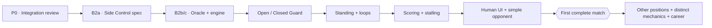

# BJJ Game — Project Oversight Ledger

**Revision:** 1.0 · **Snapshot date:** 2026-10-12 · **State:** Living manual ledger, updated from actual Claude handoffs and verified GitHub evidence.

**Repository:** https://github.com/theaxlklo/BJJ-Game  
**Engineering roadmap:** [`ENGINEERING_ROADMAP.md`](ENGINEERING_ROADMAP.md) (canonical repository document)  
**Next Claude assignment:** [`CLAUDE_B2A_HANDOFF.md`](CLAUDE_B2A_HANDOFF.md) (canonical repository document)

## One-screen overseer pulse

| Indicator | Observed value | Meaning |
|---|---|---|
| Stable integrated baseline | `main` @ `7aaf576e5fc01af4a5592dc544d632e9a3bf4fb1` | Godot PR stack is **not merged** |
| Current active stack tip | Draft PR [#63](https://github.com/theaxlklo/BJJ-Game/pull/63) @ `650e7e1b9c6ba138a931c2805ce661e2268431b2` | Specs, not executed mechanics |
| Exact-head CI | #63 **21/21 jobs PASS**; #62 **21/21 PASS** | Verified by GitHub workflow/job records; separate from merge |
| Open work | 30 sequential mainline Godot PRs + separate open #44 | Current integration exposure |
| Tip relative to `main` | 74 commits ahead, 0 behind; 198 changed paths | From GitHub comparison at snapshot |
| Executable connected positions on tip | **Mount -> Half Guard**, opt-in | No Side Control receiver |
| Player interface | **F1 Mount practice** | Not a full multi-position player-vs-opponent match |
| Complete match from Standing | **NO** | Standing, scoring, decisions and wider routes missing |
| Future custom mechanics | **Specification only** | Stalling, Momentum, Heart of a Lion, REST, zero-stamina LOW memories |

## Visual project traffic flow



Status legend: **Observed** means source or GitHub evidence reviewed. **Proposed** means awaiting owner approval. **Qualified** means CI passed at the exact SHA. **Merged** means the changes actually entered `main`. **Playable** requires manual acceptance evidence.

## Current work queue

| Track | Slice | State | Next owner-visible result |
|---|---|---|---|
| Stack safety | P0 — integration readiness and #44 decision | **Read-only audit next** | Risk assessment and safe bottom-up integration plan; no merges |
| Gameplay breadth | B2a — Side Control rules/entry spec | **Claude next** | New docs-only draft PR stacked on #63; questions for approval |
| Implementation | B2b+ — Side Control oracle, typed Godot, real receiver | **Blocked on B2a approval** | Real Half Guard Knee Slice -> Side Control |
| Wider positions | Open/Closed Guard, Standing, reversals | **Planned** | Full legal graph traversal and start |
| Match completion | Scoring, adjudication, activity enforcement, basic opponent | **Planned** | Human plays a complete fight from Standing |
| Distinctive mechanics | Heart of a Lion, REST, LOW-at-zero, Momentum | **Approved concept, not implemented** | Separate rule gates and tests after core match, or earlier if liveness blocks play |

## Owner decision register

| ID | Question | Current decision / state |
|---|---|---|
| D-SC-01 | Side Control action, role, axis, initiative, transitions and entry schema | **Open for B2a** |
| D-STACK-01 | Merge order/authorization for 30-PR chain and disposition of parallel #44 | **Not authorized, audit only** |
| D-STALL-01 | Game-specific stalling trigger | **Approved direction: third consecutive inactive personal turn**, independent by fighter |
| D-STALL-02 | Penalty repeat/reset cadence and full activity classifier | **Open**; IBJJF-inspired scoring consequences are proposed |
| D-LION-01 | Heart of a Lion | **Approved concept**: both exactly 0; once per match; 50%; five completed personal turns each; then 100% if active |
| D-REST-01 | REST recovery amount and timing | **Open** |
| D-LOW-01 | Funding/grade rule for eligible LOW memories at stamina 0 | **Open**; existing LOW normally costs 3 |
| D-MOM-01 | Momentum strength, trigger, cap, consumption | **Open** |
| D-RETURN-01 | Mount Reversal destination and Mount re-entry D3-B reconciliation | **Open**; do not assume landing |

## Verified handoff history

### E-000 — Baseline audit, 2026-10-12

- Audited [PR #62](https://github.com/theaxlklo/BJJ-Game/pull/62) and [PR #63](https://github.com/theaxlklo/BJJ-Game/pull/63), active Godot stack and parallel [#44](https://github.com/theaxlklo/BJJ-Game/pull/44).
- PR #62 match-flow diagnostics: **2,534 games**, **74,490 windows**, **73,606 CI-gated structural assertions**. Unsupported exits are *incomplete-engine boundaries*, not losses; qualitative population measurements do not prove balance.
- Corrected report typo: Half Guard exchanging-cell maximum no-progress streak **53**, not 788 (which counted feint attempts in a different table).
- #63 exact head `650e7e1b9c6ba138a931c2805ce661e2268431b2`: **21/21 CI jobs passed**. Remains **open draft**; no merge.
- Next handoff expected: **B2a specification**. No Side Control mechanics authorized until owner approves the proposal.

## Standard Claude-result ingestion form

For each result the owner pastes here, append a new `E-###` entry, checking at least:

```
Date / claimed slice:
PR URL / PR number / draft?
Base branch and SHA:
Head branch and exact SHA:
Changed files and implementation-vs-spec boundary:
Local checks and exact-head CI jobs:
Replay/parity/negative tests (actually observed):
New playable abilities (if any):
Unimplemented destinations or blocked behaviors:
Owner decisions needed:
Deviation from roadmap and why:
Merge state (not merely PR green):
Next narrow Claude prompt / acceptance gate:
```

**Operating agreement:** Updates are performed **during the conversation when new results are supplied**—not in the background. Each update should include revised downloads and the next bounded Claude prompt. Do not retroactively rewrite earlier evidence; add an entry and amend the current summary. Ask for owner approval before changing mechanics or merging the PR stack.
**Canonical upkeep:** Keep this file and [`ENGINEERING_ROADMAP.md`](ENGINEERING_ROADMAP.md) in version control. After each owner-supplied Claude handoff, verify PRs/CI, append a dated `E-###` evidence entry, and commit an update through the ordinary review process. No automatic or background updates are implied.
